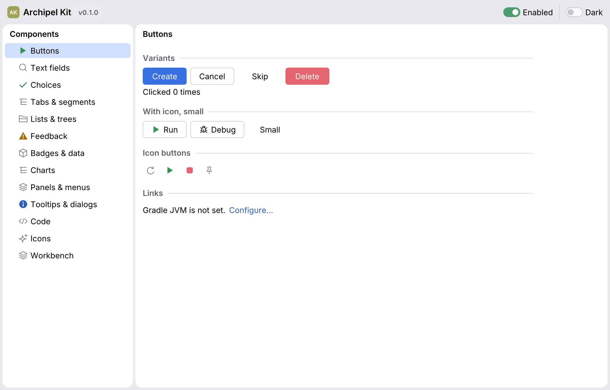

# Archipel Kit

Native Rust UI components for desktop developer tools, built on [egui](https://github.com/emilk/egui).
Archipel Kit is the shared UI layer of the [Archipel](https://github.com/archipel-dev) tools:
the IDE, Nexus HTTP and Mongo Raabit, and their plugins.

<picture>
  <source media="(prefers-color-scheme: dark)" srcset="docs/img/gallery.dark.png">
  
</picture>

- **A complete set for developer tools**: buttons, inputs, choices, tabs, trees, banners,
  toasts, progress, badges, panels and menus.
- **An icon kit** ([`archipel-icons`](docs/icons/README.md)): 128 designed glyphs and 78
  language icons stored as data, rendered with egui or exported as SVG, checked by design lints and reviewed at
  actual size.
- **Dark and light themes** as plain data, per `egui::Context`, with shared size, radius and
  typography tokens.
- **Tested like a web framework**: every component has behavior tests that find it by role
  and label, accessibility assertions, and pixel snapshots in both themes. The same helpers
  are public (`archipel_kit::testing`) for your own panels and plugins.
- **A terminal version** ([`archipel-kit-tui`](docs/tui/README.md)): the same theme, icons
  and components for [ratatui](https://ratatui.rs), so a tool can run in a terminal and look
  the same.
- **Docs that cannot rot**: every image in the docs is a snapshot test and every code block is
  a doctest.

```rust
use archipel_kit::ui::{InlineBanner, Button, Status, JBTextField};
use archipel_kit::egui;

fn connect_form(ui: &mut egui::Ui, url: &mut String) -> bool {
    InlineBanner::new(Status::Info, "Paste a connection string").show(ui);
    ui.add(JBTextField::new(url).label("URL").placeholder("mongodb://localhost:27017"));
    ui.add(Button::primary("Connect").enabled(!url.is_empty())).clicked()
}
```

## Documentation

- [Getting started](docs/getting-started.md)
- [Components](docs/README.md#components), each with images, examples, API and accessibility notes
- [Icon kit](docs/icons/README.md): [catalog](docs/icons/catalog.md), [design rules](docs/icons/design.md), [review](docs/icons/review.md)
- [Terminal UI](docs/tui/README.md): `archipel-kit-tui`, the kit for ratatui
- [Theming](docs/theming.md)
- [Testing](docs/testing.md)
- [Cursors](docs/cursors.md)
- [Contributing a component](docs/contributing.md)

Run the gallery to try every component live:

```bash
cargo run -p archipel-kit-gallery
```

## Development

```bash
cargo fmt --all --check
cargo clippy --workspace --all-targets -- -D warnings
cargo test --workspace            # behavior, accessibility, snapshots, docs
UPDATE_SNAPSHOTS=1 cargo test     # accept new snapshot images
```

Snapshot tests render through wgpu; on a machine without a GPU install a software Vulkan
driver (Ubuntu: `sudo apt-get install mesa-vulkan-drivers`).

## License

Licensed under either of [Apache License, Version 2.0](LICENSE-APACHE) or
[MIT license](LICENSE-MIT) at your option. Bundled fonts and theme data: see
[NOTICE.md](NOTICE.md).
