# Archipel Kit documentation

- [Getting started](getting-started.md): add the crate, install the theme, build a panel.
- [Theming](theming.md): colors, tokens, dark and light, custom themes.
- [Testing](testing.md): behavior, accessibility and snapshot tests for your own UI.
- [Cursors](cursors.md): which cursor shows where, and how parents override it.
- [Icon kit](icons/README.md): 113 designed glyphs, [78 language icons](icons/languages.md), [code symbols](icons/symbols.md), their [catalog](icons/catalog.md), [design rules](icons/design.md) and [review](icons/review.md).
- [Terminal UI](tui/README.md): the same theme, icons and components in the terminal (ratatui).
- [Behaviours](behaviours.md): tooltips, context menus, cursors and drag and drop on any widget with `.with(...)`.
- [Action system](action-system.md): IntelliJ-style actions, presentations, groups, keymaps and host services.
- [Building a component](building-components.md): from parts, with slots and behaviours, proven by conformance and the audit.
- [Contributing a component](contributing.md): the checklist every component meets.
- [Design rules](design-rules.md): the Islands look and feel every component follows, and how to measure a new one against Android Studio ([tools](../tools/reference/README.md)).
- [Desktop component map](component-map.md): reusable families, Android Studio reference
  behavior, interaction invariants and verification.

## Components

| Component | | Use it for |
|---|---|---|
| [Button](components/button.md) | 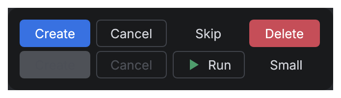 | Actions: primary, secondary, ghost, danger. |
| [ActionButton](components/action-button.md) | 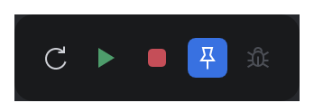 | Toolbar actions and toggles. |
| [JBTextField](components/jb-text-field.md) |  | Text input, search, validation. |
| [JBCheckBox, JBRadioButton, OnOffButton](components/choice.md) | 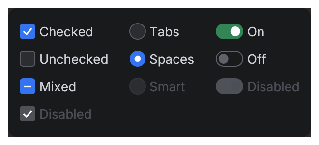 | Booleans and one-of-many choices. |
| [ComboBox](components/combo-box.md) | 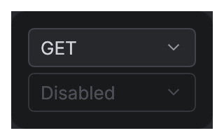 | Picking one value from a long list. |
| [SegmentedButton](components/segmented-button.md) | 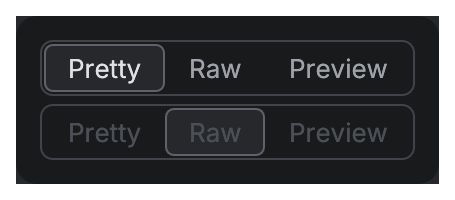 | Switching views. |
| [JBTabs](components/jb-tabs.md) | 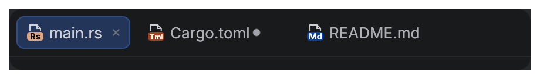 | Editor tabs. |
| [KeyValueTable](components/key-value-table.md) | 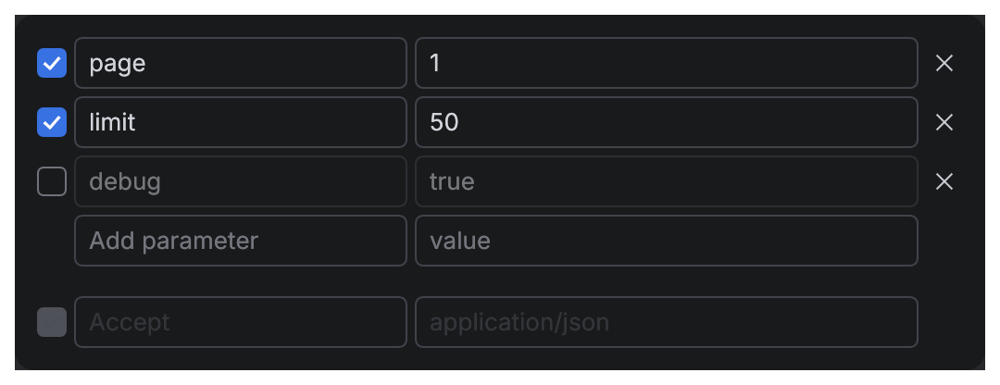 | Query parameters, headers, form fields, environment variables. |
| [CodeView, CodeEditor](components/code.md) | 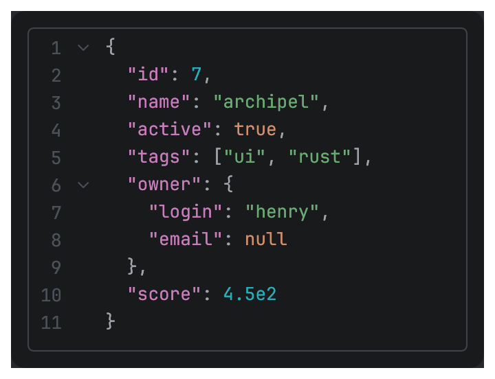 | Read-only and editable code with highlighting and find. |
| [JBList, Tree, JBTable](components/collections.md) |  | Large lists, trees and tables, virtualized. |
| [TreeTable](components/tree-table.md) | 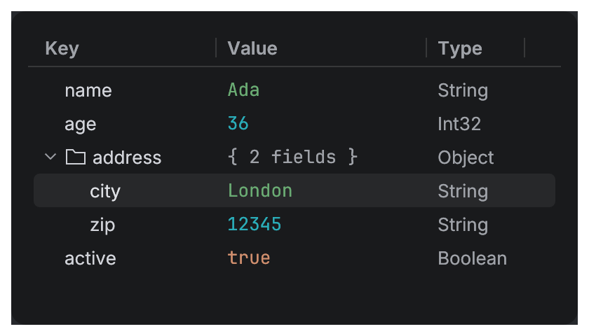 | A tree whose rows have columns, with inline cell editing. |
| [SpeedSearch](components/speed-search.md) | 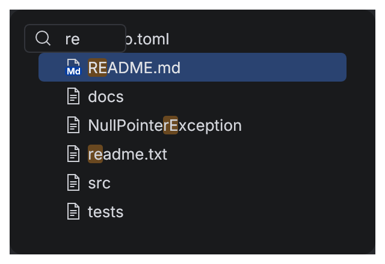 | Type to jump to or filter rows of lists, trees and tables. |
| [ColoredListCellRenderer](components/colored-list-cell-renderer.md) | 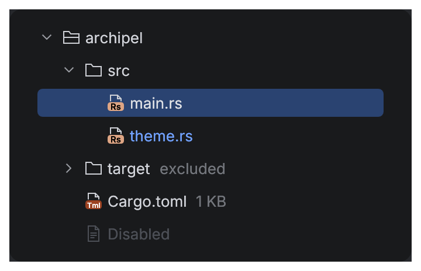 | Lists and trees. |
| [InlineBanner](components/inline-banner.md) | 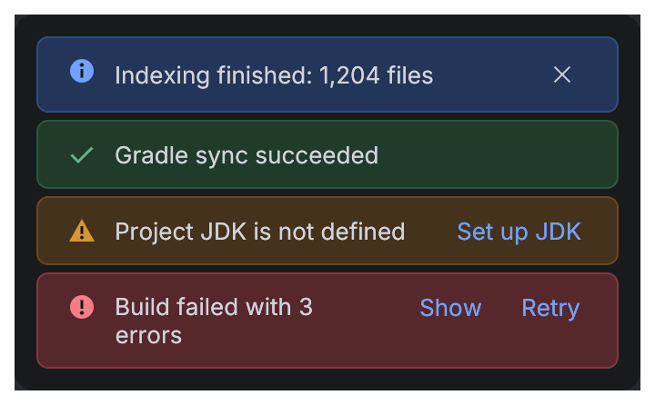 | Inline messages with actions. |
| [Notification](components/notification.md) | 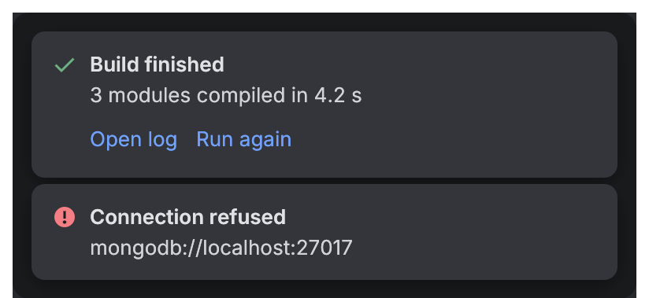 | Notifications. |
| [AsyncProcessIcon, ProgressBar](components/progress.md) | 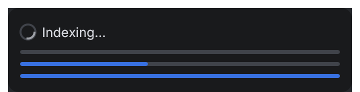 | Work in progress. |
| [JBLoadingPanel](components/loading-panel.md) | 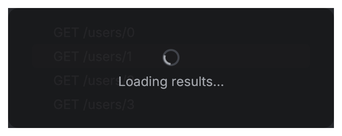 | Content that is loading, behind a veil after a start delay. |
| [CollapsiblePanel](components/collapsible-panel.md) | 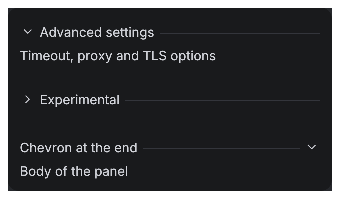 | A titled group that shows and hides its content. |
| [StatusText](components/status-text.md) | 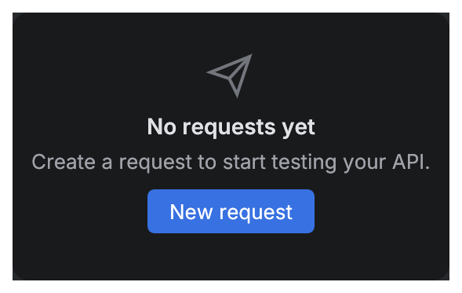 | Nothing to show yet. |
| [Counter, Tag, Kbd, Avatar](components/badges.md) | 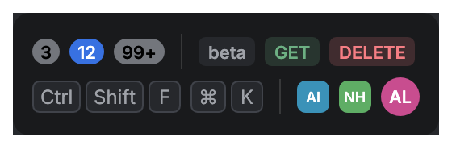 | Inline labels. |
| [Histogram, Sparkline](components/chart.md) | 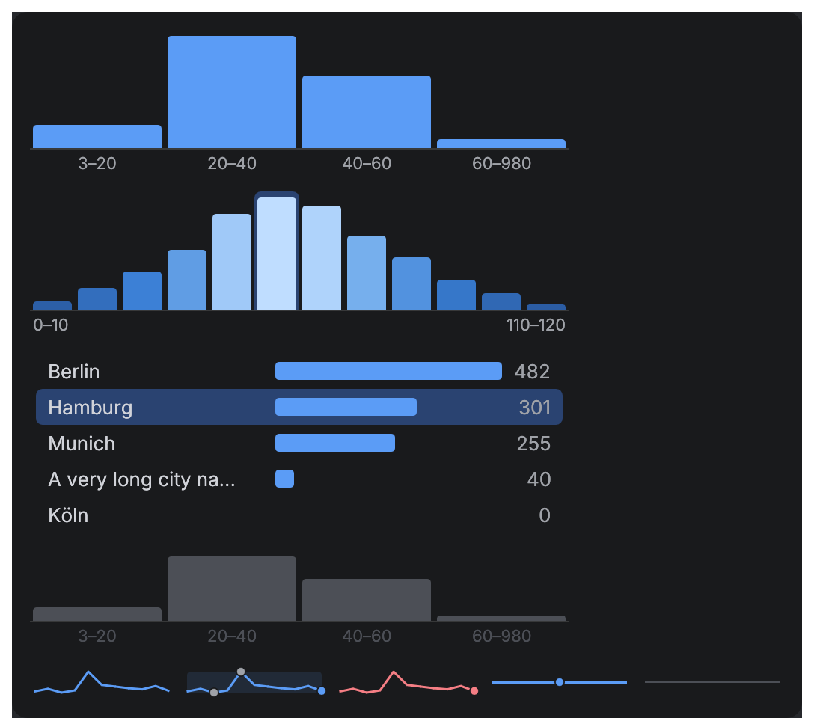 | Value distributions, top-N counts, inline trends. |
| [Form, FieldLabel](components/form.md) | 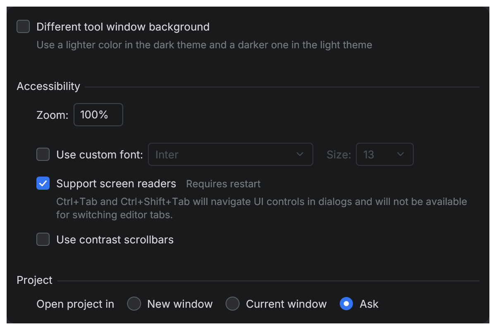 | Settings pages: rows, comments, groups. |
| [SimpleToolWindowPanel, TitledSeparator, PropertyGrid](components/simple-tool-window-panel.md) | 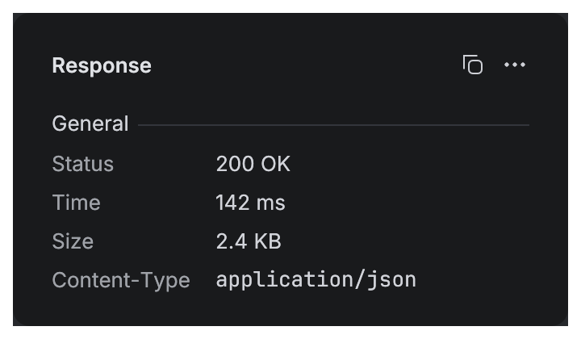 | Workbench layout and details. |
| [StatusBarWidget](components/status-bar-widget.md) | 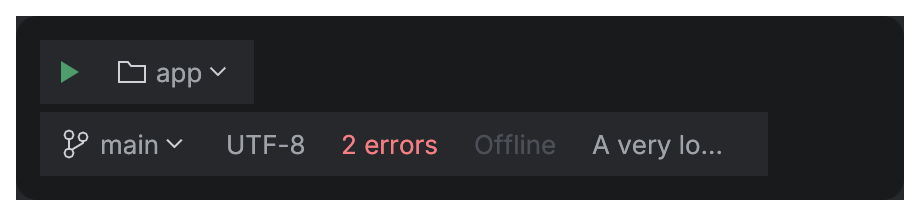 | Status bar and toolbar widgets. |
| [Splitter](components/splitter.md) |  | Resizable panes, side by side or stacked. |
| [MainToolbar](components/window.md) |  | Integrated native title area and application actions. |
| [ToolWindowPane](components/tool-window-pane.md) | 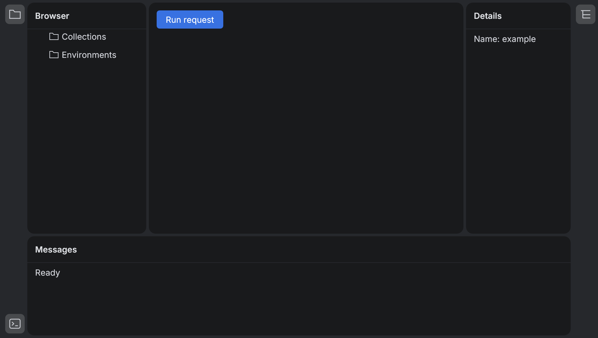 | Shared docked island shell with caller-owned layout. |
| [ActionMenuItem, ListSeparator, ActionLink](components/action-menu-item.md) | 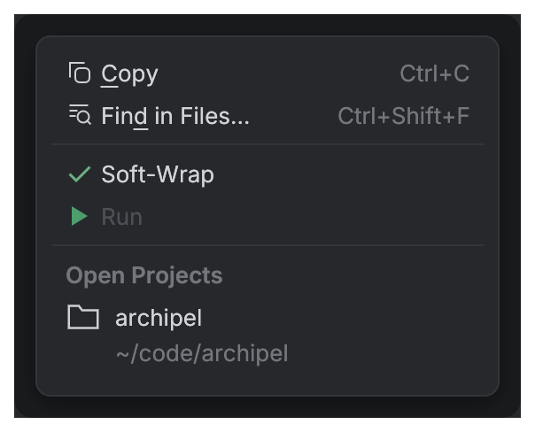 | Menus and inline actions. |
| [HelpTooltip](components/help-tooltip.md) | 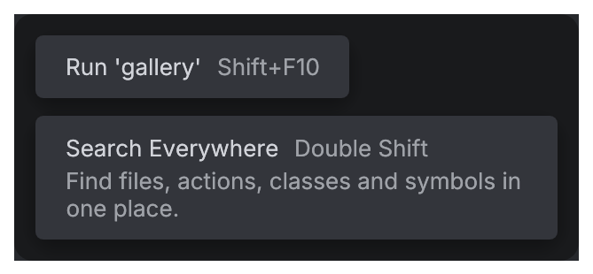 | Naming controls, shortcuts, why something is disabled. |
| [DialogWrapper](components/dialog-wrapper.md) |  | Decisions and short forms. |
| [Icons](components/icons.md) | 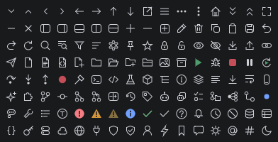 | Glyphs and file-type icons. |

Every image on these pages is a snapshot test: it is rendered by `cargo test` and compared
pixel by pixel, so the docs always show what the code draws. Every code block on the
component pages is compiled and run as a doctest.

Try everything live in the gallery: `cargo run -p archipel-kit-gallery`.
