# Archipel Kit documentation

- [Getting started](getting-started.md): add the crate, install the theme, build a panel.
- [Theming](theming.md): colors, tokens, dark and light, custom themes.
- [Testing](testing.md): behavior, accessibility and snapshot tests for your own UI.
- [Cursors](cursors.md): which cursor shows where, and how parents override it.
- [Icon kit](icons/README.md): 113 designed glyphs, [78 language icons](icons/languages.md), [code symbols](icons/symbols.md), their [catalog](icons/catalog.md), [design rules](icons/design.md) and [review](icons/review.md).
- [Terminal UI](tui/README.md): the same theme, icons and components in the terminal (ratatui).
- [Behaviours](behaviours.md): tooltips, context menus, cursors and drag and drop on any widget with `.with(...)`.
- [Building a component](building-components.md): from parts, with slots and behaviours, proven by conformance and the audit.
- [Contributing a component](contributing.md): the checklist every component meets.
- [Desktop component map](component-map.md): reusable families, Android Studio reference
  behavior, interaction invariants and verification.

## Components

| Component | | Use it for |
|---|---|---|
| [Button](components/button.md) |  | Actions: primary, secondary, ghost, danger. |
| [IconButton](components/icon-button.md) |  | Toolbar actions and toggles. |
| [TextField](components/text-field.md) | 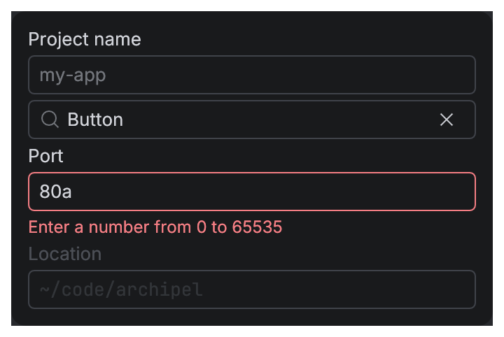 | Text input, search, validation. |
| [Checkbox, Radio, Toggle](components/choice.md) |  | Booleans and one-of-many choices. |
| [Dropdown](components/dropdown.md) |  | Picking one value from a long list. |
| [SegmentedControl](components/segmented-control.md) |  | Switching views. |
| [TabBar](components/tab-bar.md) | 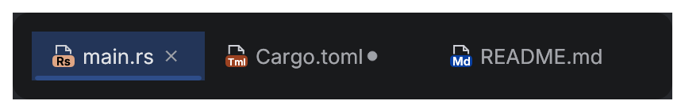 | Editor tabs. |
| [KeyValueTable](components/key-value-table.md) |  | Query parameters, headers, form fields, environment variables. |
| [CodeView, CodeEditor](components/code.md) |  | Read-only and editable code with highlighting and find. |
| [VirtualList, Tree, Table](components/collections.md) | 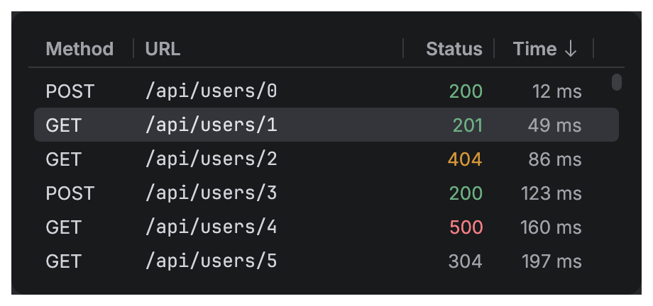 | Large lists, trees and tables, virtualized. |
| [TreeTable](components/tree-table.md) |  | A tree whose rows have columns, with inline cell editing. |
| [ListRow](components/list-row.md) | 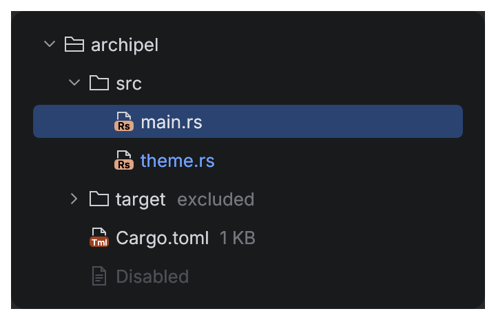 | Lists and trees. |
| [Banner](components/banner.md) | 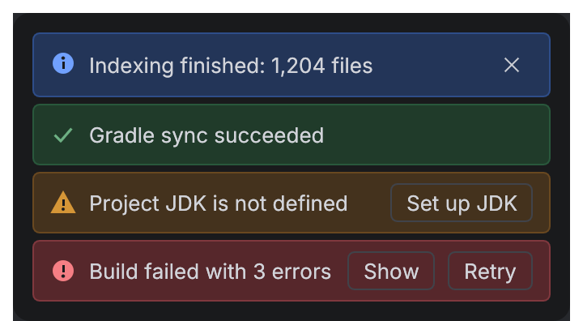 | Inline messages with actions. |
| [Toast](components/toast.md) | 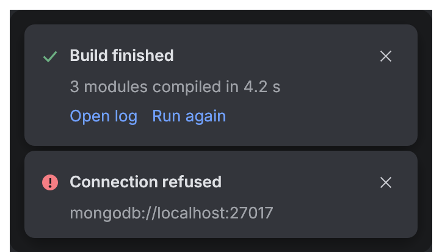 | Notifications. |
| [Spinner, ProgressBar](components/progress.md) |  | Work in progress. |
| [EmptyState](components/empty-state.md) | 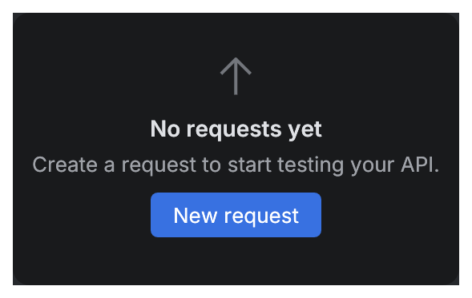 | Nothing to show yet. |
| [Counter, Tag, Kbd, Avatar](components/badges.md) |  | Inline labels. |
| [Histogram, Sparkline](components/chart.md) |  | Value distributions, top-N counts, inline trends. |
| [Panel, SectionHeader, PropertyGrid](components/panel.md) | 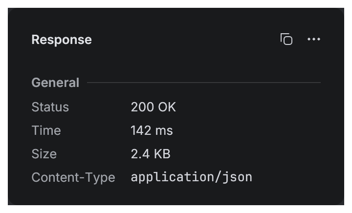 | Workbench layout and details. |
| [StatusBarItem](components/status-bar-item.md) | 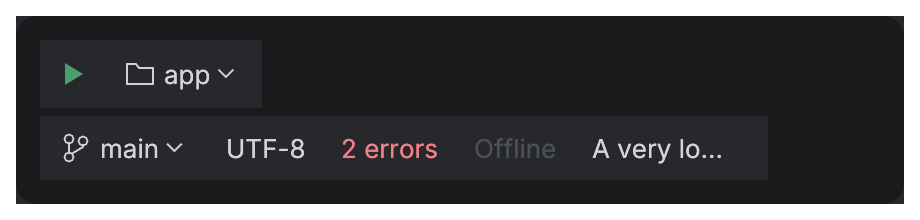 | Status bar and toolbar widgets. |
| [SplitPane](components/split-pane.md) | 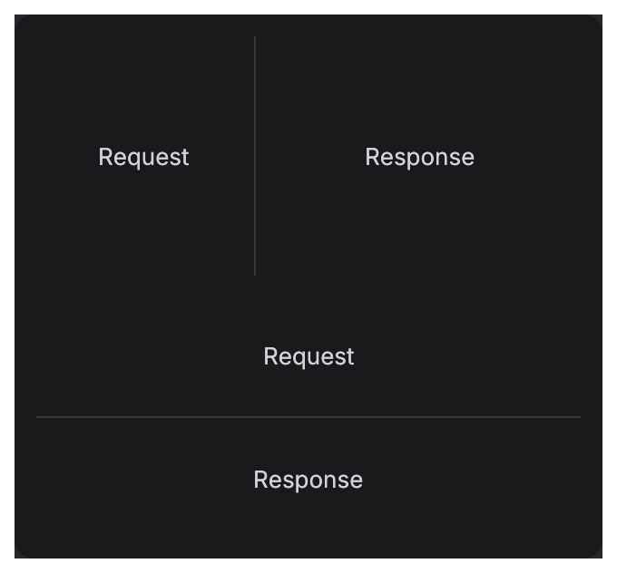 | Resizable panes, side by side or stacked. |
| [WindowToolbar](components/window.md) |  | Integrated native title area and application actions. |
| [Workbench](components/workbench.md) |  | Shared docked island shell with caller-owned layout. |
| [MenuItem, MenuSeparator, MenuHeader, Link](components/menu-item.md) | 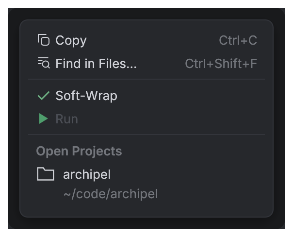 | Menus and inline actions. |
| [Tooltip](components/tooltip.md) | 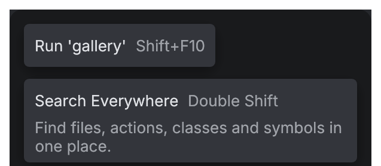 | Naming controls, shortcuts, why something is disabled. |
| [Dialog](components/dialog.md) | 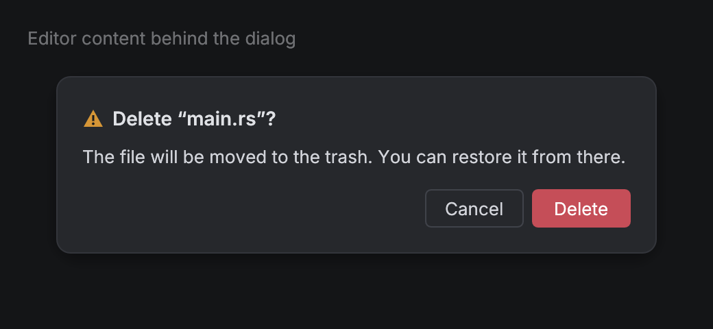 | Decisions and short forms. |
| [Icons](components/icons.md) |  | Glyphs and file-type icons. |

Every image on these pages is a snapshot test: it is rendered by `cargo test` and compared
pixel by pixel, so the docs always show what the code draws. Every code block on the
component pages is compiled and run as a doctest.

Try everything live in the gallery: `cargo run -p archipel-kit-gallery`.
