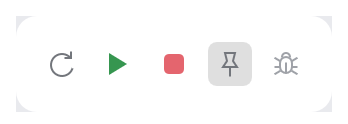
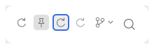

# ActionButton

The flat icon button of toolbars and panel headers (IntelliJ `ActionButton`). It renders an
icon, shows a hover fill, acts as a toggle, takes a semantic color, and can render a whole
`AnAction` from its `Presentation`: icon, text and shortcut as tooltip, enabled and toggle
state.

<picture>
  <source media="(prefers-color-scheme: dark)" srcset="img/action_button.dark.png">
  
</picture>

<picture>
  <source media="(prefers-color-scheme: dark)" srcset="img/action_button_states.dark.png">
  
</picture>

## Usage

```rust
use archipel_kit::action_system::ActionButton;
use archipel_kit::{Glyph, Icon, Theme, Tone, egui};

fn toolbar(ui: &mut egui::Ui, pinned: &mut bool) {
    let colors = Theme::colors(ui.ctx());
    ui.horizontal(|ui| {
        ui.add(ActionButton::new(Glyph::Run, "Run").tone(Tone::Run));
        ui.add(ActionButton::new(Glyph::Stop, "Stop").tone(Tone::Stop).enabled(false));
        if ui.add(ActionButton::new(Glyph::Pin, "Pin tab").selected(*pinned)).clicked() {
            *pinned = !*pinned;
        }
    });
}
```

From an action: the button updates it every frame, shows its presentation and performs it on
activation (`out.performed`).

```rust
use archipel_kit::action_system::*;
use archipel_kit::{Glyph, egui};

struct Reload;
impl AnAction for Reload {
    fn id(&self) -> &str { "Reload" }
    fn template_presentation(&self) -> Presentation {
        Presentation::new("Reload").icon(Glyph::Refresh).shortcut_text("Ctrl+R")
    }
    fn action_performed(&self, _e: &AnActionEvent<'_>) { /* reload */ }
}

fn header(ui: &mut egui::Ui, context: &DataContext) {
    let out = ActionButton::for_action(&Reload, context, &ActionPlace::TOOLBAR).show(ui);
    if out.performed { /* e.g. flash a status */ }
}
```

## API

| Builder | Effect |
|---|---|
| `ActionButton::new(icon, label)` | The label is required: it is the tooltip title and the accessible name. |
| `ActionButton::from_presentation(&Presentation)` | Icon (the help icon when missing), text, shortcut text, enabled, toggle state, drop-down arrow for a popup group. |
| `ActionButton::for_action(&action, &context, &place)` | Updates the action, renders its presentation, performs it on activation. |
| `.selected(bool)` | Makes it a toggle; toggled-on buttons keep the pressed look. |
| `.tone(Tone)` | Meaning of the icon color, e.g. `Tone::Run` (default: the icon gray). |
| `.enabled(bool)` | Disabled buttons are dimmed and ignore everything. |
| `.small(true)` / `.large(true)` / `.title_pane(true)` | 20 pt (rows, tabs) / 30 pt with a 20 pt icon (main toolbar) / 40 pt square (window controls). |
| `.dropdown(true)` | A small arrow after the icon; focused, <kbd>↓</kbd> activates it. |
| `.shortcut(text)`, `.tooltip_description(text)` | Tooltip: grey shortcut after the title; a description line (IntelliJ shows it only for whitelisted actions, so the caller decides). |
| `.focusable(bool)` | Put it in the Tab order (default: only while a screen reader is active). |
| `.show(ui)` | Returns `ActionButtonResponse { response, activated, performed, look }`; `ui.add` returns the `Response`. |
| `ActionButton::hovered_description(ctx)` | The description of the hovered action, for a status bar. |

## Behavior (IntelliJ spec §1)

| Rule | Kit |
|---|---|
| Look priority: disabled, then pressed (pointer still over) or toggled on, then hover, then keyboard focus, else normal (`ButtonLook`) | `Normal`, `Popped`, `Pushed`, `Selected`; fills `Colors::hover` / `Colors::pressed` |
| Click on **release** inside, primary button only (not with Cmd on macOS); a press that ends outside does nothing | tests/action_button.rs |
| Dragging off removes the pressed look | same |
| While a press started on one action button, hover is suppressed on every other one until release; the pressed one keeps its state | the pointer origin lives in the `egui::Context`, not in a global |
| Right and middle press: no state change | same |
| Not focusable unless a screen reader is active (AccessKit on) or `.focusable(true)`; Tab never lands on toolbar buttons | `Sense::CLICK` without `FOCUSABLE` |
| Focused: <kbd>Space</kbd> activates; <kbd>↓</kbd> activates when it has a drop-down arrow; <kbd>Enter</kbd> does not (`ActionButtonResponse::activated`) | `ui.add(..).clicked()` also reports Enter, as every egui widget does |
| Entering publishes the action description for the status bar | `ActionButton::hovered_description` |
| Tooltip: action text, grey shortcut at the right, after the 0.5 s delay | `HelpTooltip` |
| Size 22×22, 20×20 in rows, 30×30 with a 20 pt icon in the main toolbar, 40×40 in the title pane | `tokens::size`, `tokens::toolbar` |

Deviations, with reasons: the corner radius stays at the measured 4 pt (6 pt at 30 pt) rather
than `Button.arc` 8, and the drop-down arrow's size (`tokens::action_toolbar`) is the kit's,
because IntelliJ does not specify it. Toolbar mnemonics (Alt+key) are not implemented.

The toggled-on look is the pressed fill (IntelliJ: `PUSHED` permanently), not an accent fill.

## Accessibility

Role `Button`, named by its label. Toggles report their state, so screen readers announce
"Pin tab, toggle button, pressed". With a screen reader on, every button is a Tab stop.

Source: [`action_system/action_button.rs`](../../crates/archipel-kit/src/action_system/action_button.rs) ·
Tests: [`tests/action_button.rs`](../../crates/archipel-kit/tests/action_button.rs)
