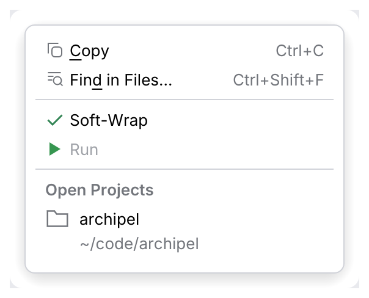
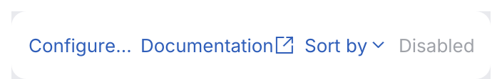
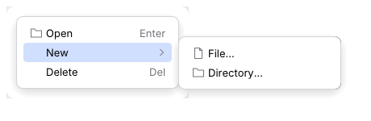

# ActionMenuItem, ListSeparator, ActionLink

A **menu item** has an icon column, a label and a right-aligned shortcut, for menu bars and
context menus. A **menu separator** is a thin line between groups of items, and a **menu
header** titles a group ("Open Projects"). A **link** is inline text that performs an action.

<picture>
  <source media="(prefers-color-scheme: dark)" srcset="img/action_menu_item.dark.png">
  
</picture>

<picture>
  <source media="(prefers-color-scheme: dark)" srcset="img/action_link.dark.png">
  
</picture>

## Usage

```rust
use archipel_kit::{ui::{Button, ActionLink}, action_system::ActionMenuItem, ui::popup::ListSeparator};
use archipel_kit::{Glyph, Icon, egui};

fn file_row(ui: &mut egui::Ui, wrap: &mut bool) {
    ui.add(Button::secondary("main.rs")).context_menu(|ui| {
        if ui.add(ActionMenuItem::new("Copy Path").icon(Glyph::Copy).shortcut("Ctrl+Shift+C")).clicked() {
            ui.close();
        }
        ui.add(ListSeparator::new());
        if ui.add(ActionMenuItem::new("Soft-Wrap").checked(*wrap)).clicked() {
            *wrap = !*wrap;
        }
    });
    ui.horizontal(|ui| {
        ui.label("Gradle JVM is not set.");
        ui.add(ActionLink::new("Configure…"));
    });
}
```

## API

| Component | Builders |
|---|---|
| `ActionMenuItem::new(label)` | `.icon(Icon)`, `.shortcut(str)`, `.checked(bool)`, `.enabled(bool)`, `.description(str)` (a dimmed second line, larger icon), `.highlighted(bool)`, `.underlined(char)` (the mnemonic letter drawn underlined; the caller handles typing it), `.submenu(\|ui\| …)` |
| `ListSeparator::new()` | A line between groups; add it with `ui.add(ListSeparator::new())`. |
| `ListSeparator::with_text(title)` | A dimmed semibold group title aligned with the icons; not focusable. |
| `ActionMenuItem::from_presentation(&Presentation)` | Text, icon, shortcut text, description, enabled, toggle check, chevron for a popup group. |
| `ActionLink::new(text)` | Underlined on hover, pointer cursor; `.enabled(bool)`, `.external(true)`, `.dropdown(true)`. |

`ActionMenuItem` is the row renderer of [`ListPopup`](list-popup.md) and
[`ActionPopupMenu`](action-popup-menu.md), which own the highlight, submenus, keys and timings
(see those pages). Used on its own inside an egui menu or `JBPopup`, it keeps the shared
highlight described below.

## ActionLink (IntelliJ spec §13.6)

<picture>
  <source media="(prefers-color-scheme: dark)" srcset="img/action_link_variants.dark.png">
  
</picture>

Link-colored text (`Colors::link`), underlined on hover only, with the hand cursor. A click
fires on release; <kbd>Space</kbd> and <kbd>Enter</kbd> fire it when it has focus, which shows
the focus ring. Disabled links are dimmed, have no hand cursor or underline, and ignore input.
`.external(true)` adds the external-link icon after the text, `.dropdown(true)` a drop-down
arrow (open your popup from `clicked()`). IntelliJ's hover, pressed and visited colors
(`Link.hoverForeground` …) are the same blue in the New UI, so the kit has one link color;
the spec gives no other values.

## Geometry and behavior

Measured on Android Studio's popups (Islands UI) and reproduced pixel for pixel
(`tokens::popup`):

- 8 pt padding above the first and below the last item; items 24 pt high, touching.
  The menu widgets set the row spacing themselves, so any popup gets it.
- The highlight pill is inset 8 pt from the popup's sides, radius 4; the icon column starts
  8 pt inside it, text 4 pt after the icon; shortcuts end 8 pt before the pill's end.
- Separators are a 9 pt row with a 1 pt line in the popup's border color, inset like pills.
- **One highlight per menu**, shared by pointer and keyboard: hovering moves it (and the
  focus, so arrow keys continue from there); it **stays on the last item** when the pointer
  leaves; and the **first pointer move after the menu opens is ignored**, so a menu that
  opens under the pointer does not highlight what happens to be there.

## Submenus

`.submenu(|ui| { … })` makes the item a parent: a chevron replaces the shortcut, and the
submenu opens to the right (to the left when there is no room), on the popup surface, built on
`JBPopup::right_of`.

<picture>
  <source media="(prefers-color-scheme: dark)" srcset="img/action_menu_item_submenu.dark.png">
  
</picture>

```rust
use archipel_kit::behaviour::PopupHandler;
use archipel_kit::behaviour::WidgetExt;
use archipel_kit::action_system::{ActionButton, ActionMenuItem};
use archipel_kit::{Glyph, egui};

fn add_menu(ui: &mut egui::Ui) {
    ui.add(
        ActionButton::new(Glyph::Plus, "Add").with(PopupHandler::new(|ui| {
            ui.add(ActionMenuItem::new("New").submenu(|ui| {
                ui.add(ActionMenuItem::new("File…"));
                ui.add(ActionMenuItem::new("Directory…"));
            }));
            ui.add(ActionMenuItem::new("Open"));
        })),
    );
}
```

- Opens when the pointer moves onto the item, on a click, or on <kbd>→</kbd> /
  <kbd>Enter</kbd> while the item has focus (focus then moves into the submenu).
- Closes on <kbd>←</kbd> (focus returns to the parent item), <kbd>Escape</kbd> (only the
  submenu; a second one closes the menu), or when the pointer moves to another item.
- A click on an item closes the whole menu, but a click on the parent item keeps it open.
  `PopupHandler` stays open on clicks inside it and every `ActionMenuItem` closes it with
  `ui.close()`, so call `ui.close()` yourself for other widgets. For a menu from
  `ui.menu_button`, whose menus close on every click, use
  `MenuConfig::close_behavior(PopupCloseBehavior::CloseOnClickOutside)`.
- A disabled parent does not open.

## Accessibility

Menu items are buttons (checkable items are check boxes) named by their label; links have
role `ActionLink`. A parent item reports `expanded` and a menu popup.

Source: [`action_system/action_menu_item.rs`](../../crates/archipel-kit/src/action_system/action_menu_item.rs) ·
Tests: [`tests/menus.rs`](../../crates/archipel-kit/tests/menus.rs)
