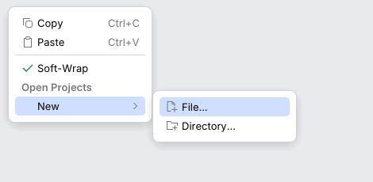

# ActionPopupMenu

An `ActionGroup` shown as a popup menu (IntelliJ `ActionPopupMenu`, the context menu and
toolbar drop-down). It follows every rule of the [list popup](list-popup.md): same keys, same
pointer rules, same 250 ms / 500 ms / 200 ms timings, same geometry. Rows are
[`ActionMenuItem`](action-menu-item.md)s drawn from the actions' presentations, so they
follow the actions live.

<picture>
  <source media="(prefers-color-scheme: dark)" srcset="img/action_popup_menu.dark.png">
  
</picture>

## Usage

As a context menu, with the `PopupHandler` behaviour: right click (Ctrl+click on macOS) opens
it at the pointer.

```rust
use archipel_kit::action_system::*;
use archipel_kit::behaviour::PopupHandler;
use archipel_kit::ui::ColoredListCellRenderer;
use archipel_kit::egui;

fn row(ui: &mut egui::Ui, menu: &DefaultActionGroup, context: &DataContext) {
    ColoredListCellRenderer::new("src")
        .with(PopupHandler::for_group(menu, context, ActionPlace::PROJECT_VIEW_POPUP))
        .show(ui);
}
```

Choosing a row performs the action (`perform`: updated first, skipped when disabled) and
closes the menu, unless the presentation says `keep_popup_on_perform`.

As a menu you open yourself, with a caller-owned `PopupChain`:

```rust
use archipel_kit::action_system::*;
use archipel_kit::ui::popup::PopupChain;
use archipel_kit::egui;

fn menu(ctx: &egui::Context, chain: &mut PopupChain, group: &DefaultActionGroup, context: &DataContext) {
    let now = ctx.input(|i| i.time);
    if ctx.input(|i| i.pointer.secondary_clicked()) {
        // `true` selects the first row at once (a drop-down); menus select nothing.
        chain.open(now, false);
    }
    let out = ActionPopupMenu::new("menu", group, context, ActionPlace::EDITOR_POPUP)
        .show_at(ctx, chain, egui::pos2(100.0, 100.0));
    if let Some(id) = out.performed {
        let _ = id;
    }
}
```

## API

| Builder | Effect |
|---|---|
| `ActionPopupMenu::new(id, &group, &context, place)` | The group, its data and the place its actions update for. |
| `.keymap(&keymap, mac)` | First keyboard shortcut of each action as the row's shortcut text. |
| `.show_submenu_on_hover(bool)` | Submenus open after 250 ms of hover (default on). |
| `.speed_search(true)` | Typing filters the rows. |
| `.numbering(true)` | Rows get the numbers 1-9, 0, A…; typing one chooses the row. |
| `.show(ctx, &mut chain, anchor)` / `.show_at(ctx, &mut chain, pos)` | Draws it while `chain` is open; returns `ActionPopupMenuResponse { performed, cancelled }`. |
| `PopupHandler::for_group(&group, &context, place)` | The context menu behaviour; `.keymap(..)`. `PopupHandler::new(closure)` still fills an egui menu with `ActionMenuItem`s. |

A popup group row is a submenu with a chevron; titled separators become group headings;
toggles show a check mark; disabled actions are dimmed and not selectable; invisible ones
are dropped. A menu opened from a context click selects nothing until a key or the pointer
moves; the first pointer move after opening is ignored.

Source: [`action_system/action_popup_menu.rs`](../../crates/archipel-kit/src/action_system/action_popup_menu.rs) ·
Tests: [`tests/action_popup_menu.rs`](../../crates/archipel-kit/tests/action_popup_menu.rs)
