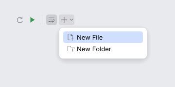

# ActionToolbar

An `ActionGroup` as a row or column of `ActionButton`s for an `ActionPlace` (IntelliJ
`ActionToolbar`). It updates every action each frame with the `DataContext`, draws toggles
as pressed, separators as lines, popup groups as drop-down buttons that open an
`ActionPopupMenu`, moves what does not fit into a "More actions" menu, and performs the
clicked action.

<picture>
  <source media="(prefers-color-scheme: dark)" srcset="img/action_toolbar.dark.png">
  
</picture>

## Usage

```rust
use archipel_kit::action_system::*;
use archipel_kit::{Glyph, egui};

struct Reload;
impl AnAction for Reload {
    fn id(&self) -> &str { "Reload" }
    fn template_presentation(&self) -> Presentation {
        Presentation::new("Reload").icon(Glyph::Refresh)
    }
    fn action_performed(&self, _e: &AnActionEvent<'_>) { /* reload */ }
}

fn header(ui: &mut egui::Ui, context: &DataContext) {
    let mut group = DefaultActionGroup::new("Tools");
    group.add(Reload).add_separator();
    let out = ActionToolbar::new("tools", &group, context, ActionPlace::TOOLBAR).show(ui);
    if let Some(id) = out.invoked {
        // `Reload` was performed by the toolbar; `id` says which.
        let _ = id;
    }
}
```

The toolbar **performs** the action itself (with `perform`, so a disabled or hidden action
does not run) and reports its id in `ActionToolbarResponse::invoked`; the same goes for
actions chosen in its drop-downs and overflow menu.

## API

| Builder | Effect |
|---|---|
| `ActionToolbar::new(id, &group, &context, place)` | The group, the data the actions see, and the place they are updated for. |
| `.orientation(ToolbarOrientation::Vertical)` | A column; menus open beside the button. |
| `.keymap(&keymap, mac)` | Shortcut text in tooltips and menus. |
| `.decorated(true)` | New UI border insets (5, 7) instead of 2. |
| `.overflow(false)` | No "More actions" menu. |
| `.secondary(&group)` | A drop-down at the far end (the gear or ellipsis group). |
| `.minimum_button_size(edge)` | Smallest button edge (22; the navigation bar uses 20). |
| `.focusable(bool)` | Tab order of the buttons (see `ActionButton`). |

`ToolbarOrientation` is `Horizontal` (default) or `Vertical`.

`ActionToolbarResponse`: `response` (the toolbar's area), `invoked`, `overflowed` (how many
rows moved into the menu), `popup_open`.

## Behavior (IntelliJ spec §1.4, §1.5)

| Rule | Kit |
|---|---|
| Buttons 22×22, 4 pt apart (1 and 2 pt insets either side) | `tokens::size::ICON_BUTTON`, `TOOLBAR_GAP` |
| Plain toolbars have a 2 pt border; decorated ones (5, 7) | `tokens::action_toolbar` |
| Presentations are recomputed every frame (the toolbar keeps no stale copy) | `flatten` runs per frame |
| Separators never lead, trail or repeat; a 1 pt line, 20 pt long, 4 pt either side | `flatten`, `Colors::separator` |
| Toggles keep the pressed look while selected | `ActionButton::selected` |
| A popup group is a button with a drop-down arrow; click (or <kbd>↓</kbd> when focused) opens an action popup below it with the first row selected and submenus that open after 250 ms of hover | `ActionPopupMenu`, `PopupChain::open(now, true)` |
| Clicking the button that owns an open menu closes it and does not reopen it (the 200 ms guard is per button; another button opens at once) | tests/action_toolbar.rs |
| Rows that do not fit move into a "More actions" menu at the end; trailing separators are dropped | `overflow(true)` |
| The toolbar is never in the Tab order unless a screen reader is on | `ActionButton` |

Deferred: IntelliJ also lets actions mark themselves as secondary inside one group, shows
separator titles, and updates presentations on a timer; here secondary actions are a separate
group and updates run each frame.

Source: [`action_system/action_toolbar.rs`](../../crates/archipel-kit/src/action_system/action_toolbar.rs) ·
Tests: [`tests/action_toolbar.rs`](../../crates/archipel-kit/tests/action_toolbar.rs)
