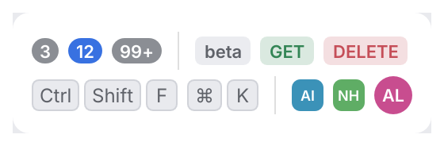

# Counter, Tag, Kbd, Avatar

Small inline labels: **counters** for numbers of items, **tags** for statuses and types,
**key caps** for shortcuts and **avatars** for projects and people.

<picture>
  <source media="(prefers-color-scheme: dark)" srcset="img/badges.dark.png">
  
</picture>

## Usage

```rust
use archipel_kit::components::{Avatar, Counter, Kbd, Tag};
use archipel_kit::{Theme, egui};

fn header(ui: &mut egui::Ui, problems: usize) {
    let colors = Theme::colors(ui.ctx());
    ui.horizontal(|ui| {
        ui.add(Avatar::new("nexus-http"));
        ui.label("Problems");
        ui.add(Counter::new(problems));
        ui.add(Tag::new("GET").color(colors.success));
        ui.add(Kbd::parse("Ctrl+Shift+F"));
    });
}
```

## API

| Component | Builders |
|---|---|
| `Counter::new(usize)` | `.accent(bool)`; counts above 99 show `99+`. |
| `Tag::new(text)` | `.color(Color32)`: colored text on a faint fill of the same color. |
| `Kbd::new([keys])`, `Kbd::parse("Ctrl+K")` | One cap per key; `parse` splits at `+`. |
| `Avatar::new(name)` | `.size(f32)`, `.round(bool)`; initials on a color derived from the name. |

## Accessibility

Each is a label: counters read their number, key caps the shortcut (`Ctrl+K`), avatars the
full name.

Source: [`components/badges.rs`](../../crates/archipel-kit/src/components/badges.rs) ·
Tests: [`tests/data.rs`](../../crates/archipel-kit/tests/data.rs)
