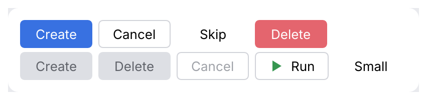

# Button

A push button with a text label and an optional leading icon. Use one **primary** button for
the default action of a dialog or form; make everything else **secondary**, **ghost** inside
dense toolbars and banners, and **danger** for destructive actions.

<picture>
  <source media="(prefers-color-scheme: dark)" srcset="img/button.dark.png">
  
</picture>

## Usage

```rust
use archipel_kit::components::Button;
use archipel_kit::{Glyph, Icon, egui};

fn dialog_buttons(ui: &mut egui::Ui, can_create: bool) -> bool {
    let mut created = false;
    ui.horizontal(|ui| {
        created = ui.add(Button::primary("Create").enabled(can_create)).clicked();
        ui.add(Button::secondary("Cancel"));
        ui.add(Button::secondary("Run").icon(Glyph::Run));
    });
    created
}
```

## API

| Builder | Effect |
|---|---|
| `Button::primary(label)` | Accent fill: the one default action. |
| `Button::secondary(label)` | Outlined. |
| `Button::ghost(label)` | No outline until hovered. |
| `Button::danger(label)` | Error fill, for Delete and other destructive actions. |
| `Button::new(label, ButtonVariant)` | The same, with the variant as a value. |
| `.icon(Icon)` | Icon before the label. |
| `.enabled(bool)` | Disabled buttons are dimmed and ignore clicks. A disabled primary or danger button keeps a label of at least 3:1 contrast (`text_on_accent_disabled` on `accent_disabled`). |
| `.small(bool)` | 24 pt instead of 28 pt tall. |
| `.min_width(f32)` | Minimum width, 72 pt by default so "OK" does not look cramped. |

Returns an `egui::Response`: `clicked()`, `hovered()`, `on_hover_text(...)`.

## Behavior

- Hover lightens filled buttons and tints outlined ones; pressing darkens them.
- <kbd>Tab</kbd> focuses the button (focus ring); <kbd>Enter</kbd> or <kbd>Space</kbd> clicks it.

## Accessibility

Role `Button`, named by its label, with the disabled state reported.

## Testing

```rust
use archipel_kit::components::Button;
use archipel_kit::testing::{self, Queryable};
use archipel_kit::Theme;

let mut harness = testing::harness_state(Theme::dark(), 0, |ui, clicks| {
    if ui.add(Button::primary("Run")).clicked() {
        *clicks += 1;
    }
});
harness.get_by_label("Run").click();
harness.run();
assert_eq!(*harness.state(), 1);
```

Source: [`components/button.rs`](../../crates/archipel-kit/src/components/button.rs) ·
Tests: [`tests/button.rs`](../../crates/archipel-kit/tests/button.rs)
