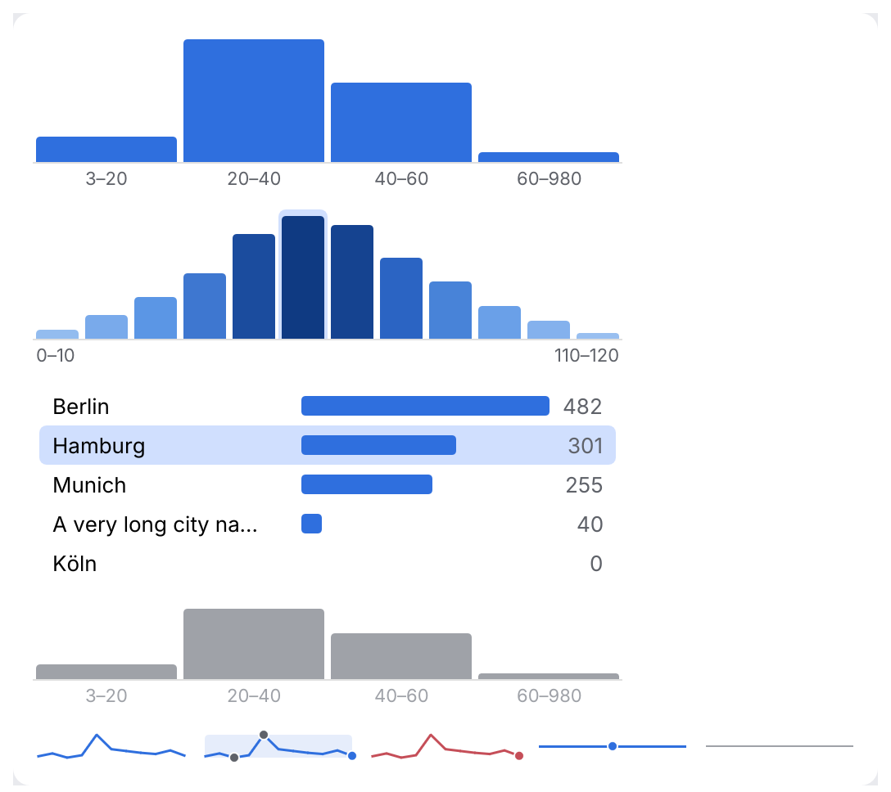

# Histogram, Sparkline

Charts for data-heavy tools. A **histogram** shows bucketed counts: the value distribution
of a numeric or date field (vertical bars), or the top-N values of a category (horizontal
bars with labels). A **sparkline** is a tiny inline trend: query time, request latency.

<picture>
  <source media="(prefers-color-scheme: dark)" srcset="img/chart.dark.png">
  
</picture>

Colors come from the theme only: the categorical chart palette and sequential ramp of
[Data colors](../theming.md#data-colors), and [`Tone`s](../theming.md). Charts scale with the
UI and draw without per-frame allocations beyond the text layout.

## Usage

```rust
use archipel_kit::components::{Bucket, ChartColor, Histogram, Sparkline};
use archipel_kit::{Tone, egui};

fn field_stats(ui: &mut egui::Ui, selected: &mut Option<usize>, latency: &[f32]) {
    let buckets = [
        Bucket::range(3.0, 20.0, 31),
        Bucket::range(20.0, 40.0, 148),
        Bucket::range(40.0, 980.0, 12),
    ];
    let out = Histogram::new("price", &buckets)
        .selectable(true)
        .selected(*selected)
        .show(ui);
    if out.selected.is_some() {
        *selected = out.selected;
    }
    if let Some(index) = out.clicked {
        println!("filter on {}", buckets[index].label());
    }

    let cities = [Bucket::new("Berlin", 482), Bucket::new("Hamburg", 301)];
    Histogram::new("city", &cities).horizontal(true).show(ui);

    ui.add(
        Sparkline::new("latency", latency)
            .color(ChartColor::Tone(Tone::Warning))
            .last_marker(true)
            .tooltip(true),
    );
}
```

## API

| Builder | Effect |
|---|---|
| `Bucket::new(label, count)` | A named bucket (category, date, stage). |
| `Bucket::range(low, high, count)` | A numeric bucket, labelled "low–high"; feeds min and max in the summary. |
| `Histogram::new(name, &[Bucket])` | Draws with `.show(ui)`. `name` is the field described. |
| `.horizontal(bool)` | One row per bucket: label, bar, count. For top-N categories. |
| `.height(f32)` | Height of a vertical histogram (120 pt). |
| `.color(ChartColor)` | `Series(n)` of the chart palette (series 0) or a `Tone`. |
| `.ramp(bool)` | Color bars by share of the largest count on the sequential ramp. |
| `.unit(str)` | What is counted, for the tooltip ("documents"). |
| `.selectable(bool)` | Opt into click, arrow keys and Enter. |
| `.selected(Option<usize>)` | The caller's selection. |
| `.enabled(bool)` | Disabled charts are dimmed and inert. |
| `.with(behaviour)` | [Behaviours](../behaviours.md): a context menu, or your own `Tooltip`, which replaces the automatic one. |
| `Sparkline::new(name, &[f32])` | `.width(f32)` (96 pt; the height is fixed), `.color`, `.last_marker(bool)`, `.min_max_band(bool)`, `.scale(low, high)`, `.tooltip(bool)`, `.format(fn(f32) -> String)`. |

`Histogram::show` returns a `HistogramResponse`: `response`, `hovered`, `selected` (changed
by click or keys this frame) and `clicked` (activated by click or Enter/Space).

## Behavior

- **Data, not an action.** The cursor stays an arrow. Hovering a bar highlights it and shows
  a kit tooltip with its range and count (and share of the total).
- **Selectable.** With `.selectable(true)` the cursor over a bar is the theme's action
  cursor (the hand) and a click selects and activates that bucket. The chart takes one
  <kbd>Tab</kbd> stop with a focus ring; <kbd>←</kbd>/<kbd>→</kbd> (<kbd>↑</kbd>/<kbd>↓</kbd>
  when horizontal), <kbd>Home</kbd> and <kbd>End</kbd> move the selection,
  <kbd>Enter</kbd> or <kbd>Space</kbd> activates it.
- **Sparkline tooltip.** The opt-in tooltip (`.tooltip(true)`) is mouse-only: a sparkline is
  read-only and takes no keyboard focus. The accessible name carries the min, max and last
  value for everyone else.
- **Axis labels.** Every bucket label if they fit, otherwise the first and the last.
  Horizontal labels truncate at 40% of the width.
- **Edge cases.** An empty histogram says "No data". Zero counts draw no bar, other bars
  are at least 2 pt tall. A sparkline with one value draws a flat line, non-finite values are
  gaps, and a sparkline without data draws a muted baseline.
- **Sparkline band.** `min_max_band` shades the span from the lowest to the highest value
  and dots both extremes; pair it with `.scale(low, high)` to give it context.

## Accessibility

A histogram is named with a value summary: "Histogram of price: 12 buckets, min 3, max 980,
mode 20–40" (min and max come from `Bucket::range`; without ranges the summary is
"…: 5 buckets, mode Berlin"; empty: "…: no data"). A selected bucket is appended
("; selected 20–40: 148 documents"). Selectable histograms have role `SelectableLabel`,
others `Image`. A sparkline is an image named "Sparkline of latency: 12 points, min 11,
max 30, last 13.5". Don't use color alone to tell series apart; the tooltip, labels and
summary carry the values.

Source: [`components/chart.rs`](../../crates/archipel-kit/src/components/chart.rs) ·
Tests: [`tests/chart.rs`](../../crates/archipel-kit/tests/chart.rs)
