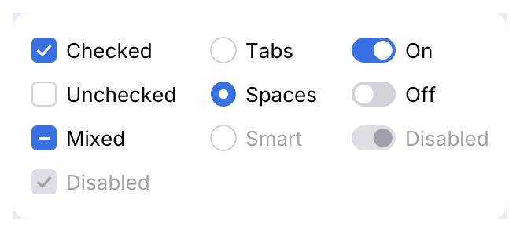

# JBCheckBox, JBRadioButton, OnOffButton

Boolean and one-of-many choices. Use a **checkbox** for options that are confirmed later
(a dialog's OK), **radio buttons** for two to five mutually exclusive options, and a
**toggle** for a setting that applies immediately.

<picture>
  <source media="(prefers-color-scheme: dark)" srcset="img/choice.dark.png">
  
</picture>

## Usage

```rust
use archipel_kit::ui::{JBCheckBox, JBRadioButton, OnOffButton};
use archipel_kit::egui;

#[derive(PartialEq, Clone, Copy)]
enum Indent { Tabs, Spaces }

fn editor_settings(ui: &mut egui::Ui, format: &mut bool, indent: &mut Indent, auto_save: &mut bool) {
    ui.add(JBCheckBox::new(format, "Reformat code on save"));
    ui.add(JBRadioButton::new(indent, Indent::Tabs, "Tabs"));
    ui.add(JBRadioButton::new(indent, Indent::Spaces, "Spaces"));
    ui.add(OnOffButton::new(auto_save, "Save files automatically"));
}
```

A parent checkbox shows **mixed** while some of its children are checked; clicking it checks
all of them:

```rust
use archipel_kit::ui::JBCheckBox;
use archipel_kit::egui;

fn inspections(ui: &mut egui::Ui, children: &mut [bool; 3]) {
    let all = children.iter().all(|c| *c);
    let some = children.iter().any(|c| *c);
    let mut parent = all;
    if ui.add(JBCheckBox::new(&mut parent, "All inspections").mixed(some && !all)).changed() {
        *children = [parent; 3];
    }
}
```

## API

| Component | Builders |
|---|---|
| `JBCheckBox::new(&mut bool, label)` | `.mixed(bool)`, `.enabled(bool)`, `.comment(text)`, `.inline_comment(text)` ([Form](form.md)), `.label_visible(bool)` (off: the label is only the accessible name, e.g. in a row's leading slot) |
| `JBRadioButton::new(&mut T, value, label)` | `.enabled(bool)`, `.comment(text)`, `.inline_comment(text)`; selected when `*current == value` |
| `OnOffButton::new(&mut bool, label)` | `.enabled(bool)` |

All return a `Response` whose `changed()` is true on the frame the value changed.

## Behavior

- The whole row (control, label and inline comment) is the click target; a comment below is not.
- The label starts 8 pt after the box (measured on Android Studio).
- <kbd>Space</kbd> toggles a focused control.
- Toggles animate the knob.

## Accessibility

Checkboxes and toggles have role `CheckBox`, radios `RadioButton`; all are named by their
label and report checked or unchecked.

Source: [`ui/choice.rs`](../../crates/archipel-kit/src/ui/choice.rs) ·
Tests: [`tests/choice.rs`](../../crates/archipel-kit/tests/choice.rs)
