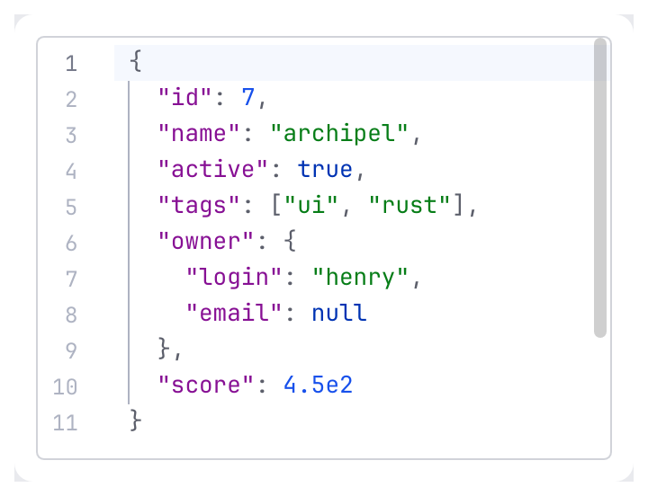
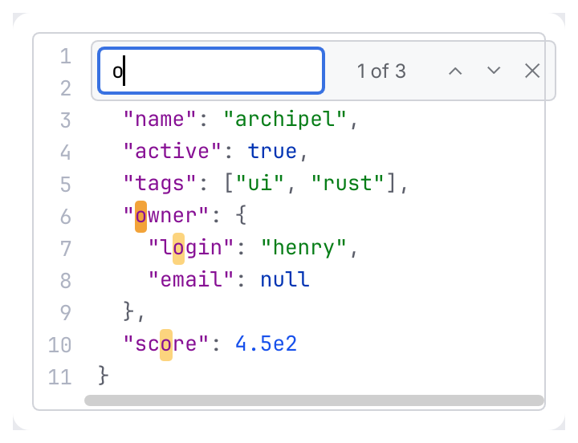
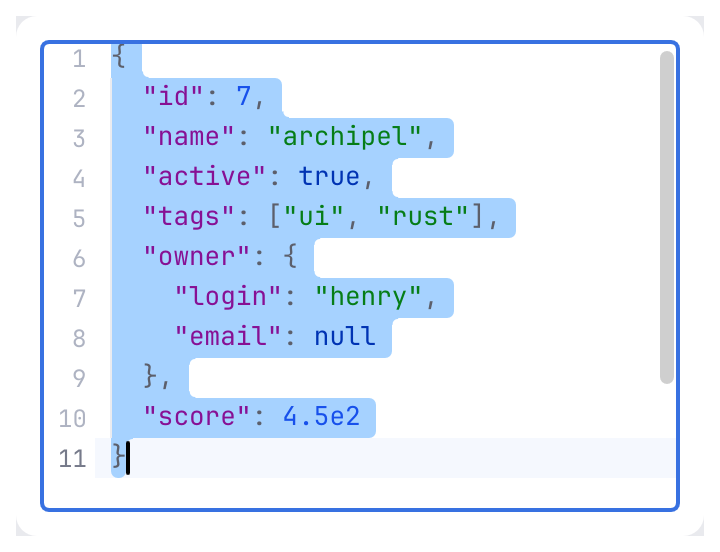
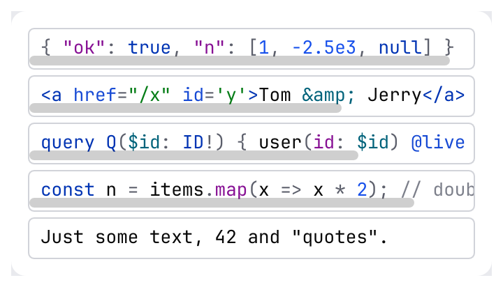
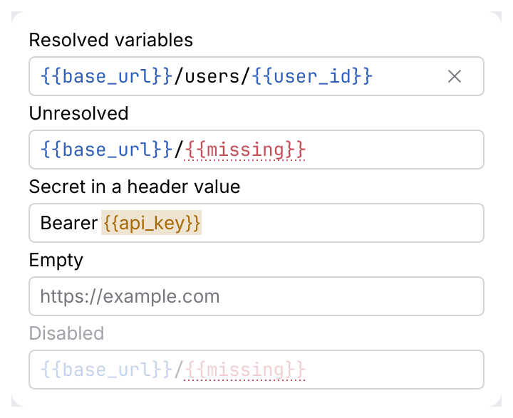
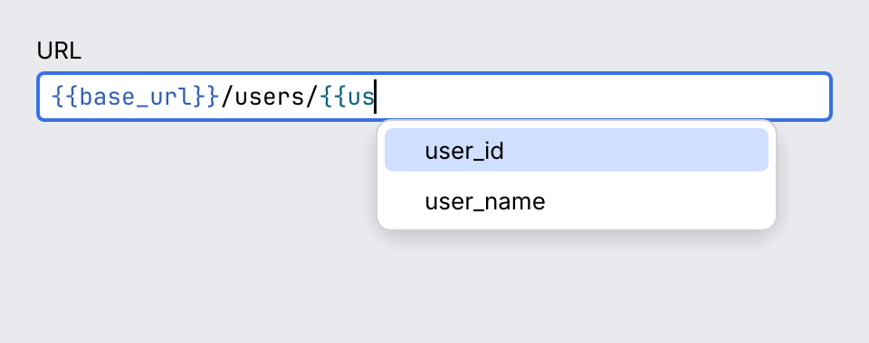

# CodeView and CodeEditor

`CodeView` shows large read-only code: response bodies, JSON documents, logs. `CodeEditor`
edits code in place: request bodies, queries, scripts. Both use the kit's monospace font,
the editor colors of the theme and the same optional gutter, find bar and highlighting.

<picture>
  <source media="(prefers-color-scheme: dark)" srcset="img/code_view.dark.png">
  
</picture>

## Usage

```rust
use archipel_kit::components::code::Json;
use archipel_kit::components::{CodeEditor, CodeView};
use archipel_kit::egui;

fn body_panel(ui: &mut egui::Ui, request: &mut String, response: &str) {
    ui.add(
        CodeEditor::new(request)
            .label("Request body")
            .highlighter(&Json)
            .line_numbers(true)
            .height(160.0),
    );
    CodeView::new(response)
        .label("Response body")
        .highlighter(&Json)
        .line_numbers(true)
        .folding(true)
        .show(ui);
}
```

## CodeView

| Builder | Effect |
|---|---|
| `CodeView::new(&str)` | Shows the text, borrowed: it is never copied. |
| `.label(str)` | Accessible name; texts up to 64 KB are also exposed as the node's value. |
| `.highlighter(&dyn Highlighter)` | Token colors (default: none). |
| `.line_numbers(bool)` | Line-number gutter. |
| `.wrap(bool)` | Soft wrap at the view's width instead of sideways scrolling. |
| `.folding(bool)` | Fold arrows for `{…}` and `[…]` regions spanning several lines. |
| `.scroll_to_line(Option<usize>)` | Centers a line (0-based), on the frame it is passed. |
| `.revision(u64)` | Bump when the text changes in place without changing its length. |
| `.height(f32)` | Height (default: the available height, or 300 when unbounded). |
| `.id(Id)` | Explicit id for several views in one place. |

`show` returns a `CodeViewResponse`: the `response`, `line_count`, the `visible_lines`,
`laid_out_rows` and the number of find `matches`. Add it with `ui.add(view)` when only the
response matters.

### Virtualization

Only the visible rows are laid out: a 10 MB, 200 000-line JSON body scrolls like a short one.
The view indexes the text once (line starts, the longest line, highlighter checkpoints every
256 lines) and caches that between frames, recognizing the text by its length, address and a
sample of its content. Highlighting needs the state of the line above (a block comment
that started earlier), so jumping far into a text with a stateful highlighter tokenizes the
lines above once; stateless ones (`Json`, `PlainText`) jump for free. Lines are laid out as a
monospace grid and a long line is cut to the visible columns, so a minified 10 MB body on
one line scrolls too.

### Selection and copy

Click and drag select, double click selects a word, triple click a line, <kbd>Ctrl</kbd>+<kbd>A</kbd>
everything and <kbd>Ctrl</kbd>+<kbd>C</kbd> copies. Arrow keys, <kbd>PgUp</kbd>/<kbd>PgDn</kbd> and
<kbd>Ctrl</kbd>+<kbd>Home</kbd>/<kbd>End</kbd> scroll while the view has focus.

### Find

<picture>
  <source media="(prefers-color-scheme: dark)" srcset="img/code_view_find.dark.png">
  
</picture>

<kbd>Ctrl</kbd>+<kbd>F</kbd> opens a find bar built from kit components: a `TextField`, the match
count and `IconButton`s. All matches are highlighted, the current one stronger. <kbd>Enter</kbd>
and <kbd>Shift</kbd>+<kbd>Enter</kbd> (or the arrows) step through the matches, scrolling and
unfolding to show them; <kbd>Esc</kbd> closes the bar. Matching ignores ASCII case and stops at
100 000 matches. The editor has the same bar.

### Folding

`.folding(true)` adds an arrow in the gutter for every `{` or `[` line whose bracket closes on
a later line. A folded region shows a `…` chip and hides its lines; the find jump unfolds what
it needs. Folding looks at brackets and `"` strings, so it suits JSON and JSON-like text.

## CodeEditor

<picture>
  <source media="(prefers-color-scheme: dark)" srcset="img/code_editor.dark.png">
  
</picture>

| Builder | Effect |
|---|---|
| `CodeEditor::new(&mut String)` | Edits the string in place; `changed()` on the response after every edit. |
| `.label(str)` | Accessible name. |
| `.placeholder(str)` | Hint shown while empty. |
| `.highlighter(&dyn Highlighter)` | Token colors. |
| `.line_numbers(bool)` | Line-number gutter; the caret line's number is stronger. |
| `.wrap(bool)` | Soft wrap. |
| `.enabled(bool)` | Disabled editors are dimmed, read-only and skipped by <kbd>Tab</kbd>. |
| `.tab_width(usize)` | Columns per indentation level (default 4). |
| `.use_tabs(bool)` | Indent with tab characters. |
| `.tab_indents(bool)` | <kbd>Tab</kbd> indents (default); off, it moves focus (for forms). |
| `.auto_indent(bool)` | <kbd>Enter</kbd> keeps the line's indentation (default on). |
| `.bracket_pairing(bool)` | Inserts closing brackets and quotes (default on). |
| `.height(f32)`, `.id(Id)` | As in the view. |

- <kbd>Tab</kbd> inserts spaces up to the next tab stop; over several selected lines it indents
  them, <kbd>Shift</kbd>+<kbd>Tab</kbd> unindents. <kbd>Ctrl</kbd>+<kbd>]</kbd> and
  <kbd>Ctrl</kbd>+<kbd>[</kbd> do the same without trapping <kbd>Tab</kbd>. While <kbd>Tab</kbd> indents,
  <kbd>Esc</kbd> leaves the editor.
- <kbd>Enter</kbd> keeps the indentation, adds a level after `{`, `[` or `(`, and splits an empty
  pair onto three lines.
- Typing an opener inserts the pair; typing the closer skips over it; backspace inside an empty
  pair removes both; an opener typed over a selection wraps it. Quotes next to a word character
  stay single, so apostrophes work.
- Undo and redo, selection and the clipboard are egui's.

**Size limit.** The editor is egui's `TextEdit` with a highlighting layouter, which lays out
the *whole* text whenever it changes. Up to about **1 MB** (roughly 20 000 lines) typing stays
responsive; the galley is cached between edits, so scrolling and idle frames only paint the
visible rows. Beyond that every keystroke pays for the whole text: show it in a `CodeView`, or
behind a "too large to edit" notice.

## Highlighting

<picture>
  <source media="(prefers-color-scheme: dark)" srcset="img/code_highlighting.dark.png">
  
</picture>

A `Highlighter` maps a line to styled `Span`s by `TokenKind` (keyword, string, number, comment,
punctuation, property, tag, attribute, variable, error). Colors come from the theme's
`EditorColors` (`syntax_keyword`, `syntax_string`, … in dark and light), never from the
highlighter. Built in: `Json`, `Xml` (also HTML), `GraphQl`, `JavaScript` and `PlainText`, all
small hand-written tokenizers without dependencies. Plug in your own, for example the IDE's
tree-sitter:

```rust
use archipel_kit::components::CodeView;
use archipel_kit::components::code::{Highlighter, Span, TokenKind};
use archipel_kit::egui;

/// Marks `TODO` and `FIXME` in a log.
struct Markers;

impl Highlighter for Markers {
    fn highlight_line(&self, line: &str, _state: &mut u32, out: &mut Vec<Span>) {
        for word in ["TODO", "FIXME"] {
            for (start, found) in line.match_indices(word) {
                out.push(Span { start, end: start + found.len(), kind: TokenKind::Keyword });
            }
        }
        out.sort_by_key(|span| span.start);
    }

    // No construct continues on the next line: jumping to any line is free.
    fn stateless(&self) -> bool {
        true
    }
}

fn log_view(ui: &mut egui::Ui, log: &str) {
    CodeView::new(log).label("Log").highlighter(&Markers).show(ui);
}
```

`highlight_line` gets the line without its break and a `state` that starts at `0` and carries
what the previous line left (a block comment still open), for constructs spanning lines.
`highlight_text` has a default that runs it over a whole text; override it when the tokenizer
wants the whole text, as a syntax tree does. The spans of lines longer than 4 KB are cached,
so even a one-line 10 MB body tokenizes once.

## Single-line fields and `{{variables}}`

<picture>
  <source media="(prefers-color-scheme: dark)" srcset="img/template_field.dark.png">
  
</picture>

A URL bar or a header value is a single line, so it is a [`TextField`](text-field.md) with
`.highlighter(&dyn Highlighter)`, not a one-line `CodeEditor`: it keeps the field's height,
focus ring, placeholder, clear button, leading icon and error message, so a highlighted input
and a plain one sit side by side in a form and look the same. The text never wraps and
<kbd>Enter</kbd> never inserts a newline: `show` reports `submitted`, and `lost_focus()` is set
too. Any `Highlighter` works; `TokenKind` has `Resolved`, `Unresolved` and `Secret` for
variables, drawn in the theme's link, error (with a dotted underline) and warning (on a tinted
background) tones.

`TemplateHighlighter` finds `{{name}}` tokens and asks your closure what each one is. It wraps
an inner highlighter for the text between them (`.inner(Json)`; plain text by default). A token
still being typed (`{{ba`) is drawn as a plain variable until it is closed.

```rust
use archipel_kit::components::TextField;
use archipel_kit::components::code::{TemplateHighlighter, TemplateToken};
use archipel_kit::egui;

fn url_bar(ui: &mut egui::Ui, url: &mut String) -> bool {
    let highlighter = TemplateHighlighter::new(|name: &str| match name {
        "token" => TemplateToken::Secret,
        "base_url" | "user_id" => TemplateToken::Resolved,
        _ => TemplateToken::Unresolved,
    });
    let out = TextField::new(url)
        .label("URL")
        .placeholder("https://example.com")
        .monospace(true)
        .highlighter(&highlighter)
        .show(ui);
    out.submitted
}
```

### The caret and autocomplete

`TextField::show` returns a `TextFieldOutput`:

| Field | Meaning |
|---|---|
| `response` | The text edit's response (`changed()`, `has_focus()`, `lost_focus()`). |
| `submitted` | The field lost focus because <kbd>Enter</kbd> was pressed. |
| `caret_rect` | The caret as a screen rectangle; anchor a `parts::Popover` on it. |
| `template` | `Option<TemplateAt>`: the `{{variable}}` the caret is in or just after. |
| `insert_completion(ctx, &mut text, name)` | Replaces the token with `{{name}}`, puts the caret after it and focuses the field. |

`TemplateAt` has `range` (byte range of the whole token, including a closing `}}` that is
already there), `partial` (the name typed before the caret: `us` for `{{us|er}}`), `name` and
`closed`. The caret counts as "at" a token after its opening `{{` and up to its end; right
before `{{` or after `}}` it is not. `template_at(text, byte)` is the same detection as a plain
function. The last caret is remembered per field, so `template` stays valid when a click on a
suggestion has already moved the focus.

The field does not draw the suggestions: the caller owns the list, so it can come from an
environment, a request history or a language server. This is the whole wiring with `MenuItem`s
and the keyboard. The keys are consumed **before** the field, while the list is open, so the
field does not move its caret on <kbd>Up</kbd>/<kbd>Down</kbd> or submit on <kbd>Enter</kbd>:

```rust
use archipel_kit::components::code::{TemplateHighlighter, TemplateToken};
use archipel_kit::components::{MenuItem, TextField};
use archipel_kit::egui::{self, Key, Modifiers};
use archipel_kit::parts::Popover;

const VARIABLES: [&str; 3] = ["base_url", "user_id", "user_name"];

/// The state of the bar: yours, the kit keeps none.
#[derive(Default)]
struct UrlBar {
    url: String,
    open: bool,
    selected: usize,
    matches: Vec<&'static str>,
}

/// Returns `true` when the user pressed Enter with no list open.
fn url_bar(ui: &mut egui::Ui, bar: &mut UrlBar) -> bool {
    let highlighter = TemplateHighlighter::new(|name: &str| {
        if VARIABLES.contains(&name) { TemplateToken::Resolved } else { TemplateToken::Unresolved }
    });

    // The list was open last frame: it owns the navigation keys.
    let listing = bar.open && !bar.matches.is_empty();
    let (mut down, mut up, mut accept) = (false, false, false);
    if listing {
        ui.input_mut(|i| {
            down = i.consume_key(Modifiers::NONE, Key::ArrowDown);
            up = i.consume_key(Modifiers::NONE, Key::ArrowUp);
            accept = i.consume_key(Modifiers::NONE, Key::Enter);
            if i.consume_key(Modifiers::NONE, Key::Escape) {
                bar.open = false;
            }
        });
    }

    let out = TextField::new(&mut bar.url)
        .label("URL")
        .monospace(true)
        .highlighter(&highlighter)
        .show(ui);

    // Filter by what was typed of the name; open on every edit.
    bar.matches = match &out.template {
        Some(token) => VARIABLES.into_iter().filter(|v| v.starts_with(token.partial.as_str())).collect(),
        None => Vec::new(),
    };
    if out.response.changed() {
        bar.open = true;
        bar.selected = 0;
    }
    // Tabbing away closes the list; a click is the popover's (outside) or an item's (inside).
    let clicking = ui.input(|i| i.pointer.any_pressed() || i.pointer.any_released());
    if bar.matches.is_empty() || out.response.lost_focus() && !clicking {
        bar.open = false;
    }

    let last = bar.matches.len().saturating_sub(1);
    if down { bar.selected = (bar.selected + 1).min(last); }
    if up { bar.selected = bar.selected.saturating_sub(1); }
    bar.selected = bar.selected.min(last);
    if accept && let Some(name) = bar.matches.get(bar.selected) {
        out.insert_completion(ui.ctx(), &mut bar.url, name);
        bar.open = false;
    }

    if let Some(caret) = out.caret_rect {
        let (matches, selected) = (bar.matches.clone(), bar.selected);
        let mut picked = None;
        Popover::new("url-completions", caret).width(220.0).show(ui.ctx(), &mut bar.open, |ui| {
            for (i, name) in matches.iter().enumerate() {
                if ui.add(MenuItem::new(*name).highlighted(i == selected)).clicked() {
                    picked = Some(*name);
                }
            }
        });
        if let Some(name) = picked {
            out.insert_completion(ui.ctx(), &mut bar.url, name);
            bar.open = false;
        }
    }
    out.submitted && !accept
}
```

<picture>
  <source media="(prefers-color-scheme: dark)" srcset="img/template_autocomplete.dark.png">
  
</picture>

`MenuItem::highlighted(true)` paints the hover fill for the row the keyboard is on.
<kbd>Escape</kbd> is consumed by the wiring while the list is open (a second press leaves the
field as usual), and the popover also closes on a click outside it. The suggestion rows are
operated from the field like a combobox list, not by <kbd>Tab</kbd>. The audit therefore runs on
the field, and the list is covered by the keyboard and click tests in
[`tests/template_field.rs`](../../crates/archipel-kit/tests/template_field.rs), which run this
same wiring.

## Behavior

- Focus draws the accent outline of text fields. The cursor is the text beam over the text and
  the arrow over the gutter.
- The view is a monospace grid: tabs expand to four columns and every `char` takes one cell, so
  wide or combining characters are approximate.
- Nothing is stored in the kit: selection, folds and find live in the egui context, keyed by the
  component's id.

## Accessibility

`CodeView` is a `Document` named by `.label(...)` with the text as its value (up to 64 KB);
`CodeEditor` is a `TextInput` named by `.label(...)`, with egui's value and selection. The fold
arrows are buttons named "Fold lines 3 to 9". The find bar's field is "Find"; its buttons are
"Previous match", "Next match" and "Close find".

## Testing

```rust
use archipel_kit::components::{CodeEditor, CodeView};
use archipel_kit::testing::{self, NodeExt, Queryable, Role};
use archipel_kit::Theme;
use archipel_kit::egui::Key;

let mut harness = testing::harness_state(Theme::dark(), String::new(), |ui, text| {
    CodeView::new("{}").label("Response").height(60.0).show(ui);
    ui.add(CodeEditor::new(text).label("Request").height(100.0));
});
assert_eq!(harness.get_by_label("Response").role(), Role::Document);

let editor = harness.get_by_label("Request");
editor.focus();
editor.type_text("{");
harness.key_press(Key::Enter);
harness.run();
assert_eq!(harness.state(), "{\n    \n}");
```

Source: [`components/code/`](../../crates/archipel-kit/src/components/code/) ·
Tests: [`tests/code.rs`](../../crates/archipel-kit/tests/code.rs)
