# EditorComponent

`EditorComponent` is the kit's code editor: the editor of the IntelliJ Platform (IntelliJ's
`EditorComponentImpl`), as an egui widget on a `model::Editor`. One component edits request
bodies, queries and scripts, and with `.viewer(true)` it shows read-only text such as response
bodies, JSON documents and logs. It uses the kit's monospace font, the editor colors of the
theme and an optional gutter, find bar and highlighting.

It replaces the former `CodeEditor` (built on egui's `TextEdit`, one caret) and `CodeView`
(read-only): the editing logic is the UI-free [editor model](../editor-model.md) (multiple
carets, column selection, IntelliJ word stops, smart Home/End, caret-restoring undo, folding),
and the component paints it and turns input into model actions. See the
[migration](../migration/intellij-names.md#codeview-and-codeeditor-became-editorcomponent).

<picture>
  <source media="(prefers-color-scheme: dark)" srcset="img/code_view.dark.png">
  
</picture>

## Usage

The caller owns the `Editor` (document, carets, undo, folds, settings); the component borrows it.

```rust
use archipel_kit::editor::model::Editor;
use archipel_kit::editor::{EditorComponent, Json};
use archipel_kit::egui;

fn body_panel(ui: &mut egui::Ui, request: &mut Editor, response: &mut Editor) {
    ui.add(
        EditorComponent::new(request)
            .label("Request body")
            .highlighter(&Json)
            .line_numbers(true)
            .height(160.0),
    );
    EditorComponent::new(response)
        .label("Response body")
        .highlighter(&Json)
        .viewer(true)
        .line_numbers(true)
        .bracket_folding(true)
        .show(ui);
}
```

| Builder | Effect |
|---|---|
| `EditorComponent::new(&mut Editor)` | The model to show and edit. |
| `.label(str)` | Accessible name; texts up to 64 KB are also exposed as the node's value. |
| `.highlighter(&dyn SyntaxHighlighter)` | Token colors (default: none). |
| `.language(&Language)` | Brackets, quotes and comment prefixes the typing and the brace highlight use (default `Language::c_like()`; `Language::plain_text()` for prose). |
| `.viewer(bool)` | Read-only (IntelliJ `isViewer`): carets, selection, multiple carets, copy, find and folds work; editing and <kbd>Tab</kbd> do not. |
| `.enabled(bool)` | Disabled components are dimmed, inert and skipped by <kbd>Tab</kbd>. |
| `.line_numbers(bool)` | Line-number gutter; the caret line's number is stronger. |
| `.folding(bool)` / `.bracket_folding(bool)` | Fold chevrons for the regions of the model; `bracket_folding` also keeps regions for multi-line `{…}` and `[…]` in sync with the text. |
| `.wrap(bool)` | Soft wrap at the width instead of sideways scrolling (Home, End, Up and Down still follow logical lines). |
| `.placeholder(str)` | Hint shown while the document is empty. |
| `.tab_indents(bool)` | <kbd>Tab</kbd> indents (default); off, it moves focus (for forms). |
| `.completer(&dyn Completer)` | A completion popup (IntelliJ `Lookup`) under the caret, as in [single-line fields](#autocomplete); it opens while typing an identifier and on <kbd>Ctrl</kbd>+<kbd>Space</kbd>, and inserts at every caret. `Completion::caret(n)` puts the caret inside the insertion (`user(id: \|)`). |
| `.scroll_to_line(Option<usize>)` | Centers a line (0-based), on the frame it is passed. |
| `.stick_to_bottom(bool)` | Follows the end while the text grows (a console, a log); scrolling up stays there until the user scrolls back down. Turns scroll past the end off. |
| `.gutter_icons(&[GutterIcon])`, `.change_markers(&[ChangeMarker])` | Icon lanes and version control markers in the gutter, as data. |
| `.highlights(&[RangeHighlight])` | Squiggles and error stripe marks for ranges, by severity. |
| `.show_whitespace(bool)`, `.indent_guides(bool)`, `.right_margin(bool)` | Whitespace dots (off), indent guides (on), the margin line at the model's `right_margin` column, 120 (on). |
| `.gutter_click_selects_line(bool)` | Classic gutter: a click on a line number selects the line. Default is the new UI, where the click is only reported. |
| `.height(f32)`, `.id(Id)` | Height (default: the available height, or 300 when unbounded); an explicit id for several components in one place. |
| `.keymap_os(Os)` | The keymap to use (default: the platform's). |

`show` returns an `EditorComponentResponse`:

| Field | Meaning |
|---|---|
| `response` | Focus, hover and the accessible node; `changed()` after every edit. |
| `text_changed`, `carets_moved` | The document changed; a caret or selection moved (or the text changed). |
| `selection` | The primary selection as a byte range, `None` for a bare caret: a query console can run just what is selected. |
| `navigation` | A <kbd>Ctrl</kbd> (<kbd>Cmd</kbd>) click: `NavigationRequest { offset, kind }`; resolving it is the application's. |
| `gutter_clicks` | Clicks in the gutter the component did not use: `GutterClick { line, area, button, modifiers }`. |
| `hover` | The pointer rested on the text for 500 ms: `HoverInfo { offset, pos, highlight }`; the caller shows the tooltip. |
| `fold_preview`, `stripe_hover` | The folded range under the pointer after 300 ms; the error stripe mark under the pointer. |
| `hint`, `caret_rect` | A hint to show under the caret ("Not found, try again to search from top"); the caret on screen, to anchor popups. |
| `line_count`, `visible_lines`, `laid_out_rows`, `matches` | The number of lines, the visible logical lines, the rows laid out this frame (never the whole text), and the find matches. |

Add it with `ui.add(component)` when only the response matters.

```rust
use archipel_kit::editor::model::Editor;
use archipel_kit::editor::EditorComponent;

fn console(ui: &mut archipel_kit::egui::Ui, script: &mut Editor) -> Option<String> {
    let out = EditorComponent::new(script).label("Script").show(ui);
    let run = ui.input(|i| i.modifiers.command && i.key_pressed(archipel_kit::egui::Key::Enter));
    run.then(|| {
        let text = script.document.text();
        out.selection.map_or(text.to_owned(), |range| text[range].to_owned())
    })
}
```

### Virtualization

Only the visible rows are laid out: a 10 MB, 200 000-line JSON body scrolls like a short one.
The component indexes the document once per change (the longest line, highlighter checkpoints
every 256 lines) and caches that between frames. Highlighting needs the state of the line above
(a block comment that started earlier), so jumping far into a text with a stateful highlighter
tokenizes the lines above once; stateless ones (`Json`, `PlainText`) jump for free. Lines are
laid out as a monospace grid and a long line is cut to the visible columns, so a minified
10 MB body on one line scrolls too. Editing touches the model's document, not a galley of the
whole text, so a keystroke in a large document costs the lines on screen.

### Keyboard

Keys go through the model's keymap (`editor_action_for`) for the current platform: the
default IntelliJ keymap on Windows and Linux, the macOS keymap on macOS. Typed text, IME
commits and the clipboard come in as egui events and become `Type`, `Copy`, `Cut` and `Paste`
actions; egui's own text editing, undo and word movement are not involved. <kbd>Tab</kbd>
stays in the editor (it indents), <kbd>Esc</kbd> first closes the completion list, then the
find bar, then clears the selection and the extra carets, and only then leaves the editor.
The full list of actions is in [the editor model](../editor-model.md).

### Mouse

| Gesture | Effect |
|---|---|
| Click | Caret to the click; a press inside the selection keeps it until release (no drag and drop: a drag from there selects anew). |
| Double click / triple click | The word (on blanks the line's text) / the whole line with its break; dragging extends by words or lines; <kbd>Shift</kbd>+click extends by the same unit. |
| Drag | Selects. Beyond the viewport's edge it autoscrolls: every `20 / d + 1` ticks of 100 ms the head moves `1 + d / 20` lines (`d` is the distance in pixels). |
| <kbd>Shift</kbd>+click | Extends the selection from its anchor. |
| <kbd>Alt</kbd>+<kbd>Shift</kbd>+click | Adds a caret; on an existing caret it removes it. Dragging after the click selects for that caret. |
| <kbd>Alt</kbd>+drag, middle drag | Column selection; short lines get a caret at their end. |
| Middle click | Linux: pastes the text last selected with the mouse (the primary selection of this editor). |
| <kbd>Ctrl</kbd>/<kbd>Cmd</kbd>+click (+<kbd>Alt</kbd>) | Moves the caret and reports a `NavigationRequest` (Go to Declaration; with <kbd>Alt</kbd> Go to Implementation). |
| Right click | Moves the caret unless the click is inside a selection; the menu is the caller's (`response.context_menu`). |
| Click on a collapsed fold placeholder | Expands it. |
| Wheel, <kbd>Shift</kbd>+wheel | Scrolls vertically and horizontally. |
| Gutter: line number | Click: reported as a `GutterClick`. Drag (after 5 px): selects whole lines up or down; <kbd>Shift</kbd>+click extends by lines. |
| Gutter: elsewhere | Drag selects from the start of the line; clicks are reported. |

The cursor is the text beam over text, the arrow over a selection and in the gutter, and the
hand over a fold placeholder.

### Painting

<picture>
  <source media="(prefers-color-scheme: dark)" srcset="img/editor_multi_caret.dark.png">
  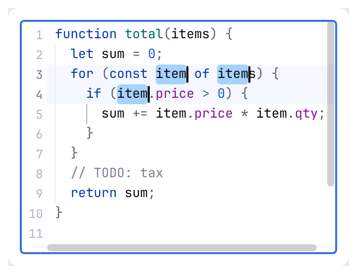
</picture>

<picture>
  <source media="(prefers-color-scheme: dark)" srcset="img/editor_column_selection.dark.png">
  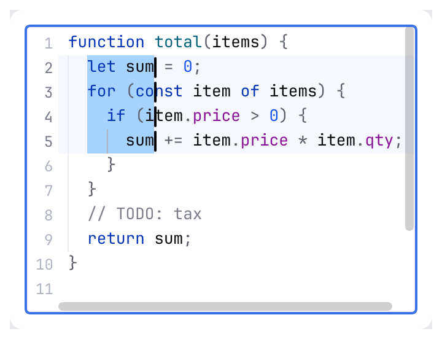
</picture>

- **Selection** is the Islands selection: one outline per block of selected rows with rounded
  outer corners (radius line height / 6) and concave fillets where rows of different widths
  meet; a selected line break shows as a one-cell tail. Column selection is plain rectangles.
  Without the focus the selection takes the dimmer inactive color; it never disappears.
- **Caret**: a 2 px rounded bar, shorter than the row, blinking every 500 ms from the last
  activity (typing, moving, clicking restarts it visible); a block with the glyph inverted in
  overwrite mode (<kbd>Insert</kbd>). Every caret is painted. The **caret row** is highlighted
  always, under the selection.
<picture>
  <source media="(prefers-color-scheme: dark)" srcset="img/editor_selection_inactive.dark.png">
  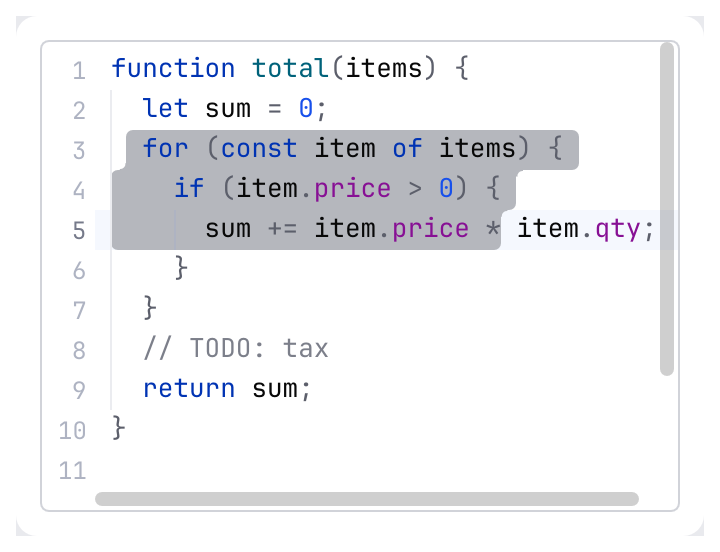
</picture>

- **Highlights**: matched braces (the unmatched one in the invalid color), occurrences of a
  selected single-line text elsewhere (at most 50), find matches (the current one is the selection with a box),
  indent guides (the caret's block in a stronger color), the right margin line, whitespace.
- **Fold placeholder**: the region's placeholder (`{...}`) on the folded background with a
  2 px border ring, full row height.

### Scrolling

Moving the caret scrolls it into view with the IntelliJ margins (one line vertically, three
columns horizontally); jumps (Find, Go to line, <kbd>Ctrl</kbd>+<kbd>M</kbd>) center it and
animate for up to 100 ms with an ease-out (one line or less jumps at once); typing never
animates. The content is five lines taller than the text, so the last line can scroll up (a
`stick_to_bottom` view has none of that slack).

### Gutter

<picture>
  <source media="(prefers-color-scheme: dark)" srcset="img/editor_gutter.dark.png">
  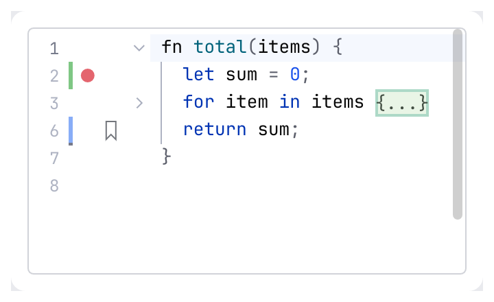
</picture>

Left to right: line numbers (the editor font one size smaller, right-aligned, the caret
line stronger), the strip of change markers (`ChangeMarker`: added, modified, deleted), the
icon lanes (`GutterIcon { line, lane, glyph, tone, name }`, 17 px each) and the fold column.
The chevrons of expanded regions fade in over 130 ms when the pointer is over the gutter and
out after 140 ms; collapsed regions always show theirs. Each chevron is a button named
"Fold lines 3 to 9" (<kbd>Alt</kbd>+click also toggles the regions nested in it); each icon is
a button named by `GutterIcon::name`, and its click comes back as a `GutterClick`.

### Highlights and the error stripe

<picture>
  <source media="(prefers-color-scheme: dark)" srcset="img/editor_error_stripe.dark.png">
  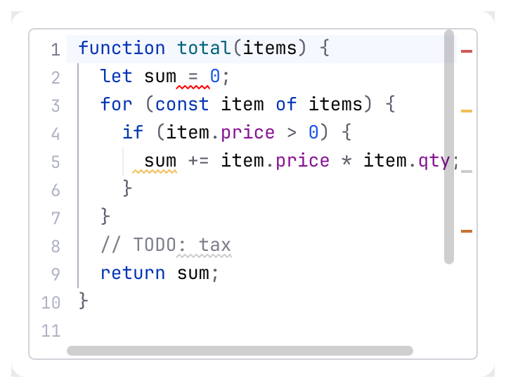
</picture>

`.highlights(&[RangeHighlight])` marks ranges the caller computed (an inspection, a search): a squiggle under the range
(error red, warning amber, weak warning faint) and a 2 px mark on the stripe, a column of 14 px next to the scroll bar, placed
in proportion to the document. Hovering a mark reports it in `stripe_hover` and clicking it moves the caret there and centers
it. Resting the pointer on a range reports `hover` with the index of the highlight, so the caller can show its message in a
`HelpTooltip`.

<picture>
  <source media="(prefers-color-scheme: dark)" srcset="img/editor_guides.dark.png">
  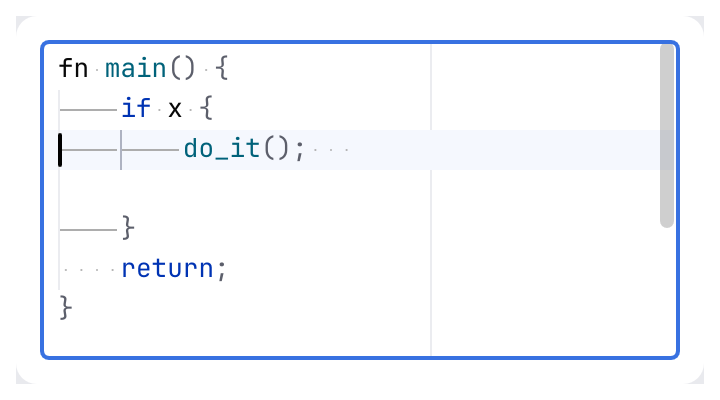
</picture>

Indent guides, the right margin and whitespace are painted under the text: `.indent_guides(false)`,
`.right_margin(false)` and `.show_whitespace(true)` switch them.

### Find and replace

<picture>
  <source media="(prefers-color-scheme: dark)" srcset="img/code_view_find.dark.png">
  
</picture>

The bar is a header docked at the top of the editor, full width, pushing the text down (IntelliJ
`EditorSearchSession`, spec §7). It is built from kit components: a `JBTextField` for the query with
the history button before it, the toggles **Cc** (Match Case), **W** (Words) and **.\*** (Regex),
the status text, `ActionButton`s for Previous, Next and Close. <kbd>Ctrl</kbd>+<kbd>R</kbd> adds a
second row with the replace field, **Replace**, **Replace All** and the **AB** (Preserve Case)
toggle. A viewer has the find row only: find works, replace is hidden and its keys do nothing.

<picture>
  <source media="(prefers-color-scheme: dark)" srcset="img/editor_find_replace.dark.png">
  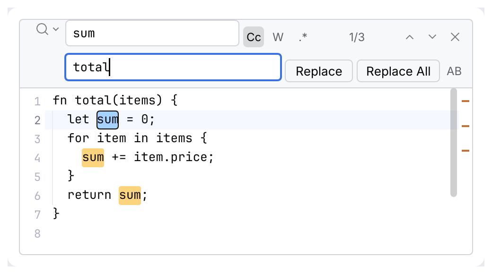
</picture>

**The current match is the editor's selection** (the Islands rounded selection plus a box in the
caret color); the other matches have the search highlight color and a 2 px mark on the error
stripe (`search_stripe`). There is no separate "current index": next and previous select the next
match, so the carets, copy and Replace all work on it.

| Key or action | Effect |
|---|---|
| <kbd>Ctrl</kbd>+<kbd>F</kbd> (<kbd>Alt</kbd>+<kbd>F3</kbd>), <kbd>Cmd</kbd>+<kbd>F</kbd> | Opens the bar (find row) and focuses the query field with its text selected. A single-line selection becomes the query; a multi-line selection becomes the **scope** ("Search in selection..."); otherwise the previous query stays. The word at the caret is not taken. While the bar is open in replace mode it switches to find mode. |
| <kbd>Ctrl</kbd>+<kbd>R</kbd>, <kbd>Cmd</kbd>+<kbd>R</kbd> | Opens the bar with the replace row (find row only in a viewer). |
| Typing in the query field, or a toggle | Results update live: the first match at or after the caret is selected and scrolled to (the view animates and unfolds as a find jump does); a query without a match puts the carets back where they were; clearing the query restores the original carets and scroll position. |
| <kbd>Enter</kbd> / <kbd>Down</kbd>, <kbd>Shift</kbd>+<kbd>Enter</kbd> / <kbd>Up</kbd> in the query field | Next / previous match. Next on the last match shows the hint `"query" not found, press F3 to search from the top` in `EditorComponentResponse::hint`; the **second** press wraps to the first match. Previous says `Shift+F3` and `the bottom`. Moving the carets in between cancels the wrap. |
| <kbd>F3</kbd> / <kbd>Shift</kbd>+<kbd>F3</kbd>, <kbd>Ctrl</kbd>+<kbd>L</kbd> / <kbd>Ctrl</kbd>+<kbd>Shift</kbd>+<kbd>L</kbd>, <kbd>Cmd</kbd>+<kbd>G</kbd> / <kbd>Shift</kbd>+<kbd>Cmd</kbd>+<kbd>G</kbd> | The same from the editor, with the bar closed too (the last query is used and the bar opens without taking the focus). The hint names the key of the platform. |
| <kbd>Ctrl</kbd>+<kbd>F3</kbd> / <kbd>Ctrl</kbd>+<kbd>Shift</kbd>+<kbd>F3</kbd> | Find the word at the caret, forward / backward (as whole word). |
| <kbd>Ctrl</kbd>+<kbd>Enter</kbd> (<kbd>Cmd</kbd>+<kbd>Enter</kbd>) | Accepts the query: adds it to the history and moves the focus to the editor; with an empty query it closes the bar. |
| <kbd>Ctrl</kbd>+<kbd>Shift</kbd>+<kbd>Enter</kbd> | Inserts a line break into the query; the field grows (up to 4 lines) and the match can span lines. |
| <kbd>Alt</kbd>+<kbd>Enter</kbd> | **Select all occurrences**: one caret with a selection per match (at most the model's 1000 carets) and the focus goes to the editor, so typing edits all of them. |
| <kbd>Alt</kbd>+<kbd>C</kbd>, <kbd>Alt</kbd>+<kbd>W</kbd>, <kbd>Alt</kbd>+<kbd>X</kbd> | Toggle Match Case, Words, Regex (in a field of the bar). |
| <kbd>Alt</kbd>+<kbd>Down</kbd> or the history button | Opens the history popup (recent queries, newest first); <kbd>Up</kbd>/<kbd>Down</kbd> and <kbd>Enter</kbd> or a click choose, <kbd>Esc</kbd> closes only the popup. |
| <kbd>Esc</kbd> or the close button | Closes the bar (the completion list closes first), remembers the query in the history and gives the focus back to the editor; the current match stays selected. |
| <kbd>Tab</kbd> / <kbd>Shift</kbd>+<kbd>Tab</kbd> | Between the query and the replace field. |
| <kbd>Enter</kbd> in the replace field, **Replace** | Replaces the current match (when the selection is not a match the first press only selects the next one), then selects the next match, wrapping silently. Each replace is an undo step. |
| <kbd>Alt</kbd>+<kbd>A</kbd>, **Replace All** | Replaces every match inside the scope as **one** undo step and reports `N occurrences replaced` as the hint. |
| <kbd>Alt</kbd>+<kbd>P</kbd>, **AB** | Preserve Case: the replacement is upper case for an upper case match, lower case for a lower case one and capitalized for a capitalized one; other shapes keep it as written. |

**Matching** (`model::search`): case-insensitive by default with Unicode case folding (`É` finds
`é`); Match Case makes it exact. Words needs identifier boundaries before and after the match.
Regex uses the Rust `regex` syntax (close to Java's; `^` and `$` match at line breaks); in the
replacement `$1`, `${name}`, `\n`, `\t` and `\\` are expanded, with Regex off the replacement is
literal. Empty matches are not shown. At most **10 000** matches are collected; the status then
reads `1/10000+`.

**Status text**: `n/m` when the selection is a match, `m results` / `1 result` / `0 results`
otherwise, `Bad pattern` for a regular expression that does not compile and `Vague pattern` for
one that matches the empty text (`|`). A bad pattern or no match turns the query field red.

<picture>
  <source media="(prefers-color-scheme: dark)" srcset="img/editor_find_not_found.dark.png">
  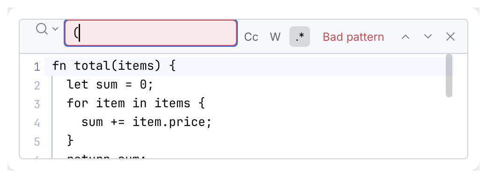
</picture>

**History** is the caller's: `EditorComponent::search_history(&mut SearchHistory)` (recent queries
and replacements, 20 each, newest first, no duplicates); without it the component keeps one for
the egui context. `SearchHistory::load` / `save` store it in any `host::PropertiesComponent`.

<picture>
  <source media="(prefers-color-scheme: dark)" srcset="img/editor_find_history.dark.png">
  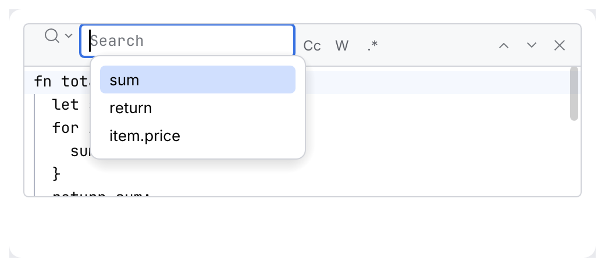
</picture>

Not implemented: the Exclude button and strike-through of excluded matches, the filter and More
menus (scroll to results while typing is always on), the "Click to highlight" link past 10 000
matches, empty-match boxes, and a 30 ms delay before a typed query is applied (results are
cached per query and recomputed in the frame, so there is nothing to wait for).

### Folding

The regions are the model's `FoldingModel`: add them from your own folding provider
(`editor.folding.add_region(..)`) with `.folding(true)`, or let `.bracket_folding(true)` derive
them from `{…}` and `[…]` pairs spanning several lines (strings in `"` are skipped), which
suits JSON. A collapsed region shows its placeholder and hides its lines; a caret never stays
inside it, and a find jump unfolds what it needs. <kbd>Ctrl</kbd>+<kbd>-</kbd> and
<kbd>Ctrl</kbd>+<kbd>=</kbd> collapse and expand the region at the caret (the model's
`CollapseRegion` and `ExpandRegion`).

## Editing

<picture>
  <source media="(prefers-color-scheme: dark)" srcset="img/code_editor.dark.png">
  
</picture>

Typing behavior is the model's and its `EditorSettings` (tab and indent size, whether to indent
with tabs, auto-pairing of brackets and quotes, smart indent, ...):

```rust
use archipel_kit::editor::model::Editor;

let mut editor = Editor::new("");
editor.settings.tab_size = 2;
editor.settings.indent_size = 2;
editor.settings.auto_pair_quotes = false;
```

- <kbd>Tab</kbd> inserts spaces up to the next indent stop; over selected lines it indents them,
  <kbd>Shift</kbd>+<kbd>Tab</kbd> unindents. While <kbd>Tab</kbd> indents the focus cannot leave by it;
  <kbd>Esc</kbd> leaves when there is nothing else for it to do.
- <kbd>Enter</kbd> keeps the indentation, splits `{|}` onto three lines; typing an opener inserts the
  pair, typing the closer skips over it, backspace inside an empty pair removes both, an
  opener typed over a selection wraps it.
- Multiple carets, column selection, duplicate, move and join lines, comment, toggle case,
  whole-line copy and cut, word-wise delete and the rest of the keymap are the model's.
- Undo and redo are the model's: a run of typing is one step, the first undo after moving the
  caret only restores it.

**Size.** A document is a `String` with a line index; a keystroke edits it in place and the
component lays out only the visible rows, so editing stays responsive in large documents.
Beyond a few MB the per-edit scan of the longest line and the fold regions is what you feel.

## Highlighting

<picture>
  <source media="(prefers-color-scheme: dark)" srcset="img/code_highlighting.dark.png">
  
</picture>

A `SyntaxHighlighter` maps a line to styled `Span`s by `TextAttributesKey` (keyword, string, number, comment,
punctuation, property, tag, attribute, variable, error, and `Value(ValueKind)` for typed data
values). Colors come from the theme's `EditorColors` (`keyword`, `string`, … in dark and
light), never from the highlighter. Built in: `Json`, `ExtendedJson` (MongoDB's shell form:
unquoted keys, `ObjectId("…")`, `ISODate("…")`, `NumberLong(…)` colored as the id, date or
number they make, the same `ValueKind` colors tables and trees use), `Xml` (also HTML),
`GraphQl`, `JavaScript` and `PlainText`, all small hand-written tokenizers without
dependencies. Plug in your own, for example the IDE's
tree-sitter:

```rust
use archipel_kit::editor::model::Editor;
use archipel_kit::editor::EditorComponent;
use archipel_kit::editor::{SyntaxHighlighter, Span, TextAttributesKey};
use archipel_kit::egui;

/// Marks `TODO` and `FIXME` in a log.
struct Markers;

impl SyntaxHighlighter for Markers {
    fn highlight_line(&self, line: &str, _state: &mut u32, out: &mut Vec<Span>) {
        for word in ["TODO", "FIXME"] {
            for (start, found) in line.match_indices(word) {
                out.push(Span { start, end: start + found.len(), kind: TextAttributesKey::Keyword });
            }
        }
        out.sort_by_key(|span| span.start);
    }

    // No construct continues on the next line: jumping to any line is free.
    fn stateless(&self) -> bool {
        true
    }
}

fn log_view(ui: &mut egui::Ui, log: &mut Editor) {
    EditorComponent::new(log).label("Log").highlighter(&Markers).viewer(true).show(ui);
}
```

`highlight_line` gets the line without its break and a `state` that starts at `0` and carries
what the previous line left (a block comment still open), for constructs spanning lines.
`highlight_text` has a default that runs it over a whole text; override it when the tokenizer
wants the whole text, as a syntax tree does. The spans of lines longer than 4 KB are cached,
so even a one-line 10 MB body tokenizes once.

## Single-line fields and `{{variables}}`

<picture>
  <source media="(prefers-color-scheme: dark)" srcset="img/template_field.dark.png">
  
</picture>

A URL bar or a header value is a single line, so it is a [`JBTextField`](jb-text-field.md) with
`.highlighter(&dyn SyntaxHighlighter)`, not a one-line `EditorComponent`: it keeps the field's height,
focus ring, placeholder, clear button, leading icon and error message, so a highlighted input
and a plain one sit side by side in a form and look the same. The text never wraps and
<kbd>Enter</kbd> never inserts a newline: `show` reports `submitted`, and `lost_focus()` is set
too. Any `SyntaxHighlighter` works; `TextAttributesKey` has `Resolved`, `Unresolved` and `Secret` for
variables, drawn like in the editor: the variable color, the invalid color (with a dotted
underline in the field) and the string color on a tint. `TextAttributesKey` is `#[non_exhaustive]`.

`TemplateHighlighter` finds `{{name}}` tokens and asks your closure what each one is. It wraps
an inner highlighter for the text between them (`.inner(Json)`; plain text by default). A token
still being typed (`{{ba`) is drawn as a plain variable until it is closed.

```rust
use archipel_kit::ui::JBTextField;
use archipel_kit::editor::{TemplateHighlighter, TemplateToken};
use archipel_kit::egui;

fn url_bar(ui: &mut egui::Ui, url: &mut String) -> bool {
    let highlighter = TemplateHighlighter::new(|name: &str| match name {
        "token" => TemplateToken::Secret,
        "base_url" | "user_id" => TemplateToken::Resolved,
        _ => TemplateToken::Unresolved,
    });
    let out = JBTextField::new(url)
        .label("URL")
        .placeholder("https://example.com")
        .monospace(true)
        .highlighter(&highlighter)
        .show(ui);
    out.submitted
}
```

### Autocomplete

`.completer(&dyn Completer)` (the `Completer` trait, IntelliJ's `CompletionContributor`) gives a
field a completion popup (IntelliJ `Lookup`), drawn and operated by the kit. The completer is
any `Fn(&str, usize) -> Option<Completions>`: given the text and the caret (a char index) it
returns where the replaced part starts and the suggestions (`Completion`, IntelliJ
`LookupElement`), or `None` when nothing completes there. It may return everything it knows:
the kit narrows and sorts the suggestions by what was typed since the start of the identifier
before the caret (`PrefixMatcher`, ranked by `MatchKind`: prefix, then camel humps, then words, then substrings, all
ignoring case; an exact-case match sorts first; ties keep the completer's order and put
recently chosen items first). <kbd>Enter</kbd> with no list open still submits.

Each suggestion is one row (`LookupElementPresentation`): an `.icon(..)`, the label with the
fragments that match drawn in the link color (`CompletionPopup.matchForeground`), a gray
`.tail_text(..)` right after it and a gray `.type_text(..)` (`.detail(..)`) right-aligned;
`.bold()` and `.strikeout()` style the label, `.lookup_string(..)` changes what is matched and
`.documentation(..)` fills the documentation popup. A `Completer` may also override
`complete_extended` (second <kbd>Ctrl</kbd>+<kbd>Space</kbd>), `recency` (the caller's
`LookupStats`), `auto_popup_delay`, `auto_insert_single`, `advertisement` (a line under the
rows), `auto_show_documentation` and `filters_by_prefix` (`false` for combo-box style
completers that filter and replace whole values themselves).

| Rule | Behavior |
|---|---|
| Opens | After a letter, digit or `_` is typed, without delay (`auto_popup_delay` adds one); never after other characters. <kbd>Ctrl</kbd>+<kbd>Space</kbd> opens it anywhere and, pressed again, asks for `complete_extended`. An explicit request that finds exactly one item inserts it at once. |
| Move | <kbd>Up</kbd>/<kbd>Down</kbd> wrap around at the ends; <kbd>PgUp</kbd>/<kbd>PgDn</kbd> move by 10 rows and stop at the ends. <kbd>Home</kbd>, <kbd>End</kbd> and the other caret keys move the caret: the list follows the prefix and closes when the caret leaves it. |
| Insert | <kbd>Enter</kbd> replaces the typed prefix and keeps the text after the caret; <kbd>Tab</kbd> also replaces the rest of the identifier after the caret; <kbd>Ctrl</kbd>+<kbd>.</kbd> inserts and types a dot. |
| Context characters | `.` `,` `;` `=` space `:` `(` insert the selected item and are then typed (so `(` gets the editor's auto-closing). Any other non-identifier character closes the list and is typed; `-` stays in the prefix while something matches. |
| Backspace | Narrows and widens the list; closes it when the prefix becomes empty (an explicitly opened list closes when the caret passes its start). |
| Mouse | A click selects a row, a double click inserts it. The wheel scrolls the rows. |
| Close | <kbd>Esc</kbd> (the editor keeps the focus), losing the focus, an empty list. |
| Documentation | <kbd>Ctrl</kbd>+<kbd>Q</kbd> (also <kbd>Ctrl</kbd>+<kbd>J</kbd>, <kbd>F1</kbd>) toggles the documentation of the selected item beside the list; a completer can ask for it to show by itself after 500 ms. |
| Multiple carets | The insertion applies at every caret whose text before it ends in the same prefix, as one undo step. |
| Layout | At most 11 rows of 24 pt, then it scrolls; a 4 pt body inset, a selection capsule inset by 2 more (radius 4, `CompletionPopup.selectionBackground`); icon 16 pt after 6 pt, 4 pt to the text, 10 pt after the type text. As wide as the widest row (at least 180 pt). It sits under the caret's line with the item text aligned to the start of the typed prefix, above it when there is no room below. |
| Result | `EditorComponentResponse::completed` is the item inserted this frame, to record in `LookupStats`. |

```rust
use archipel_kit::ui::{Completion, Completions, JBTextField};
use archipel_kit::egui;

/// `{{` before the caret: offer the environment's variables.
fn variables(text: &str, caret: usize) -> Option<Completions> {
    let before: String = text.chars().take(caret).collect();
    let open = before.rfind("{{")?;
    let typed = &before[open + 2..];
    (!typed.contains("}}")).then(|| Completions {
        start: before[..open].chars().count(),
        end: caret,
        items: ["base_url", "token"]
            .into_iter()
            .filter(|v| v.starts_with(typed))
            .map(|v| Completion::new(v, format!("{{{{{v}}}}}")).detail("Local"))
            .collect(),
    })
}

fn url_bar(ui: &mut egui::Ui, url: &mut String) -> bool {
    JBTextField::new(url).name("URL").monospace(true).completer(&variables).show(ui).submitted
}
```

<picture>
  <source media="(prefers-color-scheme: dark)" srcset="img/jb_text_field_completion.dark.png">
  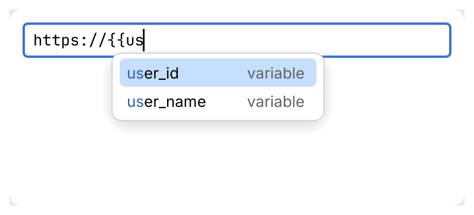
</picture>

A popup with matched fragments (`gS` matches `getString`, `setString` and `GetStringRequest` by
their humps), tail and type text, a deprecated (struck out) and a bold item, and an advertiser
line; the same with the documentation of the selected item; and the popup above the caret when
the window has no room below:

<picture>
  <source media="(prefers-color-scheme: dark)" srcset="img/lookup.dark.png">
  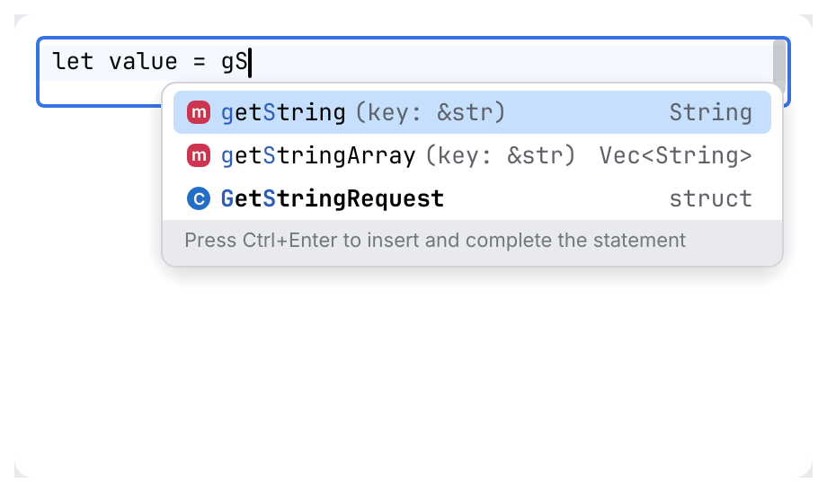
</picture>

<picture>
  <source media="(prefers-color-scheme: dark)" srcset="img/lookup_docs.dark.png">
  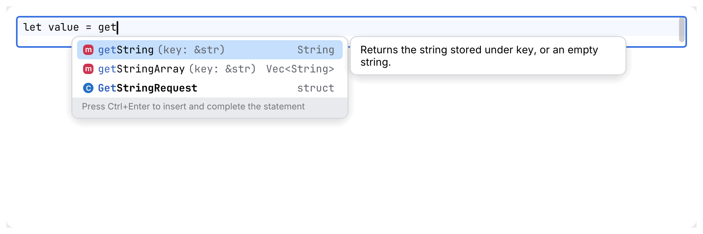
</picture>

<picture>
  <source media="(prefers-color-scheme: dark)" srcset="img/lookup_above.dark.png">
  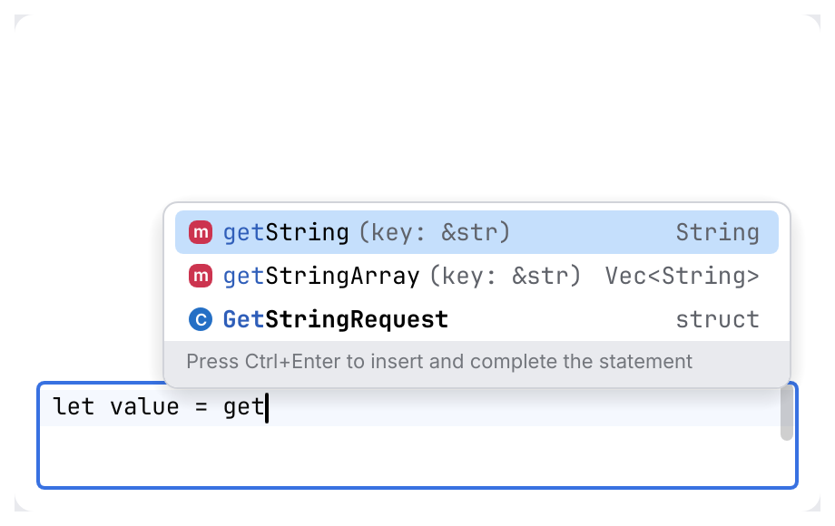
</picture>

Tests: [`tests/completion.rs`](../../crates/archipel-kit/tests/completion.rs) and
[`tests/lookup.rs`](../../crates/archipel-kit/tests/lookup.rs) (one test per rule above).

### The caret and your own list

To draw a different list, the field reports the caret instead:

`JBTextField::show` returns a `JBTextFieldOutput`:

| Field | Meaning |
|---|---|
| `response` | The text edit's response (`changed()`, `has_focus()`, `lost_focus()`). |
| `submitted` | The field lost focus because <kbd>Enter</kbd> was pressed. |
| `caret_rect` | The caret as a screen rectangle; anchor a `ui::popup::JBPopup` on it. |
| `template` | `Option<TemplateAt>`: the `{{variable}}` the caret is in or just after. |
| `insert_completion(ctx, &mut text, name)` | Replaces the token with `{{name}}`, puts the caret after it and focuses the field. |

`TemplateAt` has `range` (byte range of the whole token, including a closing `}}` that is
already there), `partial` (the name typed before the caret: `us` for `{{us|er}}`), `name` and
`closed`. The caret counts as "at" a token after its opening `{{` and up to its end; right
before `{{` or after `}}` it is not. `template_at(text, byte)` is the same detection as a plain
function. The last caret is remembered per field, so `template` stays valid when a click on a
suggestion has already moved the focus.

The field does not draw the suggestions: the caller owns the list, so it can come from an
environment, a request history or a language server. This is the whole wiring with `ActionMenuItem`s
and the keyboard. The keys are consumed **before** the field, while the list is open, so the
field does not move its caret on <kbd>Up</kbd>/<kbd>Down</kbd> or submit on <kbd>Enter</kbd>:

```rust
use archipel_kit::editor::{TemplateHighlighter, TemplateToken};
use archipel_kit::{action_system::ActionMenuItem, ui::JBTextField};
use archipel_kit::egui::{self, Key, Modifiers};
use archipel_kit::ui::popup::JBPopup;

const VARIABLES: [&str; 3] = ["base_url", "user_id", "user_name"];

/// The state of the bar: yours, the kit keeps none.
#[derive(Default)]
struct UrlBar {
    url: String,
    open: bool,
    selected: usize,
    matches: Vec<&'static str>,
}

/// Returns `true` when the user pressed Enter with no list open.
fn url_bar(ui: &mut egui::Ui, bar: &mut UrlBar) -> bool {
    let highlighter = TemplateHighlighter::new(|name: &str| {
        if VARIABLES.contains(&name) { TemplateToken::Resolved } else { TemplateToken::Unresolved }
    });

    // The list was open last frame: it owns the navigation keys.
    let listing = bar.open && !bar.matches.is_empty();
    let (mut down, mut up, mut accept) = (false, false, false);
    if listing {
        ui.input_mut(|i| {
            down = i.consume_key(Modifiers::NONE, Key::ArrowDown);
            up = i.consume_key(Modifiers::NONE, Key::ArrowUp);
            accept = i.consume_key(Modifiers::NONE, Key::Enter);
            if i.consume_key(Modifiers::NONE, Key::Escape) {
                bar.open = false;
            }
        });
    }

    let out = JBTextField::new(&mut bar.url)
        .label("URL")
        .monospace(true)
        .highlighter(&highlighter)
        .show(ui);

    // Filter by what was typed of the name; open on every edit.
    bar.matches = match &out.template {
        Some(token) => VARIABLES.into_iter().filter(|v| v.starts_with(token.partial.as_str())).collect(),
        None => Vec::new(),
    };
    if out.response.changed() {
        bar.open = true;
        bar.selected = 0;
    }
    // Tabbing away closes the list; a click is the popover's (outside) or an item's (inside).
    let clicking = ui.input(|i| i.pointer.any_pressed() || i.pointer.any_released());
    if bar.matches.is_empty() || out.response.lost_focus() && !clicking {
        bar.open = false;
    }

    let last = bar.matches.len().saturating_sub(1);
    if down { bar.selected = (bar.selected + 1).min(last); }
    if up { bar.selected = bar.selected.saturating_sub(1); }
    bar.selected = bar.selected.min(last);
    if accept && let Some(name) = bar.matches.get(bar.selected) {
        out.insert_completion(ui.ctx(), &mut bar.url, name);
        bar.open = false;
    }

    if let Some(caret) = out.caret_rect {
        let (matches, selected) = (bar.matches.clone(), bar.selected);
        let mut picked = None;
        JBPopup::new("url-completions", caret).width(220.0).show(ui.ctx(), &mut bar.open, |ui| {
            for (i, name) in matches.iter().enumerate() {
                if ui.add(ActionMenuItem::new(*name).highlighted(i == selected)).clicked() {
                    picked = Some(*name);
                }
            }
        });
        if let Some(name) = picked {
            out.insert_completion(ui.ctx(), &mut bar.url, name);
            bar.open = false;
        }
    }
    out.submitted && !accept
}
```

<picture>
  <source media="(prefers-color-scheme: dark)" srcset="img/template_autocomplete.dark.png">
  
</picture>

`ActionMenuItem::highlighted(true)` paints the hover fill for the row the keyboard is on.
<kbd>Escape</kbd> is consumed by the wiring while the list is open (a second press leaves the
field as usual), and the popover also closes on a click outside it. The suggestion rows are
operated from the field like a combobox list, not by <kbd>Tab</kbd>. The audit therefore runs on
the field, and the list is covered by the keyboard and click tests in
[`tests/template_field.rs`](../../crates/archipel-kit/tests/template_field.rs), which run this
same wiring.

## Behavior

- Focus draws the accent outline of text fields. The cursor is the text beam over the text and
  the arrow over the gutter and a selection.
- The text is a monospace grid: tabs expand to the model's tab size and every `char` takes one
  cell, so wide or combining characters are approximate.
- Nothing is stored in the kit: the document, carets, folds and settings are the caller's
  `Editor`; the scroll offset, the find bar's state and the blink live in the egui context, keyed by
  the component's id.

## Accessibility

A viewer is a `Document` and an editor a `TextInput`, both named by `.label(...)` with the
text as their value (up to 64 KB). The fold chevrons and gutter icons are buttons ("Fold lines
3 to 9", "Breakpoint on line 12"). The find bar's fields are "Find" and "Replace with"; its buttons are "Search history",
"Previous match", "Next match", "Close find", "Replace" and "Replace All", and its toggles
"Match Case", "Words", "Regex" and "Preserve Case" report their state. The status text
is a label.

## Testing

```rust
use archipel_kit::editor::model::Editor;
use archipel_kit::editor::EditorComponent;
use archipel_kit::testing::{self, NodeExt, Queryable, Role};
use archipel_kit::Theme;
use archipel_kit::egui::Key;

let mut harness = testing::harness_state(Theme::dark(), (Editor::new("{}"), Editor::new("")), |ui, (viewer, editor)| {
    EditorComponent::new(viewer).label("Response").viewer(true).height(60.0).show(ui);
    ui.add(EditorComponent::new(editor).label("Request").height(100.0));
});
assert_eq!(harness.get_by_label("Response").role(), Role::Document);

let request = harness.get_by_label("Request");
request.focus();
request.type_text("{");
harness.key_press(Key::Enter);
harness.run();
assert_eq!(harness.state().1.document.text(), "{\n    \n}");
```

Source: [`editor/`](../../crates/archipel-kit/src/editor/) ·
Tests: [`tests/code.rs`](../../crates/archipel-kit/tests/code.rs),
[`tests/editor_component.rs`](../../crates/archipel-kit/tests/editor_component.rs)
