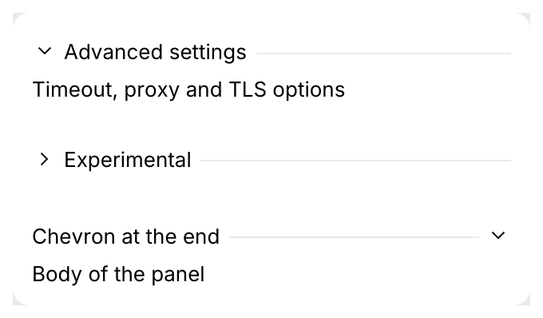

# CollapsiblePanel

A titled group that shows and hides its content (IntelliJ's `CollapsiblePanel`; the
"Advanced settings" of a form). Its header is a `TitledSeparator` with a chevron.

<picture>
  <source media="(prefers-color-scheme: dark)" srcset="img/collapsible_panel.dark.png">
  
</picture>

## Usage

```rust
use archipel_kit::ui::CollapsiblePanel;
use archipel_kit::egui;

fn advanced(ui: &mut egui::Ui, collapsed: &mut bool) {
    let out = CollapsiblePanel::new("Advanced settings", collapsed).show(ui, |ui| {
        ui.label("Timeout, proxy and TLS options");
    });
    if out.toggled() {
        // Remember the new state.
    }
}
```

`CollapsiblePanelResponse` has the header's `Response` and the content's value (`None` while
collapsed). `.collapse_button_at_left(false)` moves the chevron to the end of the line.

## Behavior

| Input | Effect |
|---|---|
| Click anywhere on the header row | Toggle. |
| <kbd>Enter</kbd> or <kbd>Space</kbd> with the header focused | Toggle. The header is reached with <kbd>Tab</kbd>. |

The title is a `TitledSeparator`: regular weight in the text color, a 1 pt line 6 pt after it
(measured on Android Studio; the IDE source says 8), the chevron 16 pt wide with a 4 pt gap.
`TitledSeparator::chevron_at_end(true)` is the same option on the separator itself.

Source: [`ui/collapsible_panel.rs`](../../crates/archipel-kit/src/ui/collapsible_panel.rs) ·
Tests: [`tests/status_and_loading.rs`](../../crates/archipel-kit/tests/status_and_loading.rs)
