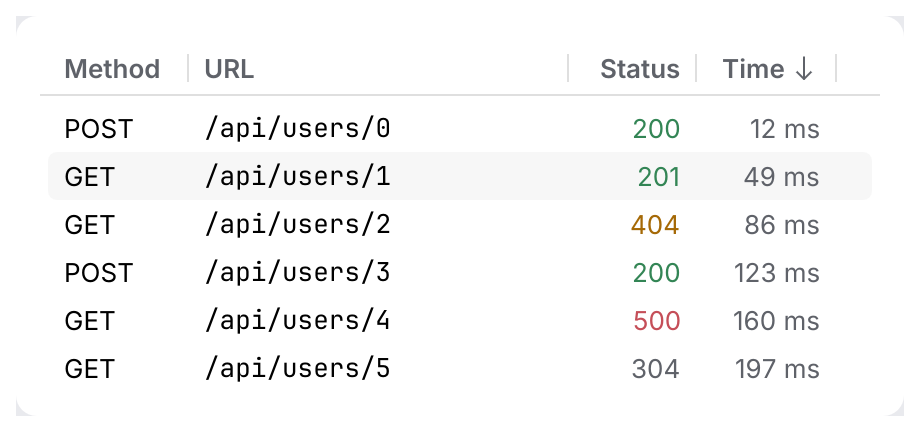
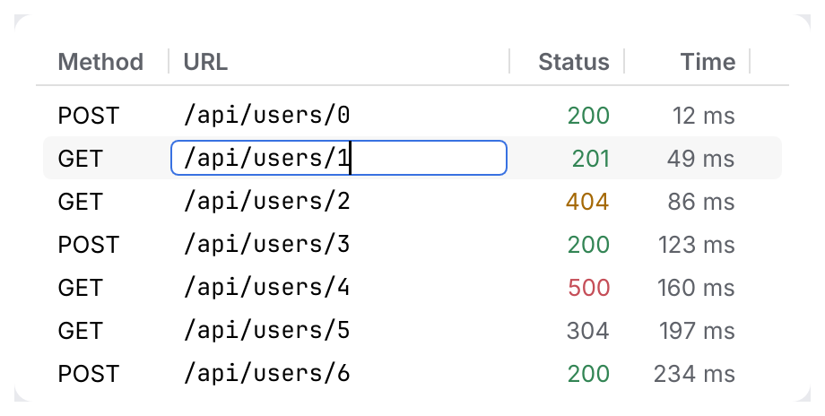

# VirtualList, Tree, Table

> Need a tree with columns, or editable cells? See [`TreeTable`](tree-table.md).

Collections that draw **only the visible rows**, so they stay fast with hundreds of
thousands of items: request history, project and structure trees, query results.

<picture>
  <source media="(prefers-color-scheme: dark)" srcset="img/virtual_list.dark.png">
  
</picture>

<picture>
  <source media="(prefers-color-scheme: dark)" srcset="img/tree.dark.png">
  
</picture>

<picture>
  <source media="(prefers-color-scheme: dark)" srcset="img/table.dark.png">
  
</picture>

### Table: edit cells and reorder columns

<picture>
  <source media="(prefers-color-scheme: dark)" srcset="img/table_edit.dark.png">
  
</picture>

Two opt-in extensions, both backward compatible (a table that uses neither behaves as before):

- **Inline edit**, the same as in [`TreeTable`](tree-table.md): mark cells `Cell::editable(true)`;
  <kbd>F2</kbd>, <kbd>Enter</kbd> or a double-click opens a field in the cell, <kbd>Enter</kbd>
  commits, <kbd>Escape</kbd> cancels. A commit arrives as `CollectionResponse::edited`
  (`CellEdit` with row, column and text). The table never changes your data.
- **Column reorder**: `Table::reorderable(true)` makes the headers drag sources and drop
  targets (`behaviour::DragSource` / `DropTarget`). Dropping a header on another one reports
  the new order in `CollectionResponse::column_order` (`order[new_position] = old_index`).
  You own the column order: apply it to your columns, and map the column indices your cell
  callback receives (they are positions) to your data. Clicking still sorts and the edge
  still resizes.

```rust
use archipel_kit::components::{Cell, Column, Table};
use archipel_kit::egui;

struct Grid {
    columns: Vec<Column>,
    /// The data column shown at each position.
    order: Vec<usize>,
    selected: Option<usize>,
    names: Vec<String>,
}

fn grid(ui: &mut egui::Ui, grid: &mut Grid) {
    let order = grid.order.clone();
    let names = grid.names.clone();
    let out = Table::new("grid", &mut grid.columns, names.len(), &mut grid.selected)
        .reorderable(true)
        .show(ui, |row, position| match order[position] {
            0 => Cell::new(row.to_string()).muted(),
            _ => Cell::new(names[row].as_str()).editable(true),
        });
    if let Some(edit) = out.edited {
        grid.names[edit.row] = edit.text;
    }
    if let Some(new) = out.column_order {
        grid.columns = new.iter().map(|&i| grid.columns[i].clone()).collect();
        grid.order = new.iter().map(|&i| grid.order[i]).collect();
    }
}
```

## The model

All three work the same way:

- **You own the data and the selection.** The widget borrows `&mut Option<usize>` and asks
  you for the rows it draws. It never copies or caches your data.
- **The widget owns the keys.** The collection takes focus as a whole, so <kbd>Tab</kbd>
  reaches it once, not on every row. <kbd>↑</kbd>/<kbd>↓</kbd>, <kbd>Home</kbd>/<kbd>End</kbd>
  and <kbd>PgUp</kbd>/<kbd>PgDn</kbd> move the selection and scroll it into view.
  <kbd>Enter</kbd> or a double-click activates a row.
- **It reports what happened** in a `CollectionResponse`: `selection_changed`, `activated`,
  `toggled` (trees) and `sort_clicked` (tables).

A selection is blue while the collection has focus and gray when focus is elsewhere, as in
the IDE.

## Usage

```rust
use archipel_kit::components::{
    Cell, Column, ListRow, SortOrder, Table, Tree, TreeRow, VirtualList,
};
use archipel_kit::{Glyph, egui};

fn history(ui: &mut egui::Ui, urls: &[String], selected: &mut Option<usize>) {
    let out = VirtualList::new("history", urls.len(), selected)
        .height(240.0)
        .show(ui, |i| ListRow::new(&urls[i]).icon(Glyph::Send));
    if let Some(i) = out.activated {
        println!("open {}", urls[i]);
    }
}

struct Node {
    name: String,
    children: Vec<Node>,
    expanded: bool,
}

/// Flattens the expanded part of the tree into rows, remembering the path to each row.
fn flatten<'a>(node: &'a Node, depth: usize, rows: &mut Vec<TreeRow>, paths: &mut Vec<Vec<usize>>, path: Vec<usize>) {
    let mut row = TreeRow::new(&node.name, depth);
    if !node.children.is_empty() {
        row = row.icon(Glyph::Folder).parent(node.expanded);
    }
    rows.push(row);
    paths.push(path.clone());
    if node.expanded {
        for (i, child) in node.children.iter().enumerate() {
            let mut child_path = path.clone();
            child_path.push(i);
            flatten(child, depth + 1, rows, paths, child_path);
        }
    }
}

fn project(ui: &mut egui::Ui, root: &mut Node, selected: &mut Option<usize>) {
    let (mut rows, mut paths) = (Vec::new(), Vec::new());
    flatten(root, 0, &mut rows, &mut paths, Vec::new());
    let out = Tree::new("project", &rows, selected).show(ui);
    if let Some(i) = out.toggled {
        let mut node = &mut *root;
        for &step in &paths[i] {
            node = &mut node.children[step];
        }
        node.expanded = !node.expanded;
    }
}

fn results(
    ui: &mut egui::Ui,
    columns: &mut [Column],
    docs: &[(String, u32)],
    selected: &mut Option<usize>,
    sort: &mut Option<(usize, SortOrder)>,
) {
    let out = Table::new("results", columns, docs.len(), selected)
        .sort(*sort)
        .show(ui, |row, col| match col {
            0 => Cell::new(&docs[row].0),
            _ => Cell::new(docs[row].1.to_string()),
        });
    if let Some(col) = out.sort_clicked {
        *sort = Some(match *sort {
            Some((c, order)) if c == col => (col, order.reversed()),
            _ => (col, SortOrder::Ascending),
        });
        // Sort `docs` by the column here.
    }
}
```

## API

| Item | Builders and fields |
|---|---|
| `VirtualList::new(id, len, &mut selected)` | `.height(f32)`, `.show(ui, \|index\| ListRow)` |
| `VirtualList` as a tree | Rows with `.expanded(Some(..))` report `toggled` on <kbd>→</kbd> (collapsed) and <kbd>←</kbd> (expanded). |
| `Tree::new(id, &rows, &mut selected)` | `.height(f32)`, `.show(ui)`, `.show_with(ui, \|index, row\| row)` |
| `TreeRow::new(label, depth)` | `.parent(expanded)`, `.icon(Icon)`, `.secondary(str)` |
| `Table::new(id, &mut columns, len, &mut selected)` | `.sort(Option<(column, SortOrder)>)`, `.reorderable(bool)`, `.height(f32)`, `.show(ui, \|row, column\| Cell)` |
| `Column::new(title, width)` | `.right()`, `.mono()`; `width` is public and changes when the user drags a header edge |
| `Cell::new(text)` | `.editable(bool)`, `.icon(Icon)`, `.color(Color32)`, `.muted()`; `&str` and `String` convert into cells |
| `CollectionResponse` | `response`, `selection_changed`, `activated`, `toggled`, `sort_clicked`, `edited`, `column_order` |

## Behavior

- **Trees.** You flatten your tree into the visible rows and keep the expanded state.
  <kbd>→</kbd> expands a collapsed node, or moves to its first child when it is already
  expanded. <kbd>←</kbd> collapses an expanded node, or moves to its parent. The chevron and
  a double-click on a parent toggle it too. Each of these reports `toggled`. A `VirtualList`
  of `ListRow`s with an expanded state toggles on <kbd>→</kbd>/<kbd>←</kbd> the same way (it
  has no parent or child to walk to, as it does not know the tree).
- **Per-row behaviours.** `Tree::show_with` hands each visible row to your closure before it
  is drawn: add a context menu, a drag source or a drop target with `.with(...)`, or a tint,
  a trailing slot, a semibold label. The closure may be called every frame for every
  visible row, so share state between rows with a `Cell` (`DropTarget::shared`) rather than
  `&mut`.
- **Tables.** Clicking a header reports `sort_clicked`. You sort the data and pass the order
  back with `.sort`, which draws the arrow. Drag a header edge to resize a column (minimum
  40 points). Right-aligned columns are for numbers. Cells clip at the column edge. With
  `.reorderable(true)` the header shows the open hand on hover and the closed hand while
  dragging (the kit's drag cursors) instead of the pointing hand, and the drop target is
  outlined.
- **Rows** are 24 points high. Only the rows in view are laid out and painted, and the scroll
  bar reflects all rows.

## Accessibility

Rows are selectable labels, named by their text, with their selected state. A table row is
named by its cells joined with commas, for example `GET, /api/users/1, 201, 49 ms`. Table
headers are buttons. Only visible rows are in the accessibility tree, like the pixels.

Source: [`components/collections/`](../../crates/archipel-kit/src/components/collections/mod.rs) ·
Tests: [`tests/collections.rs`](../../crates/archipel-kit/tests/collections.rs)
