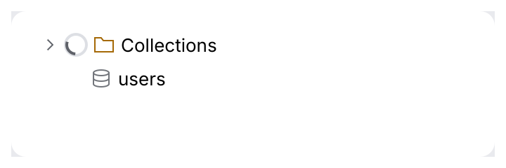
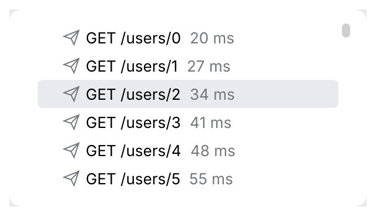
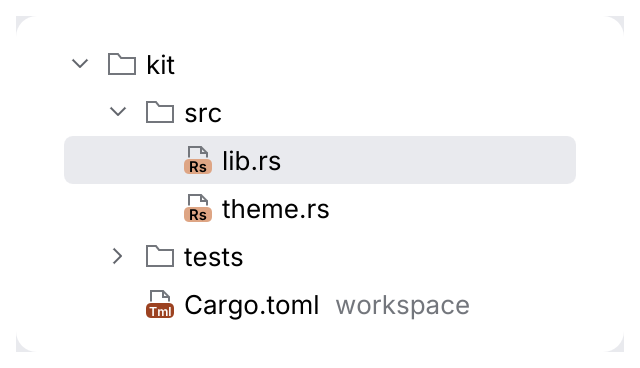
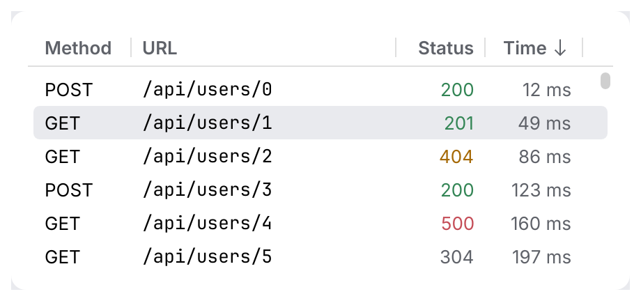
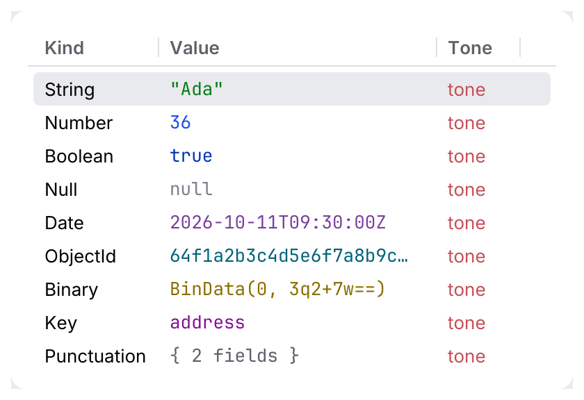
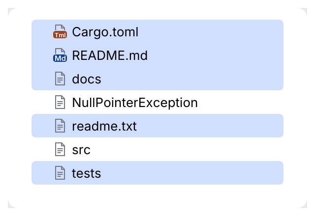
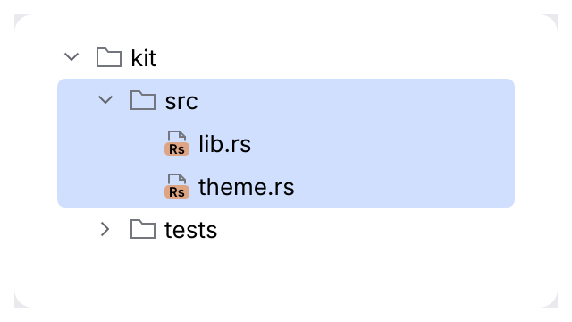

# JBList, Tree, JBTable

Loading tree rows retain selection and expansion keys while showing a named spinner.
Double-clicking a parent toggles it and gives the tree keyboard focus.

<picture>
  <source media="(prefers-color-scheme: dark)" srcset="img/tree_busy.dark.png">
  
</picture>

> Need a tree with columns, or editable cells? See [`TreeTable`](tree-table.md).

Collections that draw **only the visible rows**, so they stay fast with hundreds of
thousands of items: request history, project and structure trees, query results.

<picture>
  <source media="(prefers-color-scheme: dark)" srcset="img/jb_list.dark.png">
  
</picture>

<picture>
  <source media="(prefers-color-scheme: dark)" srcset="img/tree.dark.png">
  
</picture>

<picture>
  <source media="(prefers-color-scheme: dark)" srcset="img/jb_table.dark.png">
  
</picture>

### JBTable: edit cells and reorder columns

<picture>
  <source media="(prefers-color-scheme: dark)" srcset="img/jb_table_edit.dark.png">
  
</picture>

Two opt-in extensions, both backward compatible (a table that uses neither behaves as before):

- **Inline edit**, the same as in [`TreeTable`](tree-table.md): mark cells `Cell::editable(true)`;
  <kbd>F2</kbd>, <kbd>Enter</kbd> or a double-click opens a field in the cell, <kbd>Enter</kbd>
  commits, <kbd>Escape</kbd> cancels. A commit arrives as `CollectionResponse::edited`
  (`CellEdit` with row, column and text). The table never changes your data.
- **Column reorder**: `JBTable::reorderable(true)` makes the headers drag sources and drop
  targets (`behaviour::DragSource` / `DropTarget`). Dropping a header on another one reports
  the new order in `CollectionResponse::column_order` (`order[new_position] = old_index`).
  You own the column order: apply it to your columns, and map the column indices your cell
  callback receives (they are positions) to your data. Clicking still sorts and the edge
  still resizes.

```rust
use archipel_kit::ui::{Cell, ColumnInfo, JBTable};
use archipel_kit::egui;

struct Grid {
    columns: Vec<ColumnInfo>,
    /// The data column shown at each position.
    order: Vec<usize>,
    selected: Option<usize>,
    names: Vec<String>,
}

fn grid(ui: &mut egui::Ui, grid: &mut Grid) {
    let order = grid.order.clone();
    let names = grid.names.clone();
    let out = JBTable::new("grid", &mut grid.columns, names.len(), &mut grid.selected)
        .reorderable(true)
        .show(ui, |row, position| match order[position] {
            0 => Cell::new(row.to_string()).muted(),
            _ => Cell::new(names[row].as_str()).editable(true),
        });
    if let Some(edit) = out.edited {
        grid.names[edit.row] = edit.text;
    }
    if let Some(new) = out.column_order {
        grid.columns = new.iter().map(|&i| grid.columns[i].clone()).collect();
        grid.order = new.iter().map(|&i| grid.order[i]).collect();
    }
}
```

### Typed values

<picture>
  <source media="(prefers-color-scheme: dark)" srcset="img/jb_table_value_kinds.dark.png">
  
</picture>

`Cell::value_kind(ValueKind)` colors a cell like the code editor colors the same kind of value
(`String`, `Number`, `Boolean`, `Null`, `Date`, `Id`, `Binary`, `Key`, `Punctuation`; see
[theming](../theming.md)): for document and JSON views, in `JBTable` and `TreeTable`. Like
`.tone(Tone)` the color stays when the row is selected, and the last of the two calls wins.
Use a tone for meaning (a 500 in red) and a kind for the type of data.

## The model

All of them work the same way:

- **You own the data and the selection.** The widget borrows `&mut Option<usize>` (one row)
  or a [`ListSelectionModel`](#several-rows-listselectionmodel) (several rows, with anchor and
  lead) and asks you for the rows it draws. It never copies or caches your data.
- **The widget owns the keys.** The collection takes focus as a whole, so <kbd>Tab</kbd>
  reaches it once, not on every row. The keys below move the selection and scroll it into
  view.
- **It reports what happened** in a `CollectionResponse`: `selection_changed`, `activated`,
  `toggled` (trees), `sort_clicked` (tables), `secondary_clicked` (right click) and
  `empty_text_link`.

A selection is blue while the collection has focus and the window is active, and gray when
focus is elsewhere or the window is inactive, as in the IDE. The rows have no hover fill.

## Several rows: ListSelectionModel

<picture>
  <source media="(prefers-color-scheme: dark)" srcset="img/jb_list_multi_selection.dark.png">
  
</picture>

Pass `&mut ListSelectionModel` where you passed `&mut Option<usize>`. Like Swing's model it has
a mode (`SelectionMode::Single`, `SingleInterval`, `MultipleInterval`), the selected indices,
an **anchor** (where a <kbd>Shift</kbd> selection starts) and a **lead** (where the keyboard
moves from). Rows that are selected next to each other join into one block: only the outer
corners are round, as in the IDE's trees.

```rust
use archipel_kit::ui::{ColoredListCellRenderer, JBList, ListSelectionModel};
use archipel_kit::egui;

fn files(ui: &mut egui::Ui, names: &[String], selection: &mut ListSelectionModel) {
    let out = JBList::new("files", names.len(), &mut *selection)
        .show(ui, |i| ColoredListCellRenderer::new(&names[i]));
    if out.selection_changed {
        let chosen: Vec<&String> = selection.iter().map(|i| &names[i]).collect();
        println!("{} selected", chosen.len());
    }
}
```

## Keys

| Key | Effect |
|---|---|
| <kbd>↑</kbd> <kbd>↓</kbd> | Select the previous or next row. With nothing selected, the first row. At the ends the selection stays (no wrap around). |
| <kbd>Home</kbd> <kbd>End</kbd> | Select the first or last row. |
| <kbd>PgUp</kbd> <kbd>PgDn</kbd> | Select the first or last fully visible row; pressed again, one page further. |
| <kbd>Shift</kbd> + any of the above | Extend the selection from the anchor to the new lead row. |
| <kbd>Ctrl</kbd>/<kbd>Cmd</kbd> + any of the above | Move the lead (an outline) without changing the selection. |
| <kbd>Ctrl</kbd>/<kbd>Cmd</kbd> + <kbd>Space</kbd> | Toggle the lead row. |
| <kbd>Ctrl</kbd>/<kbd>Cmd</kbd> + <kbd>A</kbd> | Select all rows (several-row modes). |
| <kbd>→</kbd> / <kbd>←</kbd> (trees) | Expand a collapsed node, or select its first child; collapse an expanded node, or select its parent. |
| <kbd>Enter</kbd> | Activate the row; on a tree node with children, expand or collapse it. |
| <kbd>F2</kbd> | Edit the cell, where cells are editable. |
| A letter, digit or punctuation mark | Open the [speed search](speed-search.md). |

## Mouse

| Gesture | Effect |
|---|---|
| Click | Select the row (and only it); the collection takes focus. |
| <kbd>Ctrl</kbd>/<kbd>Cmd</kbd> + click | Toggle the row. |
| <kbd>Shift</kbd> + click | Select the rows between the anchor and the row; the anchor stays. |
| <kbd>Ctrl</kbd> + <kbd>Shift</kbd> + click | Add that range to the selection. |
| Double click | Activate the row; on a tree node with children, expand or collapse it. |
| Right click | If the row is inside the selection, keep the selection; else select the row alone. Reported in `secondary_clicked`; open your menu for the selection (`PopupHandler`). |
| Chevron | Expand or collapse (single click). |

<picture>
  <source media="(prefers-color-scheme: dark)" srcset="img/tree_multi_selection.dark.png">
  
</picture>

## Speed search

Typing in a focused collection opens a [speed search](speed-search.md): pass
`.speed_search(SpeedSearch::new(&mut state))` with a `SpeedSearchState` you keep.

<picture>
  <source media="(prefers-color-scheme: dark)" srcset="img/speed_search.dark.png">
  
</picture>

## Empty text and the scroll bar

A collection with no rows shows "Nothing to show" centered in its viewport, or the
[`StatusText`](status-text.md) you give with `.empty_text(..)`, whose links are reported in
`CollectionResponse::empty_text_link`.

<picture>
  <source media="(prefers-color-scheme: dark)" srcset="img/jb_list_empty.dark.png">
  
</picture>

The scroll bar is the kit's `parts::ScrollBar`: a 7 pt thumb that brightens 150 ms after the
pointer enters its strip (over 125 ms) and dims 300 ms after it leaves (over 125 ms), as in
the IDE. Drag the thumb, or click the track to scroll a page.

## Usage

```rust
use archipel_kit::ui::{Cell, ColumnInfo, ColoredListCellRenderer, SortOrder, JBTable, Tree, TreeNode, JBList};
use archipel_kit::{Glyph, egui};

fn history(ui: &mut egui::Ui, urls: &[String], selected: &mut Option<usize>) {
    let out = JBList::new("history", urls.len(), selected)
        .height(240.0)
        .show(ui, |i| ColoredListCellRenderer::new(&urls[i]).icon(Glyph::Send));
    if let Some(i) = out.activated {
        println!("open {}", urls[i]);
    }
}

struct Node {
    name: String,
    children: Vec<Node>,
    expanded: bool,
}

/// Flattens the expanded part of the tree into rows, remembering the path to each row.
fn flatten<'a>(node: &'a Node, depth: usize, rows: &mut Vec<TreeNode>, paths: &mut Vec<Vec<usize>>, path: Vec<usize>) {
    let mut row = TreeNode::new(&node.name, depth);
    if !node.children.is_empty() {
        row = row.icon(Glyph::Folder).parent(node.expanded);
    }
    rows.push(row);
    paths.push(path.clone());
    if node.expanded {
        for (i, child) in node.children.iter().enumerate() {
            let mut child_path = path.clone();
            child_path.push(i);
            flatten(child, depth + 1, rows, paths, child_path);
        }
    }
}

fn project(ui: &mut egui::Ui, root: &mut Node, selected: &mut Option<usize>) {
    let (mut rows, mut paths) = (Vec::new(), Vec::new());
    flatten(root, 0, &mut rows, &mut paths, Vec::new());
    let out = Tree::new("project", &rows, selected).show(ui);
    if let Some(i) = out.toggled {
        let mut node = &mut *root;
        for &step in &paths[i] {
            node = &mut node.children[step];
        }
        node.expanded = !node.expanded;
    }
}

fn results(
    ui: &mut egui::Ui,
    columns: &mut [ColumnInfo],
    docs: &[(String, u32)],
    selected: &mut Option<usize>,
    sort: &mut Option<(usize, SortOrder)>,
) {
    let out = JBTable::new("results", columns, docs.len(), selected)
        .sort(*sort)
        .show(ui, |row, col| match col {
            0 => Cell::new(&docs[row].0),
            _ => Cell::new(docs[row].1.to_string()),
        });
    if let Some(col) = out.sort_clicked {
        *sort = Some(match *sort {
            Some((c, order)) if c == col => (col, order.reversed()),
            _ => (col, SortOrder::Ascending),
        });
        // Sort `docs` by the column here.
    }
}
```

## API

| Item | Builders and fields |
|---|---|
| `JBList::new(id, len, selection)` | `selection` is `&mut Option<usize>` or `&mut ListSelectionModel`. `.height(f32)`, `.name(str)`, `.speed_search(SpeedSearch)`, `.empty_text(StatusText)`, `.show(ui, \|index\| ColoredListCellRenderer)` |
| `JBList` as a tree | Rows with `.expanded(Some(..))` report `toggled` on <kbd>→</kbd> (collapsed) and <kbd>←</kbd> (expanded). |
| `Tree::new(id, &rows, selection)` | `.height(f32)`, `.speed_search(..)`, `.empty_text(..)`, `.show(ui)`, `.show_with(ui, \|index, row\| row)` |
| `TreeNode::new(label, depth)` | `.parent(expanded)`, `.icon(Icon)`, `.icon_tone(Tone)`, `.busy(bool)`, `.secondary(str)`, `.append(str, SimpleTextAttributes)` |
| `JBTable::new(id, &mut columns, len, selection)` | `.sort(Option<(column, SortOrder)>)`, `.reorderable(bool)`, `.height(f32)`, `.speed_search(..)`, `.empty_text(..)`, `.show(ui, \|row, column\| Cell)` |
| `ColumnInfo::new(title, width)` | `.right()`, `.mono()`; `width` is public and changes when the user drags a header edge |
| `Cell::new(text)` | `.value_kind(ValueKind)`, `.editable(bool)`, `.icon(Icon)`, `.color(Color32)`, `.muted()`; `&str` and `String` convert into cells |
| `CollectionResponse` | `response`, `selection_changed`, `activated`, `toggled`, `sort_clicked`, `edited`, `column_order`, `secondary_clicked`, `empty_text_link`, `current` |
| `SelectionTarget` | What the constructors take: `&mut Option<usize>` or `&mut ListSelectionModel` convert into it. |
| `ListSelectionModel` | `new(SelectionMode)`, `single()`, `multiple()`, `select`, `toggle`, `set_selection_interval`, `add_selection_interval`, `remove_selection_interval`, `select_all`, `clear`, `iter`, `is_selected`, `anchor`, `lead`, `first`, `last`, `len` |

## Behavior

- **Trees.** You flatten your tree into the visible rows and keep the expanded state.
  <kbd>→</kbd> expands a collapsed node, or moves to its first child when it is already
  expanded. <kbd>←</kbd> collapses an expanded node, or moves to its parent. The chevron,
  <kbd>Enter</kbd> and a double-click on a parent toggle it too. Each of these reports
  `toggled`; a leaf is `activated` instead. A `JBList`
  of `ColoredListCellRenderer`s with an expanded state toggles on <kbd>→</kbd>/<kbd>←</kbd> the same way (it
  has no parent or child to walk to, as it does not know the tree).
- **Per-row behaviours.** `Tree::show_with` hands each visible row to your closure before it
  is drawn: add a context menu, a drag source or a drop target with `.with(...)`, or a tint,
  a trailing slot, a semibold label. The closure may be called every frame for every
  visible row, so share state between rows with a `Cell` (`DropTarget::shared`) rather than
  `&mut`.
- **Tables.** Clicking a header reports `sort_clicked`. You sort the data and pass the order
  back with `.sort`, which draws the arrow. Drag a header edge to resize a column (minimum
  40 points). Right-aligned columns are for numbers. Cells clip at the column edge. With
  `.reorderable(true)` the header shows the open hand on hover and the closed hand while
  dragging (the kit's drag cursors) instead of the pointing hand, and the drop target is
  outlined.
- **Rows** are 24 points high (IntelliJ New UI `List.rowHeight`/`Tree.rowHeight` 24; the selection arc 8 of Swing is a 4 pt radius). Only the rows in view are laid out and painted, and the scroll
  bar reflects all rows.

## Accessibility

Rows are selectable labels, named by their text, with their selected state. A table row is
named by its cells joined with commas, for example `GET, /api/users/1, 201, 49 ms`. JBTable
headers are buttons. Only visible rows are in the accessibility tree, like the pixels.

Source: [`ui/collections/`](../../crates/archipel-kit/src/ui/collections/mod.rs) ·
Tests: [`tests/collections.rs`](../../crates/archipel-kit/tests/collections.rs),
[`tests/collections_selection.rs`](../../crates/archipel-kit/tests/collections_selection.rs),
[`tests/scroll_bar.rs`](../../crates/archipel-kit/tests/scroll_bar.rs)
