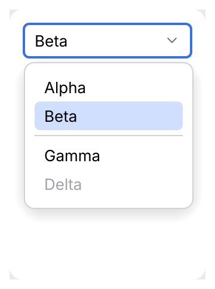

# ComboBox

The list is the kit's popup engine ([`ListPopup`](list-popup.md)): below the combo box (above
when there is no room), as wide as it, ten rows before it scrolls, the value the combo holds
highlighted. The highlight moves without changing the value; the value changes when a row is
chosen. IntelliJ spec section 4 (`ComboBox`, `DarculaComboBoxUI`, `ComboBoxPopup`):

| Input | Closed | Open |
|---|---|---|
| <kbd>Alt</kbd>+<kbd>Down</kbd>, <kbd>F4</kbd> | Opens the list | |
| <kbd>Enter</kbd> (press), <kbd>Space</kbd> (release) | Opens the list | <kbd>Enter</kbd> chooses the highlighted row |
| <kbd>Up</kbd> / <kbd>Down</kbd> | Previous / next value, stopping at the ends | Move the highlight, wrapping; unselectable rows are skipped |
| <kbd>Home</kbd> <kbd>End</kbd> <kbd>PgUp</kbd> <kbd>PgDn</kbd> | | First, last, a page up or down |
| letters | Select the next value starting with the typed prefix; the same letter again cycles; a pause of 1 s starts over | Filter, with `.speed_search(true)` |
| <kbd>Esc</kbd> | Not used (a dialog sees it) | Closes the list, the value stays, focus returns to the combo |
| click | Opens the list | On the combo: closes it (a second click does not reopen it, `POPUP_REOPEN_GUARD`); on a row: chooses; outside: closes |

Size: at least 49 x 28 (`ComboBox.minimumSize`), text 9 pt from the left (`ComboBox.padding`),
the chevron centered 16 pt from the right edge (the spec's arrow area is 28 wide, centered at 14;
the measured 16 is kept), corner arc 8 (radius 4), focus ring 2 pt with one outside. A disabled
combo has no fill, `border_disabled` and dimmed text. The editable combo box is
[`JBTextField::suggestions`](jb-text-field.md#combo-box).

Use `.leading(|value| Slot::icon(...))` for a per-option icon, or a decorative
`Slot::ui_width` for a themed color dot. The same factory draws the selected value; the list
shows icon slots only. Each option keeps its text as its accessible name.

<picture>
  <source media="(prefers-color-scheme: dark)" srcset="img/combo_box_leading.dark.png">
  
</picture>

Use `.tone(|value| Tone)` to color options by meaning, e.g. HTTP methods with
`Tone::method`: the selected value and each option are drawn in that color and keep their
text as their name.

<picture>
  <source media="(prefers-color-scheme: dark)" srcset="img/combo_box_tone.dark.png">
  
</picture>

Picks one value from a list, in a popup. Use it for more than five options or when space is
tight; for fewer, prefer a [segmented control](segmented-button.md) or
[radio buttons](choice.md).

<picture>
  <source media="(prefers-color-scheme: dark)" srcset="img/combo_box.dark.png">
  
</picture>

## Usage

```rust
use archipel_kit::openapi::ui::ComboBox;
use archipel_kit::egui;

fn method_picker(ui: &mut egui::Ui, method: &mut &'static str) {
    ui.add(
        ComboBox::new("method", method, ["GET", "POST", "PUT", "PATCH", "DELETE"])
            .label("HTTP method")
            .width(120.0),
    );
}
```

Any `PartialEq + Clone + ToString` value works, including your own enums with a `Display`
impl.

## API

| Builder | Effect |
|---|---|
| `ComboBox::new(id_salt, &mut T, options)` | `id_salt` must be unique among dropdowns in the same `Ui`. |
| `.label(str)` | Accessible name (default: the selected value). |
| `.width(f32)` | Width, 160 pt by default, at least 49. |
| `.max_rows(n)` | Rows before the list scrolls (10). |
| `.unselectable([index])` | Listed, but cannot be chosen; the arrow keys skip them. |
| `.separators([index])`, `.tone(fn)`, `.leading(fn)` | Lines before options, colored options, leading slots. |
| `.speed_search(bool)` | Typing in the open list filters it. |
| `.enabled(bool)` | Disabled dropdowns are dimmed and cannot open. |

## Behavior

<kbd>Escape</kbd> closes the popup without picking anything and returns the focus to the
dropdown button. The key is used up: in a [dialog](dialog-wrapper.md) the first <kbd>Escape</kbd>
only closes the popup, the next one dismisses the dialog.

<picture>
  <source media="(prefers-color-scheme: dark)" srcset="img/combo_box_list.dark.png">
  
</picture>

## Accessibility

Role `ComboBox`, named by `.label` and with the selected value as its value.

## Testing

Popups open below the button, so give the harness room first:

```rust
use archipel_kit::openapi::ui::ComboBox;
use archipel_kit::testing::{self, Queryable, Role};
use archipel_kit::{Theme, egui};

let mut harness = testing::harness_state(Theme::dark(), "GET", |ui, method| {
    ui.add(ComboBox::new("method", method, ["GET", "POST", "PUT"]));
});
harness.set_size(egui::vec2(testing::DEFAULT_WIDTH, 240.0));
harness.run();
harness.get_by_role(Role::ComboBox).click();
harness.run();
harness.get_by_label("PUT").click();
harness.run();
assert_eq!(*harness.state(), "PUT");
```

Source: [`openapi/ui/combo_box.rs`](../../crates/archipel-kit/src/openapi/ui/combo_box.rs) ·
Tests: [`tests/combo_box.rs`](../../crates/archipel-kit/tests/combo_box.rs), [`tests/inputs_behavior.rs`](../../crates/archipel-kit/tests/inputs_behavior.rs)

## Groups

`.separators([4, 8])` draws lines before the options at those indices, grouping them like
Android Studio's theme picker. As there, the chevron keeps pointing down while the list is
open, and the list has no icon column unless options have a `leading` slot.
