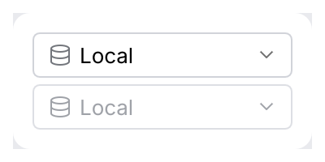
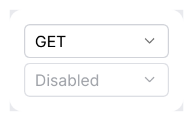

# ComboBox

Open with Enter/Space or Down. While open, Up/Down, Home/End and Page Up/Down move the
highlight without changing the value. Enter commits; Escape cancels and returns focus
to the button.

Use `.leading(|value| Slot::icon(...))` for a per-option icon, or a decorative
`Slot::ui_width` for a themed color dot. The same factory draws the selected value and
each popup option; each option keeps its text as its accessible name.

<picture>
  <source media="(prefers-color-scheme: dark)" srcset="img/combo_box_leading.dark.png">
  
</picture>

Use `.tone(|value| Tone)` to color options by meaning, e.g. HTTP methods with
`Tone::method`: the selected value and each option are drawn in that color and keep their
text as their name.

<picture>
  <source media="(prefers-color-scheme: dark)" srcset="img/combo_box_tone.dark.png">
  
</picture>

Picks one value from a list, in a popup. Use it for more than five options or when space is
tight; for fewer, prefer a [segmented control](segmented-button.md) or
[radio buttons](choice.md).

<picture>
  <source media="(prefers-color-scheme: dark)" srcset="img/combo_box.dark.png">
  
</picture>

## Usage

```rust
use archipel_kit::openapi::ui::ComboBox;
use archipel_kit::egui;

fn method_picker(ui: &mut egui::Ui, method: &mut &'static str) {
    ui.add(
        ComboBox::new("method", method, ["GET", "POST", "PUT", "PATCH", "DELETE"])
            .label("HTTP method")
            .width(120.0),
    );
}
```

Any `PartialEq + Clone + ToString` value works, including your own enums with a `Display`
impl.

## API

| Builder | Effect |
|---|---|
| `ComboBox::new(id_salt, &mut T, options)` | `id_salt` must be unique among dropdowns in the same `Ui`. |
| `.label(str)` | Accessible name (default: the selected value). |
| `.width(f32)` | Width, 160 pt by default. |
| `.enabled(bool)` | Disabled dropdowns are dimmed and cannot open. |

## Behavior

<kbd>Escape</kbd> closes the popup without picking anything and returns the focus to the
dropdown button. The key is used up: in a [dialog](dialog-wrapper.md) the first <kbd>Escape</kbd>
only closes the popup, the next one dismisses the dialog.

## Accessibility

Role `ComboBox`, named by `.label` and with the selected value as its value.

## Testing

Popups open below the button, so give the harness room first:

```rust
use archipel_kit::openapi::ui::ComboBox;
use archipel_kit::testing::{self, Queryable, Role};
use archipel_kit::{Theme, egui};

let mut harness = testing::harness_state(Theme::dark(), "GET", |ui, method| {
    ui.add(ComboBox::new("method", method, ["GET", "POST", "PUT"]));
});
harness.set_size(egui::vec2(testing::DEFAULT_WIDTH, 240.0));
harness.run();
harness.get_by_role(Role::ComboBox).click();
harness.run();
harness.get_by_label("PUT").click();
harness.run();
assert_eq!(*harness.state(), "PUT");
```

Source: [`openapi/ui/combo_box.rs`](../../crates/archipel-kit/src/openapi/ui/combo_box.rs) ·
Tests: [`tests/menus.rs`](../../crates/archipel-kit/tests/menus.rs)

## Groups

`.separators([4, 8])` draws lines before the options at those indices, grouping them like
Android Studio's theme picker. As there, the chevron keeps pointing down while the list is
open, and the list has no icon column unless options have a `leading` slot.
