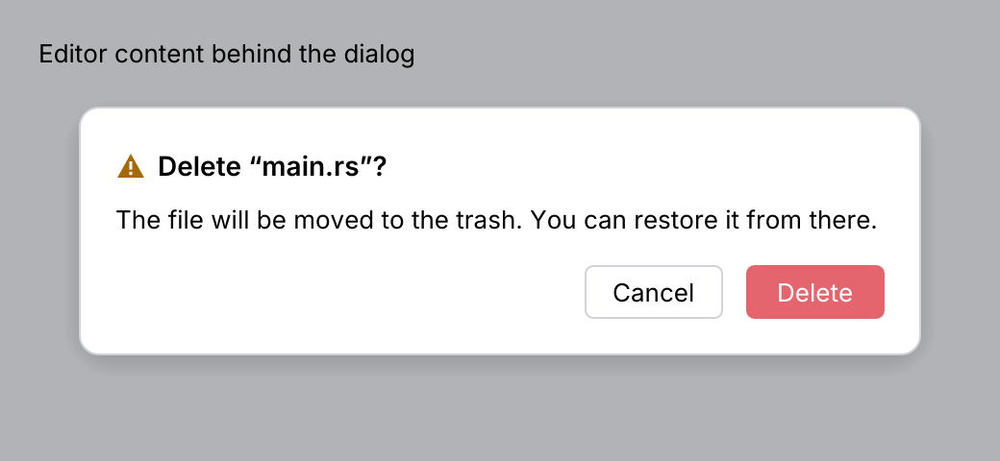
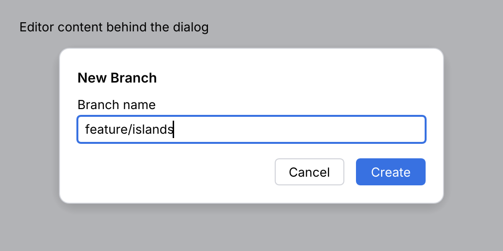
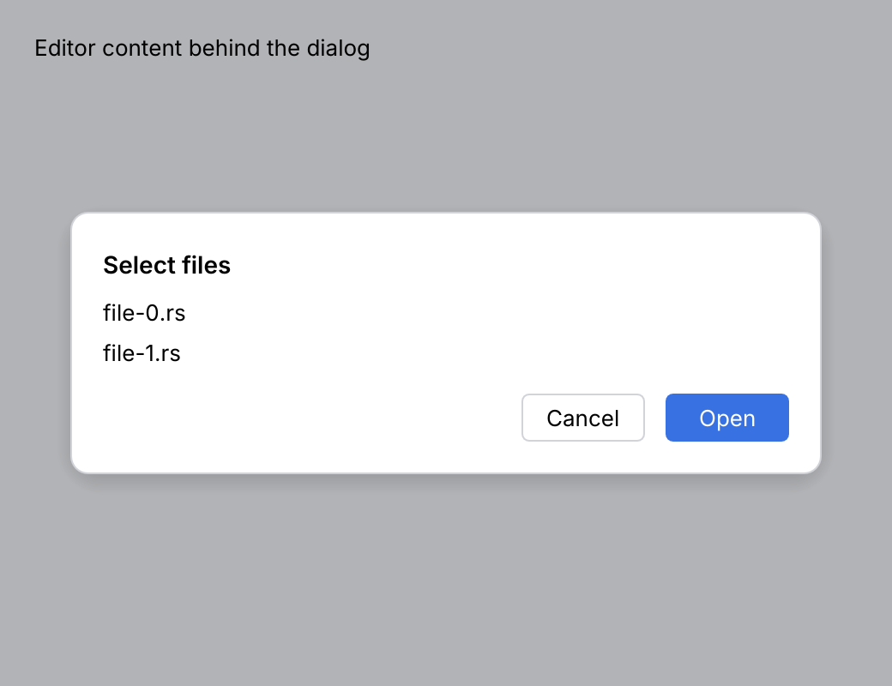
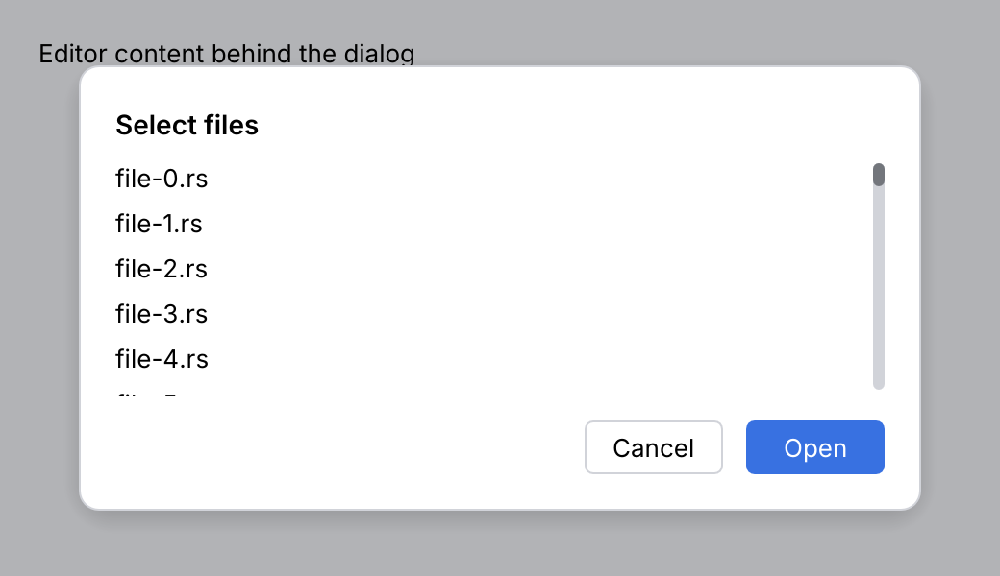
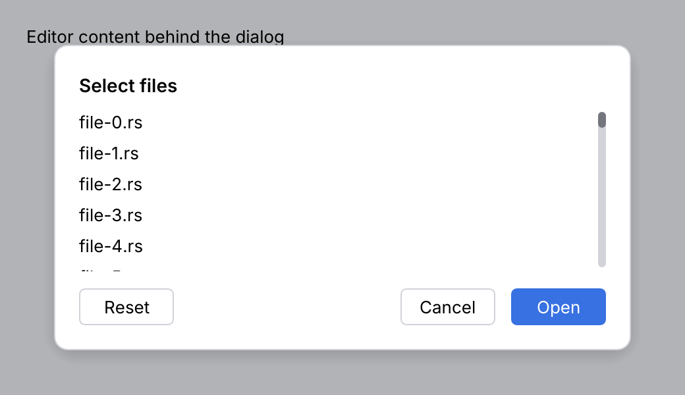

# DialogWrapper

A **dialog** asks for a decision or a few inputs before work continues. It has a title, a
message or custom content, and buttons at the bottom right. The rest of the window is dimmed
and blocked while it is open.

<picture>
  <source media="(prefers-color-scheme: dark)" srcset="img/dialog_wrapper.dark.png">
  
</picture>

<picture>
  <source media="(prefers-color-scheme: dark)" srcset="img/dialog_wrapper_form.dark.png">
  
</picture>

<picture>
  <source media="(prefers-color-scheme: dark)" srcset="img/dialog_wrapper_short.dark.png">
  
</picture>

<picture>
  <source media="(prefers-color-scheme: dark)" srcset="img/dialog_wrapper_scroll.dark.png">
  
</picture>

<picture>
  <source media="(prefers-color-scheme: dark)" srcset="img/dialog_wrapper_tertiary.dark.png">
  
</picture>

## Usage

The dialog is stateless. Show it while your `open` flag is set, and clear the flag when it
reports an action.

```rust
use archipel_kit::{openapi::ui::{DialogWrapper, ExitCode}, ui::JBTextField};
use archipel_kit::egui;

struct NewBranch {
    open: bool,
    name: String,
}

fn new_branch(ctx: &egui::Context, state: &mut NewBranch) -> Option<String> {
    if !state.open {
        return None;
    }
    let valid = !state.name.trim().is_empty();
    let action = DialogWrapper::new("New Branch")
        .content(|ui| {
            ui.add(JBTextField::new(&mut state.name).label("Branch name"));
        })
        .primary("Create")
        .primary_enabled(valid)
        .secondary("Cancel")
        .width(360.0)
        .show(ctx);
    match action {
        Some(ExitCode::Primary) => {
            state.open = false;
            Some(state.name.clone())
        }
        Some(_) => {
            state.open = false;
            None
        }
        None => None,
    }
}
```

## API

| Builder | Default | Effect |
|---|---|---|
| `DialogWrapper::new(title)` | | Title in semibold. |
| `.message(str)` | none | Wrapped text below the title. |
| `.icon(Glyph)` | none | Icon before the title (`Glyph::Warning` for destructive questions). |
| `.message_icon(MessageIcon)` | none | A 32 pt icon before the message, as in IntelliJ's message dialogs: `MessageIcon::Information`, `Warning`, `Error` or `Question`. |
| `.content(FnOnce(&mut Ui))` | none | Fields or lists below the message. |
| `.primary(label)` | none | The rightmost, accent button (the default button). |
| `.secondary(label)` | none | The button left of it. |
| `.tertiary(label)` | none | A secondary-style button at the left edge (e.g. "Reset"); reports `Tertiary`. |
| `.danger(bool)` | `false` | Makes the primary button red. |
| `.primary_enabled(bool)` | `true` | Disables the primary button and <kbd>Enter</kbd>. |
| `.yes_no_keys(bool)` | `false` | <kbd>Y</kbd> presses the primary button, <kbd>N</kbd> the secondary one. |
| `.preferred_focus(Id)` | first field | The widget that gets the focus when the dialog opens. |
| `.validation(&DialogValidation)` | none | Shows the problems above the buttons; OK is off while one blocks. |
| `.width(f32)` | 400 | Width in points. |
| `.max_height(f32)` | 80% of the window | Tallest the dialog grows; beyond it the message and content scroll. |
| `.show(ctx)` | | Returns `Option<ExitCode>`: `Primary`, `Secondary`, `Tertiary` or `Dismissed`. |

`ExitCode::code()` gives IntelliJ's number: `OK_EXIT_CODE` (0) for the primary button,
`CANCEL_EXIT_CODE` (1) for the secondary button, `CLOSE_EXIT_CODE` (1) for dismissing and
`NEXT_USER_EXIT_CODE` (2) for the tertiary action. `ExitCode::is_ok()` is IntelliJ's `isOK`.

## Keys and timings

| Input | Effect | IntelliJ spec |
|---|---|---|
| <kbd>Esc</kbd> | Cancels (`Dismissed`); inside an open [dropdown](combo-box.md) it only closes its popup | §7 |
| <kbd>Enter</kbd> | Presses the primary button when it is enabled, also from a single-line field. A focused button keeps <kbd>Enter</kbd> for itself (it is pressed instead). In a multiline field <kbd>Enter</kbd> is a new line: <kbd>Ctrl</kbd>/<kbd>Cmd</kbd>+<kbd>Enter</kbd> presses the primary button | §7 |
| <kbd>Left</kbd> / <kbd>Right</kbd> | With a button focused: the focus moves to the previous / next button (tertiary, secondary, primary), and stops at the ends | §7 |
| <kbd>Y</kbd> / <kbd>N</kbd> | In a dialog with `yes_no_keys(true)` (every `Messages::yes_no_dialog`): yes / no, unless a field has the focus | §7 |
| <kbd>Tab</kbd> | Reading order: tertiary, secondary, primary | |
| Initial focus | `preferred_focus`, else the first focusable widget of the content; the buttons only get it when you tab to them | §7 |
| Button gap | 12 pt (`size::DIALOG_BUTTON_GAP`) | §7 |
| Validation delay | 300 ms after the input last changed (`motion::DIALOG_VALIDATION_DELAY`) | §7 |

## Validation

`DialogValidation` is yours: keep it next to the input. `update` takes what the check looks at
and the check itself; it runs the check on the first frame and 300 ms after the input last
changed, so messages do not flash while typing. `ValidationInfo::error` blocks OK,
`ValidationInfo::warning` and errors marked `with_ok_enabled` do not; `.for_field(id)` names
the field that gets the focus when the user presses <kbd>Enter</kbd> despite an error. Call
`validate_now` when the dialog reports `Primary`: the last keystrokes may not be validated yet.

```rust
use archipel_kit::openapi::ui::{DialogValidation, DialogWrapper, ExitCode, ValidationInfo};
use archipel_kit::{egui, ui::JBTextField};

struct Rename {
    name: String,
    validation: DialogValidation,
}

fn check(name: &str) -> Vec<ValidationInfo> {
    if name.trim().is_empty() {
        vec![ValidationInfo::error("Enter a name")]
    } else if name.contains(' ') {
        vec![ValidationInfo::warning("Spaces are unusual")]
    } else {
        vec![]
    }
}

fn rename(ctx: &egui::Context, state: &mut Rename) -> Option<String> {
    let Rename { name, validation } = state;
    validation.update(ctx, &*name, || check(name));
    let answer = DialogWrapper::new("Rename")
        .content(|ui| {
            ui.add(JBTextField::new(name).label("Name"));
        })
        .primary("Rename")
        .secondary("Cancel")
        .validation(validation)
        .show(ctx)?;
    if answer == ExitCode::Primary && validation.validate_now(check(name)) {
        return Some(name.clone());
    }
    None
}
```

## Messages

`Messages` builds the common message dialogs as `DialogWrapper`s, with the icon of their kind
left of the message (IntelliJ `showInfoMessage`, `showWarningDialog`, `showErrorDialog`,
`showOkCancelDialog`, `showYesNoDialog`):

| Builder | Buttons |
|---|---|
| `Messages::info_dialog(title, message)` | OK |
| `Messages::warning_dialog(title, message)` | OK |
| `Messages::error_dialog(title, message)` | OK |
| `Messages::ok_cancel_dialog(title, message)` | OK, Cancel |
| `Messages::yes_no_dialog(title, message)` | Yes (`Primary`), No (`Secondary`), keys <kbd>Y</kbd> and <kbd>N</kbd> |

```rust
use archipel_kit::openapi::ui::{ExitCode, Messages};
use archipel_kit::egui;

fn confirm_delete(ctx: &egui::Context, asking: &mut bool) -> bool {
    match Messages::yes_no_dialog("Delete branch?", "The branch has unmerged commits.").show(ctx) {
        Some(answer) => {
            *asking = false;
            answer == ExitCode::Primary
        }
        None => false,
    }
}
```

Yes/no/cancel and input dialogs are not provided yet.

## Behavior

- The dialog is as tall as its content, up to the max height. The title and the buttons
  stay in view; the message and content scroll.
- Name buttons by what they do ("Delete", "Create"), not "OK". For destructive actions, use
  `.danger(true)`, a warning icon and a message that says what happens.
- One dialog at a time: a dialog that needs another decision replaces its content instead
  of stacking.
- Content insets: the dialog keeps the 18 pt padding measured on Android Studio rather than
  IntelliJ's (8, 12) content border.

## Accessibility

The title is a label and the buttons are buttons named by their text, so tests can use
`get_by_label("Delete").click()`. Keyboard focus stays inside the dialog while it is open.

Source: [`openapi/ui/dialog_wrapper.rs`](../../crates/archipel-kit/src/openapi/ui/dialog_wrapper.rs),
[`validation.rs`](../../crates/archipel-kit/src/openapi/ui/validation.rs),
[`messages.rs`](../../crates/archipel-kit/src/openapi/ui/messages.rs) ·
Tests: [`tests/overlays.rs`](../../crates/archipel-kit/tests/overlays.rs),
[`tests/dialog_wrapper.rs`](../../crates/archipel-kit/tests/dialog_wrapper.rs)
