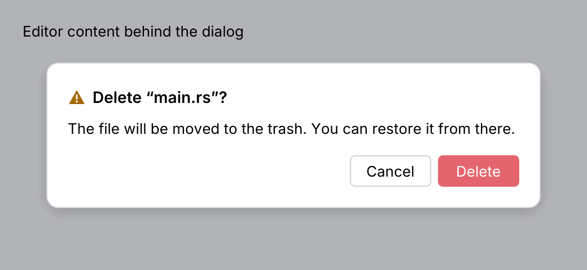
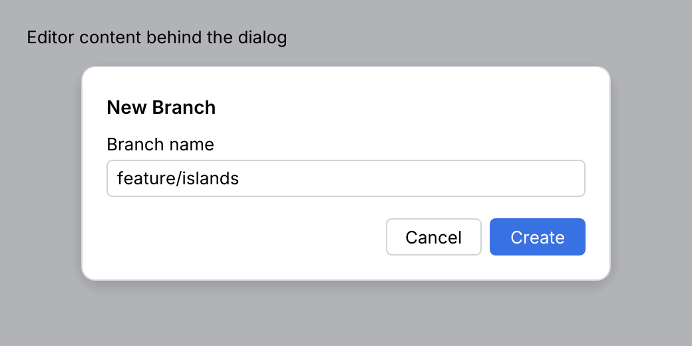

# Dialog

A **dialog** asks for a decision or a few inputs before work continues. It has a title, a
message or custom content, and buttons at the bottom right. The rest of the window is dimmed
and blocked while it is open.

<picture>
  <source media="(prefers-color-scheme: dark)" srcset="img/dialog.dark.png">
  
</picture>

<picture>
  <source media="(prefers-color-scheme: dark)" srcset="img/dialog_form.dark.png">
  
</picture>

## Usage

The dialog is stateless. Show it while your `open` flag is set, and clear the flag when it
reports an action.

```rust
use archipel_kit::components::{Dialog, DialogAction, TextField};
use archipel_kit::egui;

struct NewBranch {
    open: bool,
    name: String,
}

fn new_branch(ctx: &egui::Context, state: &mut NewBranch) -> Option<String> {
    if !state.open {
        return None;
    }
    let valid = !state.name.trim().is_empty();
    let action = Dialog::new("New Branch")
        .content(|ui| {
            ui.add(TextField::new(&mut state.name).label("Branch name"));
        })
        .primary("Create")
        .primary_enabled(valid)
        .secondary("Cancel")
        .width(360.0)
        .show(ctx);
    match action {
        Some(DialogAction::Primary) => {
            state.open = false;
            Some(state.name.clone())
        }
        Some(_) => {
            state.open = false;
            None
        }
        None => None,
    }
}
```

## API

| Builder | Default | Effect |
|---|---|---|
| `Dialog::new(title)` | | Title in semibold. |
| `.message(str)` | none | Wrapped text below the title. |
| `.icon(Glyph)` | none | Icon before the title (`Glyph::Warning` for destructive questions). |
| `.content(FnOnce(&mut Ui))` | none | Fields or lists below the message. |
| `.primary(label)` | none | The rightmost, accent button. |
| `.secondary(label)` | none | The button left of it. |
| `.danger(bool)` | `false` | Makes the primary button red. |
| `.primary_enabled(bool)` | `true` | Disables the primary button and <kbd>Enter</kbd>. |
| `.width(f32)` | 400 | Width in points. |
| `.show(ctx)` | | Returns `Option<DialogAction>`: `Primary`, `Secondary` or `Dismissed`. |

## Behavior

- <kbd>Enter</kbd> picks the primary button when it is enabled. <kbd>Escape</kbd> and a
  click outside the dialog dismiss it.
- Name buttons by what they do ("Delete", "Create"), not "OK". For destructive actions, use
  `.danger(true)`, a warning icon and a message that says what happens.
- One dialog at a time: a dialog that needs another decision replaces its content instead
  of stacking.

## Accessibility

The title is a label and the buttons are buttons named by their text, so tests can use
`get_by_label("Delete").click()`. Keyboard focus stays inside the dialog while it is open.

Source: [`components/overlay.rs`](../../crates/archipel-kit/src/components/overlay.rs) ·
Tests: [`tests/overlays.rs`](../../crates/archipel-kit/tests/overlays.rs)
