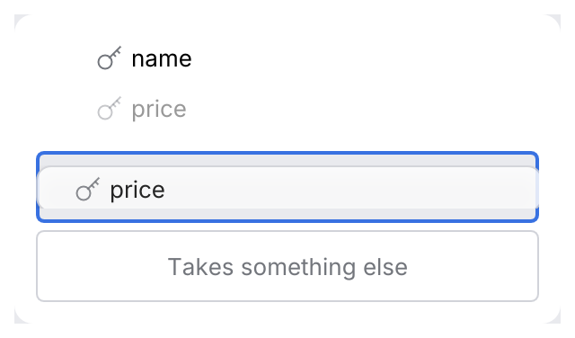

# DropZone (drag and drop)

Drag and drop in the kit is one protocol with three parts:

- [`DragSource(payload)`](../behaviours.md) — a behaviour that makes a widget draggable:
  `ColoredListCellRenderer::new("price").with(DragSource(Field("price")))`.
- [`DropTarget`](../behaviours.md) — a behaviour that makes an existing widget a target (a
  folder row in a tree).
- `DropZone` — an area of its own that takes a payload type, with a hint while it is empty: the
  Query, Projection and Sort areas of a query builder.

<picture>
  <source media="(prefers-color-scheme: dark)" srcset="img/drag_and_drop.dark.png">
  
</picture>

## Usage

```rust
use archipel_kit::behaviour::DragSource;
use archipel_kit::ui::{DropZone, ColoredListCellRenderer};
use archipel_kit::egui;

#[derive(Clone)]
struct Field(String);

fn builder(ui: &mut egui::Ui, fields: &[String], filter: &mut Vec<String>) {
    for name in fields {
        let row = ColoredListCellRenderer::new(name.as_str())
            .with(DragSource(Field(name.clone())))
            .show(ui);
        // The keyboard way to the same result.
        if row.response.double_clicked() {
            filter.push(name.clone());
        }
    }
    let zone = DropZone::new("filter")
        .hint("Drop fields here to filter")
        .show_hint(filter.is_empty())
        .show::<Field, _>(ui, |ui| {
            for name in filter.iter() {
                ui.label(name.as_str());
            }
        });
    if let Some(field) = zone.dropped {
        filter.push(field.0.clone());
    }
}
```

## API

| Builder | Effect |
|---|---|
| `DropZone::new(id_salt)` | A target for payloads of the type given to `show`. |
| `.hint(str)` | Gray text centered in the zone while it holds nothing; also its accessible name. |
| `.show_hint(bool)` | Hide the hint once the zone shows content. |
| `.show::<P, _>(ui, \|ui\| …)` | Lays the zone out around the content; returns a `DropZoneResponse` with `inner`, `response`, `hovered` (a matching payload is over it) and `dropped` (`Option<Arc<P>>`, the frame it is released). |

## Behavior

- A `ColoredListCellRenderer` with a `DragSource` shows a grab cursor on hover and a grabbing one while
  dragged. It stays in place at 40 % opacity; a card with its icon and label follows the
  pointer at 85 %, held where it was grabbed. Clicks and double-clicks still reach the row.
- While a matching payload is dragged, every zone that takes it shows a 1 pt focus-color
  outline; the zone under the pointer a 2 pt focus ring and the inactive selection tint, and
  hides its hint. Zones for other payload types stay plain, and a release over them drops
  nothing.
- Zones are at least 40 pt tall with 8 pt padding and the control radius.

## Accessibility

Dragging is a pointer gesture. An app that offers it also offers a keyboard way to the same
result: a double-click or <kbd>Enter</kbd> on the row, or a menu item. The zone is exposed with
its hint as its name; the row keeps its role and name.

Source: [`ui/drag.rs`](../../crates/archipel-kit/src/ui/drag.rs),
[`behaviour.rs`](../../crates/archipel-kit/src/behaviour.rs) ·
Tests: [`tests/drag.rs`](../../crates/archipel-kit/tests/drag.rs)
