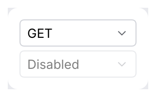

# Dropdown

Picks one value from a list, in a popup. Use it for more than five options or when space is
tight; for fewer, prefer a [segmented control](segmented-control.md) or
[radio buttons](choice.md).

<picture>
  <source media="(prefers-color-scheme: dark)" srcset="img/dropdown.dark.png">
  
</picture>

## Usage

```rust
use archipel_kit::components::Dropdown;
use archipel_kit::egui;

fn method_picker(ui: &mut egui::Ui, method: &mut &'static str) {
    ui.add(
        Dropdown::new("method", method, ["GET", "POST", "PUT", "PATCH", "DELETE"])
            .label("HTTP method")
            .width(120.0),
    );
}
```

Any `PartialEq + Clone + ToString` value works, including your own enums with a `Display`
impl.

## API

| Builder | Effect |
|---|---|
| `Dropdown::new(id_salt, &mut T, options)` | `id_salt` must be unique among dropdowns in the same `Ui`. |
| `.label(str)` | Accessible name (default: the selected value). |
| `.width(f32)` | Width, 160 pt by default. |
| `.enabled(bool)` | Disabled dropdowns are dimmed and cannot open. |

## Accessibility

Role `ComboBox`, named by `.label` and with the selected value as its value.

## Testing

Popups open below the button, so give the harness room first:

```rust
use archipel_kit::components::Dropdown;
use archipel_kit::testing::{self, Queryable, Role};
use archipel_kit::{Theme, egui};

let mut harness = testing::harness_state(Theme::dark(), "GET", |ui, method| {
    ui.add(Dropdown::new("method", method, ["GET", "POST", "PUT"]));
});
harness.set_size(egui::vec2(testing::DEFAULT_WIDTH, 240.0));
harness.run();
harness.get_by_role(Role::ComboBox).click();
harness.run();
harness.get_by_label("PUT").click();
harness.run();
assert_eq!(*harness.state(), "PUT");
```

Source: [`components/misc.rs`](../../crates/archipel-kit/src/components/misc.rs) ·
Tests: [`tests/menus.rs`](../../crates/archipel-kit/tests/menus.rs)
