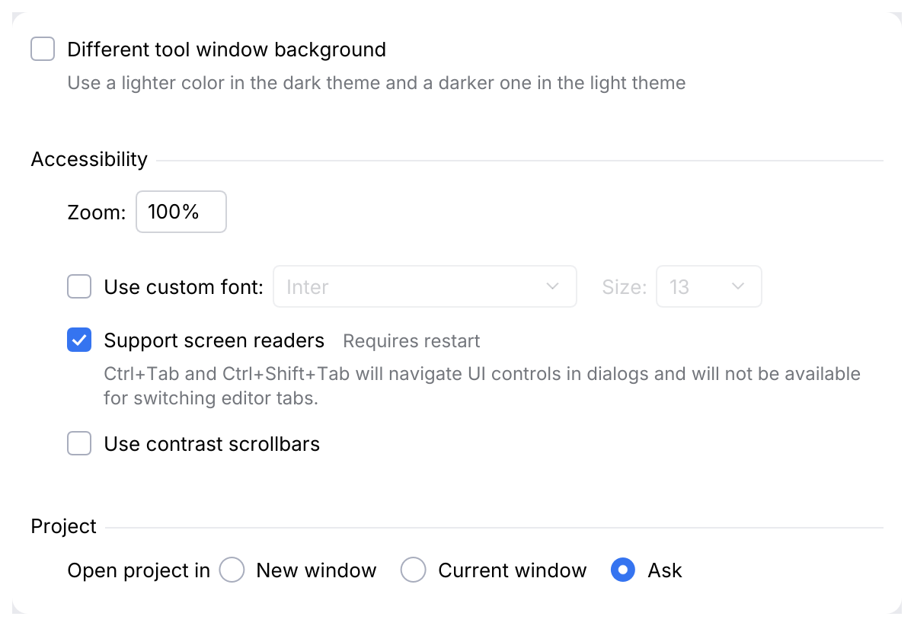
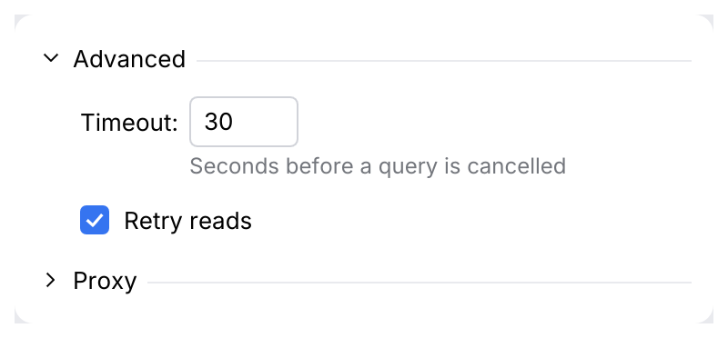
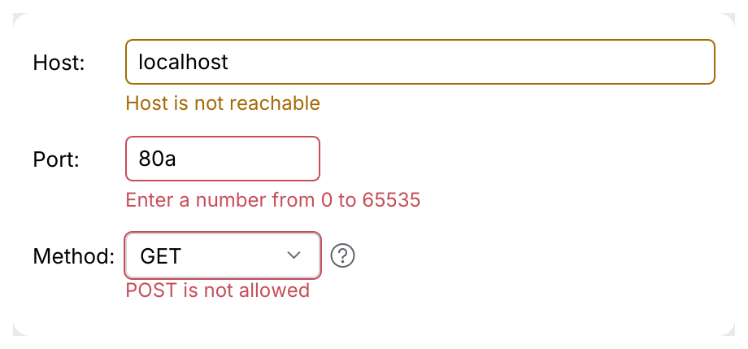

# UI DSL: panel, Row, Cell

Settings pages and dialogs in the style of IntelliJ's Kotlin UI DSL v2 (`panel { row { } }`):
rows of cells in titled groups, a label column that lines up, comments under cells, gaps
and validation. It replaces the earlier `Form`, `FormUi` and `FieldLabel`, which are gone
(see [the migration](../migration/intellij-names.md)). The page owns the rhythm, so pages
built with it cannot drift: checkbox rows 29 pt apart, fields 9 pt from their neighbours,
a group title with a line to the right edge and 20 pt above it, the group's rows indented 24 pt.

<picture>
  <source media="(prefers-color-scheme: dark)" srcset="img/dsl.dark.png">
  
</picture>

## Usage

```rust
use archipel_kit::openapi::ui::ComboBox;
use archipel_kit::ui::dsl::{Gap, RadioGroup, RightGap, panel};
use archipel_kit::egui;

fn appearance(ui: &mut egui::Ui, readers: &mut bool, custom: &mut bool, zoom: &mut String, open: &mut u8) {
    let (mut font, mut size) = ("Inter", "13");
    panel(ui, |p| {
        p.group("Accessibility", |p| {
            p.row("Zoom:", |r| {
                r.text_field(zoom).width(60.0);
            });
            // A cell borrows its value until the row is laid out: read what `enabled_if`
            // needs first.
            let custom_font = *custom;
            p.unlabeled_row(|r| {
                r.top_gap(Gap::Small);
                r.check_box(custom, "Use custom font:").gap(RightGap::Small);
                r.combo_box("font", &mut font, ["Inter"]).width(200.0).enabled_if(custom_font);
                r.label("Size:").enabled_if(custom_font);
                r.combo_box("size", &mut size, ["13"]).width(70.0).enabled_if(custom_font);
            });
            p.unlabeled_row(|r| {
                r.check_box(readers, "Support screen readers")
                    .comment("Ctrl+Tab will navigate UI controls in dialogs.");
            });
        });
        let group = RadioGroup::new(open);
        p.group("Project", |p| {
            p.row("Open project in", |r| {
                r.radio_button(&group, 0, "New window");
                r.radio_button(&group, 1, "Current window");
            });
        });
    });
}
```

A cell is described when you write it and laid out when its row closure returns, so its
options chain after it (`r.text_field(&mut s).comment("...").enabled_if(on)`) and the
column widths are known. What a cell reports is a `Response`: `.on_response(|r| ...)`.

## API

| Item | Use |
|---|---|
| `panel(ui, \|p\| …)` | The page; `p` is a `Panel`. |
| `p.row(label, \|r\| …)` | `Label:` followed by cells. Labels of a panel (or a group) are padded to the widest, so the cells start in one column. |
| `p.unlabeled_row(\|r\| …)` | Cells from the left edge. |
| `p.group(title, \|p\| …)` | A titled group, rows indented 24 pt, with a label column of its own. The first group of a page has no space above. |
| `p.collapsible_group(title, &mut open, \|p\| …)` | A group the user shows and hides; the rows only while `open`. |
| `p.buttons_group(Some(title), \|p\| …)` | A title over radio buttons or toggles, 2 pt apart, rows indented. |
| `p.indent(\|p\| …)`, `p.separator()`, `p.gap(Gap)` | Rows that depend on the row above; a line; extra space. |
| `p.enabled_if(bool, \|p\| …)`, `p.visible_if(bool, \|p\| …)` | Disable or hide the rows inside. |
| `r.cell(widget)`, `r.cell_ui(\|ui\| response)` | Any widget as a cell. |
| `r.label`, `r.comment`, `r.check_box`, `r.radio_button`, `r.button`, `r.text_field`, `r.password_field`, `r.int_spinner`, `r.combo_box`, `r.segmented_button` | The kit's controls, named after the row's label. `RadioGroup::new(&mut value)` shares one selection between radio buttons. |
| `r.top_gap(Gap)`, `r.bottom_gap(Gap)`, `r.row_comment(text)`, `r.layout(RowLayout)`, `r.enabled_if(bool)`, `r.visible_if(bool)` | Row options. |
| `.comment(text)` | A cell's explanation under it, 12 pt gray, 3 pt below, wrapped. `.comment_indent(pt)` lines it up with a checkbox label. |
| `.comment_right(text)`, `.context_help(text)` | A note 12 pt after the cell; a help icon whose tooltip explains the cell. |
| `.enabled_if(bool)`, `.visible_if(bool)` | Plain bools: the caller owns state. |
| `.gap(RightGap)` | Space after the cell: `Default` 16, `Small` 6, `Columns` 60 pt. |
| `.align(CellAlign)`, `.width(pt)`, `.label(text, LabelPosition)` | `Left`, `Right` (needs one frame to measure) and `Fill`; a field's width; a label before or above. |
| `.validation(Option<&ValidationInfo>)` | A [`ValidationInfo`](dialog-wrapper.md) on the cell: error or warning outline, message below. |

## Behavior

Measured on Android Studio's Settings pages (Appearance, System Settings), Islands Dark and
Light, with the IntelliJ UI DSL spacing values (`SpacingConfiguration`) where they match:

- Checkbox rows are 29 pt apart; a comment adds 7 pt plus 16 pt per line. Fields (28 pt)
  sit 9 pt from a checkbox's box above or below and from each other.
- `Gap::Small` is 8 pt and `Gap::Medium` 20 pt (`verticalSmallGap`, `verticalMediumGap`);
  between cells `RightGap::Default` is 16 pt (`horizontalDefaultGap`), `Small` 6 pt,
  `Columns` 60 pt, a right comment 12 pt (`horizontalCommentGap`).
- Columns line up by measuring, not by solving a grid: the panel keeps the widest label of
  its group, the heights of the rows and (for `RowLayout::ParentGrid`) the widest cell of
  each column from the last frame in the `egui::Context`, and asks egui to lay the frame
  out again when one changed. The first frame of a panel is laid out twice, later frames once.
- A group title is regular text in the text color; its line (1 pt, `group_separator`) starts
  6 pt after the title and runs to the right edge. A collapsible title follows a chevron
  (right while closed, down while open); a click, <kbd>Enter</kbd> or <kbd>Space</kbd> toggle
  it. The caller owns the `open` flag.
- A field's accessible name is its row's label without the colon.
- Disabled cells keep their place: `enabled_if(false)` dims and blocks input; `visible_if(false)`
  removes the cell and its gap.
- A cell's validation draws a 1 pt red (error) or yellow (warning) outline around widgets
  that do not draw their own, and the message under the cell; text fields draw both
  themselves.

<picture>
  <source media="(prefers-color-scheme: dark)" srcset="img/dsl_collapsible.dark.png">
  
</picture>

<picture>
  <source media="(prefers-color-scheme: dark)" srcset="img/dsl_validation.dark.png">
  
</picture>

## Differences from the Kotlin DSL

The kit is immediate mode and stateless, so there is no `DialogPanel` with `apply`, `reset`
and `isModified`, and no `bindText` / `bindSelected`: cells borrow the caller's values
and report `changed()`. Validation is the caller's too: compute `ValidationInfo`s (with
[`DialogValidation`](dialog-wrapper.md)) and hand them to the cells. `Cell::on_response`
replaces `onChanged`. Sub-panels, `twoColumnsRow` and `scrollCell` are not provided; use
`p.ui()` for content that is not a row.

## Accessibility

Rows keep their controls' roles. Group titles and labels are labels; a collapsible group's
title is a collapsing header that reports whether it is expanded; a comment is a label, and
the comment of a checkbox or radio set with their own `.comment` is its description.

Source: [`ui/dsl.rs`](../../crates/archipel-kit/src/ui/dsl.rs) ·
Tests: [`tests/dsl.rs`](../../crates/archipel-kit/tests/dsl.rs)
