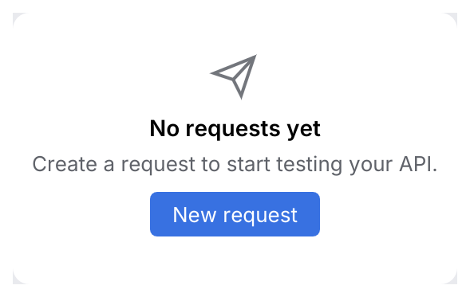

# EmptyState

What a list, table or panel shows when it has nothing to display: an icon, a title, a hint
that says how to fill it and optionally one action.

<picture>
  <source media="(prefers-color-scheme: dark)" srcset="img/empty_state.dark.png">
  
</picture>

## Usage

```rust
use archipel_kit::components::EmptyState;
use archipel_kit::{Glyph, Icon, egui};

fn requests(ui: &mut egui::Ui, requests: &mut Vec<String>) {
    if requests.is_empty() {
        let new = EmptyState::new("No requests yet")
            .icon(Glyph::Send)
            .hint("Create a request to start testing your API.")
            .action("New request")
            .show(ui);
        if new.clicked() {
            requests.push("Untitled".into());
        }
    }
}
```

## API

| Builder | Effect |
|---|---|
| `EmptyState::new(title)` | `.hint(str)`, `.icon(Icon)`, `.action(label)`. |
| `.show(ui)` | Centered; returns the action button's `Response`. |

Source: [`components/misc.rs`](../../crates/archipel-kit/src/components/misc.rs) ·
Tests: [`tests/feedback.rs`](../../crates/archipel-kit/tests/feedback.rs)
