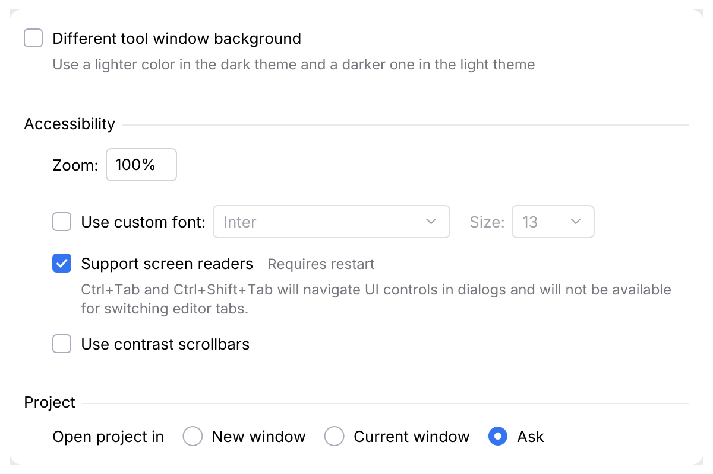
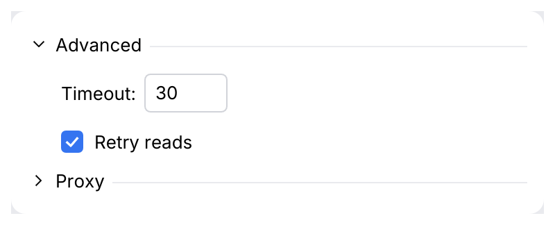

# Form, FormUi, FieldLabel

A settings page: rows of checkboxes, radios and labelled fields in titled groups, spaced
like Android Studio's Settings pages. The form owns the rhythm, so a page built from it
cannot drift: checkbox rows 29 pt apart, fields 9 pt from their neighbours, a group title
with a line to the right edge and 20 pt above it, the group's rows indented 24 pt.

<picture>
  <source media="(prefers-color-scheme: dark)" srcset="img/form.dark.png">
  
</picture>

## Usage

```rust
use archipel_kit::components::{Checkbox, Dropdown, FieldLabel, Form, Radio, TextField};
use archipel_kit::{egui, tokens};

fn appearance(ui: &mut egui::Ui, readers: &mut bool, custom: &mut bool, zoom: &mut String, open: &mut u8) {
    let (mut font, mut size) = ("Inter", "13");
    Form::new().show(ui, |form| {
        form.group("Accessibility", |form| {
            form.row("Zoom:", |ui| ui.add(TextField::new(zoom).name("Zoom").width(60.0)));
            form.fields(|ui| {
                ui.add(Checkbox::new(custom, "Use custom font:"));
                ui.add(Dropdown::new("font", &mut font, ["Inter"]).enabled(*custom));
                ui.add_space(tokens::size::FORM_CONTROL_SPACE);
                ui.add(FieldLabel::new("Size:").enabled(*custom));
                ui.add(Dropdown::new("size", &mut size, ["13"]).width(70.0).enabled(*custom));
            });
            form.add(
                Checkbox::new(readers, "Support screen readers")
                    .inline_comment("Requires restart")
                    .comment("Ctrl+Tab will navigate UI controls in dialogs."),
            );
        });
        form.group("Project", |form| {
            form.radios("Open project in", |ui| {
                ui.add(Radio::new(open, 0, "New window"));
                ui.add(Radio::new(open, 1, "Current window"));
            });
        });
    });
}
```

## API

| Item | Use |
|---|---|
| `Form::new().show(ui, \|form\| …)` | The page; `form` is a `FormUi`. |
| `form.add(widget)` | A row with a control that names itself (checkbox, radio, toggle). |
| `form.row(label, \|ui\| …)` | `Label:` followed by fields, 6 pt apart. |
| `form.fields(\|ui\| …)` | A row of fields without a leading label. Set independent fields apart with `ui.add_space(tokens::size::FORM_CONTROL_SPACE)`; label them with `FieldLabel`. |
| `form.radios(label, \|ui\| …)` | A label and radio buttons in one row, 16 pt apart. |
| `form.group(title, \|form\| …)` | A titled group, rows indented. The first group of a page has no space above. |
| `form.collapsible(title, &mut open, \|form\| …)` | A group the user shows and hides ("Advanced"): a chevron before the title; the rows only while `open`. |
| `form.indent(\|form\| …)` | Rows that depend on the row above. |
| `form.space()` | Extra space between loosely related rows. |
| `form.ui()` | The `Ui`, for content that is not a row. |
| `Checkbox`/`Radio` `.comment(text)` | Explanation below, 12 pt gray, aligned with the label, wrapped; also the accessible description. |
| `Checkbox`/`Radio` `.inline_comment(text)` | Short note after the label (`Requires restart`), on its baseline. |
| `FieldLabel::new(text)` | `.enabled(bool)`: dimmed with a disabled field. |

## Behavior

Measured on Android Studio's Settings pages (Appearance, System Settings), Islands Dark and
Light:

- Checkbox rows are 29 pt apart; a comment adds 7 pt plus 16 pt per line.
- Fields (28 pt) sit 9 pt from a checkbox's box above or below and from each other.
- A group title is regular text in the text color; its line (1 pt, `group_separator`) starts
  6 pt after the title, 4 pt above its baseline, and runs to the right edge.
- Labels end 6 pt before their field; radio buttons in a row are 16 pt apart; a checkbox's
  label starts 8 pt after the box.
- Comments are not click targets: clicking one does not toggle the checkbox.
- A collapsible group's title follows a chevron (right while closed, down while open); a
  click on the chevron or title, <kbd>Enter</kbd> or <kbd>Space</kbd> toggle it. The caller
  owns the `open` flag, so the app decides whether it persists.

<picture>
  <source media="(prefers-color-scheme: dark)" srcset="img/form_collapsible.dark.png">
  
</picture>
- A disabled dropdown has no fill, a faint border and dimmed text.

## Accessibility

Rows keep their controls' roles. Group titles and field labels are labels; a collapsible
group's title is a collapsing header that reports whether it is expanded; a comment below a
checkbox or radio is its description.

Source: [`components/form.rs`](../../crates/archipel-kit/src/components/form.rs) ·
Tests: [`tests/form.rs`](../../crates/archipel-kit/tests/form.rs)
