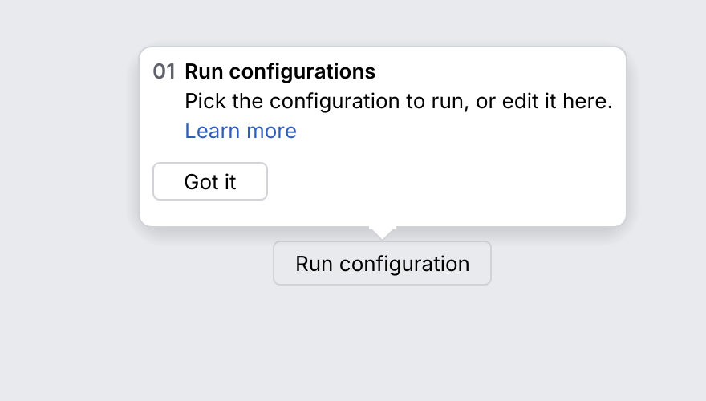

# GotItTooltip

An **onboarding bubble** that points at a control once: "here is something new". The user
dismisses it with "Got it" (or <kbd>Esc</kbd>), and the application never shows it again.
After IntelliJ's `GotItTooltip` (IntelliJ spec section 11.2).

<picture>
  <source media="(prefers-color-scheme: dark)" srcset="img/got_it_tooltip.dark.png">
  
</picture>

## Usage

The tooltip is stateless; whether it was seen is the application's. `show_with` does the
bookkeeping in a `PropertiesComponent` (the host stores it): it counts showings and
remembers a dismissal under `gotit.<id>.shown` and `gotit.<id>.done`.

```rust
use archipel_kit::host::PropertiesComponent;
use archipel_kit::ide::GotItTooltip;
use archipel_kit::ui::Button;
use archipel_kit::egui;

fn toolbar(ui: &mut egui::Ui, props: &mut dyn PropertiesComponent) {
    let target = ui.add(Button::secondary("Run configuration")).rect;
    GotItTooltip::new("run.config", "Pick the configuration to run here.")
        .header("Run configurations")
        .show_with(ui.ctx(), target, props);
}
```

To keep the persistence somewhere else, ask `can_show`, pass the answer to `show`, and store
what it reports:

```rust
use archipel_kit::host::InMemoryProperties;
use archipel_kit::ide::GotItTooltip;
use archipel_kit::egui;

fn tip(ctx: &egui::Context, target: egui::Rect, props: &mut InMemoryProperties) {
    let tip = GotItTooltip::new("run.config", "Pick the configuration to run here.");
    let response = tip.show(ctx, target, tip.can_show(props) || tip.is_showing(ctx));
    if response.newly_shown {
        tip.record_shown(props);
    }
    if response.dismissed.is_some() {
        tip.got_it(props);
    }
}
```

## API

| Item | Effect |
|---|---|
| `GotItTooltip::new(id, text)` | The id is the key of its state. |
| `.header(str)` | A bold line above the text. |
| `.step(n)` | A step number ("01") before the text, for a tour. |
| `.link(str)` | A link below the text: `GotItResponse::link_clicked`; the tooltip stays. |
| `.button_label(str)` | The button's label (default "Got it"). |
| `.secondary_button(str)` | A second, flat button: `secondary_clicked`; the tooltip stays. |
| `.with_timeout()`, `.timeout(Option<f32>)` | Closes by itself after 5 s (or after the given time) and has no button. |
| `.position(GotItPosition)` | `GotItPosition::TopMiddle`, `BottomMiddle` (default), `LeftMiddle`, `RightMiddle` or `BottomLeft`. |
| `.max_width(f32)` | The text's widest line (default 280). |
| `.show_count(n)` | Showings allowed without a dismissal (default 1). |
| `.focus(bool)` | The button gets the keyboard focus when the tooltip appears. |
| `.show(ctx, target, should_show)` | Draws it next to `target` while `should_show`; returns `GotItResponse`: `visible`, `newly_shown`, `dismissed` (a `GotItDismissal`: `Button`, `Escape` or `Timeout`), `link_clicked`, `secondary_clicked`. |
| `.show_with(ctx, target, &mut props)` | `show` with `can_show`, `record_shown` and `got_it` done for you. |
| `.can_show(&props)`, `.record_shown(&mut props)`, `.got_it(&mut props)`, `.reset(&mut props)`, `.is_showing(ctx)` | The persistence, one step at a time. |

## Behavior

| Rule | Detail |
|---|---|
| One-shot | `can_show` is false once the tooltip was dismissed (button, <kbd>Esc</kbd> or timeout) or shown `show_count` times. |
| One at a time | While one got-it tooltip is on screen, others wait and show when it has gone. |
| <kbd>Esc</kbd> | Closes it (IntelliJ action `CloseGotItTooltip`). |
| Click elsewhere | Does not close it. |
| Timeout | With a timeout there is no button, and it closes after 5 s. |
| Size and look | Radius 8, insets (7, 8), arrow 16 x 8, button 12 pt below the text; fill `got-it-bg` (white, `#2E4D89` on dark) with the `feedback-border` outline. |
| Keeps its place | The target rect is passed every frame, so the bubble follows the control; the arrow stays on the bubble's edge when the bubble is kept inside the window. |

Not implemented: images, shortcut chips and the contrast (blue) variant.

## Accessibility

The header, text, link and buttons are labels, links and buttons that tests find by their text.

Source: [`ide/got_it_tooltip.rs`](../../crates/archipel-kit/src/ide/got_it_tooltip.rs) ·
Tests: [`tests/tooltips.rs`](../../crates/archipel-kit/tests/tooltips.rs)
