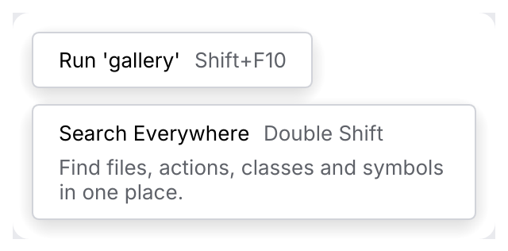
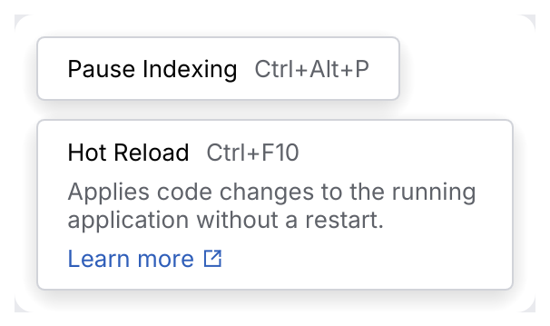

# HelpTooltip

A **tooltip** names what a control does, after a short hover. It can show a shortcut after
the label, a longer description below and a link. Tooltips also appear on disabled controls,
where they say why the control is disabled.

<picture>
  <source media="(prefers-color-scheme: dark)" srcset="img/help_tooltip.dark.png">
  
</picture>

## Usage

```rust
use archipel_kit::{ui::Button, action_system::ActionButton, ide::{HelpTooltip, HelpTooltipExt}};
use archipel_kit::{Glyph, egui};

fn toolbar(ui: &mut egui::Ui, connected: bool) {
    ui.add(ActionButton::new(Glyph::Run, "Run"))
        .tooltip_with(HelpTooltip::new("Run 'gallery'").shortcut("Shift+F10"));
    ui.add(Button::primary("Deploy").enabled(connected))
        .tooltip("Connect a cluster first");
}
```

## API

| Item | Use |
|---|---|
| `response.tooltip(label)` | A plain tooltip (`HelpTooltipExt`, implemented for `egui::Response`). |
| `response.tooltip_with(HelpTooltip)` | A tooltip with a shortcut or hint. |
| `response.tooltip_with_response(HelpTooltip)` | The same, returning `(Response, HelpTooltipResponse)`: `visible` and `link_clicked`. |
| `HelpTooltip::new(label)` | `.shortcut(str)`, `.hint(str)` (the description), `.link(text, external)` |
| `.immediate(bool)`, `.align(RectAlign)` | Show without the delay; place the tooltip beside the owner (tool window stripes). |
| `.show_delay(secs)`, `.hide_delay(secs)`, `.never_hide_on_timeout(bool)` | IntelliJ's `setInitialDelay`, `setHideDelay` and `setNeverHideOnTimeout`. |
| `HelpTooltip::frame(ctx)`, `tooltip.content(ui)` | The frame and content, to show a tooltip outside of hover (onboarding, docs). |

<picture>
  <source media="(prefers-color-scheme: dark)" srcset="img/help_tooltip_link.dark.png">
  
</picture>

## Behavior

Timings and rules after IntelliJ's `HelpTooltip` (IntelliJ spec section 11.1); the delays are
`tokens::motion::HELP_TOOLTIP_*`.

| Situation | Behavior |
|---|---|
| The pointer comes to rest on the owner | The tooltip shows after 500 ms. Moving the pointer starts the wait over, so it never shows while the pointer is moving about. |
| `immediate(true)` | Shows at once (tool window stripe buttons). |
| The pointer leaves | The tooltip hides after 150 ms. |
| The pointer is over the tooltip | It stays, so its link can be clicked; it hides 150 ms after the pointer has left both the owner and the tooltip. |
| Time | Hides by itself after 10 s (a title and shortcut only) or 30 s (with a description or link), unless `never_hide_on_timeout(true)`. It shows again when the pointer leaves and comes back. |
| Pressing the owner | Hides the tooltip until the pointer has left and returned. |
| Dragging anything | No tooltip. |
| Disabled owner | The tooltip shows as for an enabled one, to say why it is disabled. |
| Size | The description wraps at 250 pt; 6 pt between title row, description and link. |

The measured Android Studio tooltip lingers about 0.5 s after the pointer leaves
(`docs/component-map.md`); the kit follows IntelliJ's 150 ms registry value.

Write the label as the action ("Run 'gallery'"), not the control ("Run button"). Put the
shortcut in `.shortcut`, not in the label.

## Accessibility

The label is an accessible label in the tooltip, so tests find it with
`get_by_label` once it shows. Icon-only buttons still need their own accessible name
(`ActionButton::new(glyph, name)`): a tooltip doesn't replace it.

Source: [`ide/help_tooltip.rs`](../../crates/archipel-kit/src/ide/help_tooltip.rs) ·
Tests: [`tests/overlays.rs`](../../crates/archipel-kit/tests/overlays.rs),
[`tests/tooltips.rs`](../../crates/archipel-kit/tests/tooltips.rs)
