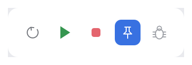

# IconButton

A transparent square button showing one icon, for toolbars and panel headers. It can act as
a toggle (filled with the accent color while selected) and take a semantic color, such as
green for Run.

<picture>
  <source media="(prefers-color-scheme: dark)" srcset="img/icon_button.dark.png">
  
</picture>

## Usage

```rust
use archipel_kit::components::IconButton;
use archipel_kit::{Icon, Theme, egui};

fn toolbar(ui: &mut egui::Ui, pinned: &mut bool) {
    let colors = Theme::colors(ui.ctx());
    ui.horizontal(|ui| {
        ui.add(IconButton::new(Icon::Run, "Run").color(colors.run));
        ui.add(IconButton::new(Icon::Stop, "Stop").color(colors.stop).enabled(false));
        if ui.add(IconButton::new(Icon::Pin, "Pin tab").selected(*pinned)).clicked() {
            *pinned = !*pinned;
        }
    });
}
```

## API

| Builder | Effect |
|---|---|
| `IconButton::new(icon, label)` | The label is required: it is the tooltip and the accessible name. |
| `.selected(bool)` | Makes it a toggle; selected toggles are accent-filled. |
| `.color(Color32)` | Icon color (default: the theme's icon color). |
| `.enabled(bool)` | Disabled buttons are dimmed and ignore clicks. |

## Accessibility

Role `Button`, named by its label. Toggles report their state, so screen readers announce
"Pin tab, toggle button, pressed".

Source: [`components/icon_button.rs`](../../crates/archipel-kit/src/components/icon_button.rs)
