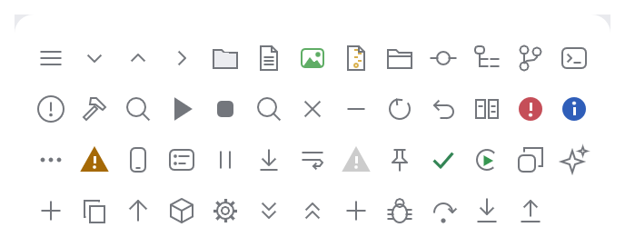

# Icons

Vector icons drawn on a 16×16 grid in a thin-outline style: crisp at any scale, colored by
the theme, and with no image assets to ship. `Icon::for_file` picks a file-type icon from a
file name.

<picture>
  <source media="(prefers-color-scheme: dark)" srcset="img/icons.dark.png">
  
</picture>

## Usage

```rust
use archipel_kit::{Icon, Theme, egui, icons};

fn file_label(ui: &mut egui::Ui, name: &str) {
    let colors = Theme::colors(ui.ctx());
    ui.horizontal(|ui| {
        icons::show(ui, Icon::for_file(name), 16.0, colors.icon);
        ui.label(name);
    });
}
```

`icons::paint(painter, rect, icon, color)` draws into any rect, for custom widgets.
`Icon::ALL` lists every parameterless icon with its name (the gallery's icon page filters
it).

Status icons (`Error`, `Warning`, `Info`, `Success`) keep their semantic colors whatever
color you pass.

## Adding an icon

1. Add a variant to `Icon` and its drawing to `icons::paint` (16×16 design units, 1 pt
   strokes, rounded joins).
2. Add it to `Icon::ALL`.
3. Run `UPDATE_SNAPSHOTS=1 cargo test` and review `img/icons.*.png` in the PR.

Source: [`icons.rs`](../../crates/archipel-kit/src/icons.rs) ·
Tests: [`tests/icons.rs`](../../crates/archipel-kit/tests/icons.rs)
