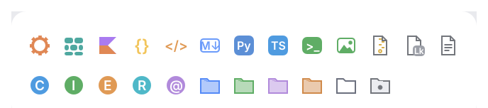

# Icons

The kit draws two kinds of icons:

- **Glyphs** from the [icon kit](../icons/README.md) (`archipel-icons`): about a hundred
  designed outline icons for actions, navigation, files, development, version control,
  status and data. Re-exported as `archipel_kit::Glyph`.
- **File-type icons** (`archipel_kit::Icon`): letter badges for languages and config files,
  Java type circles and folders tinted by their role. `Icon::for_file` picks one from a file
  name.

<picture>
  <source media="(prefers-color-scheme: dark)" srcset="img/file_icons.dark.png">
  
</picture>

## Usage

Every component that shows an icon takes `impl Into<Icon>`, so glyphs and file icons mix
freely:

```rust
use archipel_kit::components::{IconButton, ListRow};
use archipel_kit::{Glyph, Icon, Theme, egui, icons};

fn file_row(ui: &mut egui::Ui, name: &str) {
    ListRow::new(name).icon(Icon::for_file(name)).show(ui);
    ui.add(IconButton::new(Glyph::Refresh, "Reload"));

    // Custom widgets: paint into any rect, in a theme color.
    let colors = Theme::colors(ui.ctx());
    icons::show(ui, Glyph::Database, 16.0, colors.icon);
}
```

Status glyphs (`Error`, `Warning`, `Info`, `Success`, `Run`, `Stop`) keep their semantic
theme colors whatever color you pass.

Source: [`icons.rs`](../../crates/archipel-kit/src/icons.rs) ·
Tests: [`tests/icons.rs`](../../crates/archipel-kit/tests/icons.rs)
