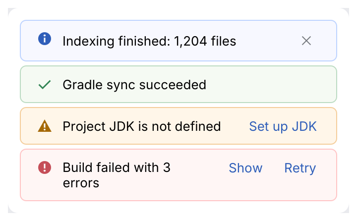

# InlineBanner

A full-width message above the content it is about: a missing SDK, an outdated index, a
failed sync. Status picks the tint and icon; actions are buttons on the right.

<picture>
  <source media="(prefers-color-scheme: dark)" srcset="img/inline_banner.dark.png">
  
</picture>

## Usage

```rust
use archipel_kit::ui::{InlineBanner, Status};
use archipel_kit::egui;

fn jdk_banner(ui: &mut egui::Ui, visible: &mut bool) {
    if !*visible {
        return;
    }
    let out = InlineBanner::new(Status::Warning, "Project JDK is not defined")
        .action("Set up JDK")
        .dismissible(true)
        .show(ui);
    if out.action == Some(0) {
        // open the SDK dialog
    }
    if out.dismissed {
        *visible = false;
    }
}
```

## API

| Builder | Effect |
|---|---|
| `InlineBanner::new(Status, text)` | `Info`, `Success`, `Warning` or `Error`. |
| `.action(label)` | Adds a button; `MessageResponse::action` is its index when clicked. |
| `.dismissible(bool)` | Close button; `MessageResponse::dismissed` reports it. |

The banner owns no state: hide it yourself when it is dismissed.

## Guidelines

- Say what is wrong and offer the fix as an action, not just "Error".
- Long text wraps; actions stay on the right.

Source: [`ui/feedback.rs`](../../crates/archipel-kit/src/ui/feedback.rs) ·
Tests: [`tests/feedback.rs`](../../crates/archipel-kit/tests/feedback.rs)
