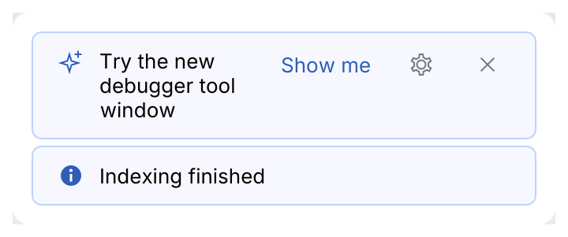
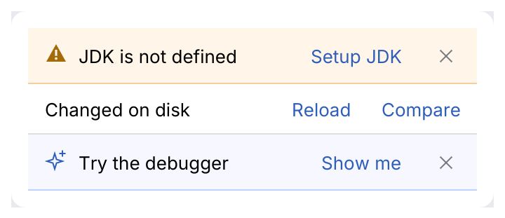

# InlineBanner, EditorNotificationPanel

A full-width message above the content it is about: a missing SDK, an outdated index, a
failed sync. Status picks the tint and icon; actions are links on the right. `InlineBanner`
is the rounded banner for dialogs, tool windows and under the editor tabs (measured on
Android Studio); `EditorNotificationPanel` is IntelliJ's flat strip across the top of a file's
editor.

<picture>
  <source media="(prefers-color-scheme: dark)" srcset="img/inline_banner.dark.png">
  
</picture>

## Usage

```rust
use archipel_kit::ui::{InlineBanner, Status};
use archipel_kit::egui;

fn jdk_banner(ui: &mut egui::Ui, visible: &mut bool) {
    if !*visible {
        return;
    }
    let out = InlineBanner::new(Status::Warning, "Project JDK is not defined")
        .action("Set up JDK")
        .dismissible(true)
        .show(ui);
    if out.action == Some(0) {
        // open the SDK dialog
    }
    if out.dismissed {
        *visible = false;
    }
}
```

## API

| Builder | Effect |
|---|---|
| `InlineBanner::new(Status, text)` | `Info`, `Success`, `Warning`, `Error` or `Promo` (the info tint with the sparkle icon). |
| `.action(label)` | Adds a link; `MessageResponse::action` is its index when clicked. |
| `.dismissible(bool)` | Close button; `MessageResponse::dismissed` reports it. |
| `.gear_action(name)` | A gear button before the close button; `MessageResponse::gear` reports it. |

The banner owns no state: hide it yourself when it is dismissed.

<picture>
  <source media="(prefers-color-scheme: dark)" srcset="img/inline_banner_promo.dark.png">
  
</picture>

## EditorNotificationPanel

<picture>
  <source media="(prefers-color-scheme: dark)" srcset="img/editor_notification_panel.dark.png">
  
</picture>

```rust
use archipel_kit::ui::{EditorNotificationPanel, Status};
use archipel_kit::egui;

fn above_the_editor(ui: &mut egui::Ui, visible: &mut bool) {
    if !*visible {
        return;
    }
    let out = EditorNotificationPanel::new("File is read-only")
        .status(Status::Warning)
        .action("Make writable")
        .dismissible(true)
        .show(ui);
    if out.action == Some(0) {
        // make the file writable
    }
    *visible = !out.dismissed;
}
```

| Builder | Effect |
|---|---|
| `EditorNotificationPanel::new(text)` | A panel without status: the editor's color, no icon, a separator line below. |
| `.status(Status)` | The tint, border and icon of the status (IntelliJ `EditorNotificationPanel.Status`: `Info`, `Success`, `Warning`, `Error`, `Promo`). |
| `.action(label)` | A link; `MessageResponse::action` is its index. |
| `.dismissible(bool)` | A close button; `MessageResponse::dismissed`. |

Layout (IntelliJ spec section 10.2): full width, 10 pt above and below, 12 pt at the sides, the
icon 8 pt before the text, 20 pt between the text and the links, the close button last, a 1 pt
line below. Collapsing actions that do not fit into a drop-down, and the hover and pressed
feedback of the whole `InlineBanner`, are not implemented yet: the text wraps instead.

## Guidelines

- Say what is wrong and offer the fix as an action, not just "Error".
- Long text wraps; actions stay on the right.

Source: [`ui/feedback.rs`](../../crates/archipel-kit/src/ui/feedback.rs),
[`ui/editor_notification_panel.rs`](../../crates/archipel-kit/src/ui/editor_notification_panel.rs) ·
Tests: [`tests/feedback.rs`](../../crates/archipel-kit/tests/feedback.rs),
[`tests/notifications.rs`](../../crates/archipel-kit/tests/notifications.rs)
