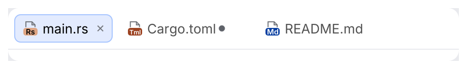
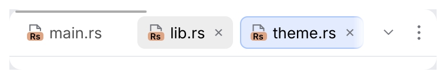
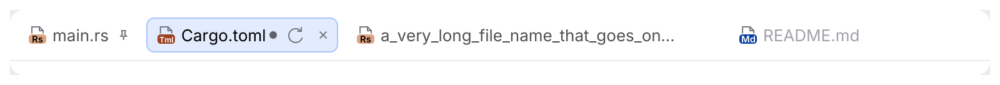
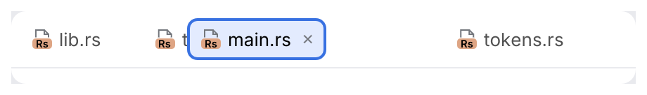

# JBTabs

Editor tabs as in Android Studio's Islands UI. The selected tab is a tinted pill with a 1 pt
border; tabs can show a file icon, an unsaved-changes dot and a close button.

<picture>
  <source media="(prefers-color-scheme: dark)" srcset="img/jb_tabs.dark.png">
  
</picture>

When the tabs don't fit, the strip scrolls sideways. With the pointer over it, a thin scroll
bar shows at its top edge; "Show hidden tabs" (the chevron) and "More actions" (⋮) sit at
its right end:

<picture>
  <source media="(prefers-color-scheme: dark)" srcset="img/jb_tabs_overflow.dark.png">
  
</picture>

<picture>
  <source media="(prefers-color-scheme: dark)" srcset="img/jb_tabs_hidden_tabs.dark.png">
  
</picture>

Tabs can be pinned, show tab actions from an `ActionGroup`, cut long titles, and be dragged:

<picture>
  <source media="(prefers-color-scheme: dark)" srcset="img/jb_tabs_pinned_actions.dark.png">
  
</picture>

<picture>
  <source media="(prefers-color-scheme: dark)" srcset="img/jb_tabs_dragging.dark.png">
  
</picture>

## Usage

```rust
use archipel_kit::{action_system::ActionMenuItem, ui::tabs::{TabInfo, JBTabs}};
use archipel_kit::{Icon, egui};

fn editor_tabs(ui: &mut egui::Ui, files: &mut Vec<String>, current: &mut usize) {
    let tabs: Vec<TabInfo> = files
        .iter()
        .map(|name| TabInfo::new(name.as_str()).icon(Icon::for_file(name)).closable(true))
        .collect();
    let mut close_all = false;
    let out = JBTabs::new(&tabs, *current)
        .more_menu(|ui| {
            if ui.add(ActionMenuItem::new("Close All Tabs")).clicked() {
                close_all = true;
            }
        })
        .show(ui);
    if let Some(index) = out.selected {
        *current = index;
    }
    if let Some(index) = out.closed {
        files.remove(index);
        *current = (*current).min(files.len().saturating_sub(1));
    }
    if close_all {
        files.clear();
        *current = 0;
    }
}
```

## API

| Item | Effect |
|---|---|
| `TabInfo::new(label)` | A tab. `.icon(Icon)`, `.closable(bool)`, `.modified(bool)`, `.pinned(bool)`, `.enabled(bool)`, `.actions(Rc<dyn ActionGroup>)`. |
| `JBTabs::new(&tabs, selected).show(ui)` | Draws the strip as wide as the `Ui`. Returns `JBTabsResponse { selected, closed, moved, pin_toggled, popup_requested, performed, hidden_tabs_button, more_button }`. |
| `.reorderable(bool)` | Tabs can be dragged (default `true`); the new place is reported in `moved: Option<(from, to)>`. |
| `.popup_group(&dyn ActionGroup)`, `.data_context(&DataContext)` | The tab's context menu (place `EDITOR_TAB_POPUP`) and the context tab actions and the menu update with. The action that runs is reported in `performed`. |
| `.more_menu(\|ui\| …)` | A "More actions" button (⋮) at the right end, opening a menu of the app's [`ActionMenuItem`](action-menu-item.md)s. A clicked item closes it. |
| `.separator(bool)` | The 1 pt line under the strip (on by default). |
| `.id_salt(salt)` | Tells two tab bars in one `Ui` apart (each remembers its scroll position). |

The caller owns the tab list and the selection; `show` only reports what the user did. The
scroll position and the open popups are kept in egui's memory, like a scroll area's.

## Behavior

| Input | Effect (IntelliJ spec section 2) |
|---|---|
| Left press on a tab (no Ctrl or Alt) | Selects it **on press**, not on release, and focuses it. A press on the tab's own buttons selects nothing. |
| Middle click, or Shift + left press | The close click: closes the tab (`closed`), never selects it. Tabs that are not closable or are pinned ignore it. |
| Right press | `popup_requested`, and the `popup_group` menu opens at the pointer. Does not select. |
| Pointer enters an unselected tab | Its close button and tab actions appear at once and **ignore clicks for 150 ms** (`motion::TAB_CLOSE_DEADZONE`). The selected tab's buttons are always there, without a dead zone. |
| <kbd>←</kbd> <kbd>→</kbd> on a focused tab | Select the previous or next enabled tab and move the focus to it (consumed; nothing at the ends). |
| <kbd>Enter</kbd>, <kbd>Space</kbd> | Select the focused tab. |
| Press, then move more than 7 pt | The tab detaches and follows the pointer; the others move aside when its center crosses them; the release reports `moved`. |
| Click the pin of a pinned tab | `pin_toggled`. |

- Clicking a tab selects it; middle-clicking a closable tab closes it.
- The close button shows on the selected tab and on hover. Its room is kept on every
  closable tab, so tabs never move when it appears; hovering the cross shows a round
  highlight behind it.
- Hovering an unselected tab shows a hover pill and brings its dimmed title (`tab_text`) up
  to full strength.

- Tabs that don't fit scroll sideways: the mouse wheel scrolls the strip (a vertical wheel
  too), and so do <kbd>Shift</kbd>+wheel and a trackpad's sideways swipe. Tabs are cut off
  at the ends of the scrolling area and fade out over 10 pt there; the strip never changes
  height.
- While the pointer is over an overflowing strip (and 0.2 s after it leaves or the wheel
  stops, then fading out), a thin scroll bar shows along the strip's top edge: a 2 pt thumb,
  1 pt from the edge, 4 pt thick under the pointer. Drag it to scroll.
- The selected tab is scrolled into view when it changes (a click, a shortcut, a new tab),
  and so is a tab that gets keyboard focus.
- **Show hidden tabs** (a chevron) appears while tabs don't fit. It lists the tabs that are
  not wholly in view, with their icons; the list opens on its first row, the arrow keys move
  through it, <kbd>Enter</kbd> or a click picks a tab, which is selected (reported in
  `selected`) and scrolled into view. <kbd>Escape</kbd> closes the list and gives the focus
  back to the button.
- **More actions** (⋮), with `more_menu`, opens the app's menu below it.

- A tab is at most 300 pt wide (`tab::MAX_WIDTH`, `DEFAULT_MAX_TAB_WIDTH`); a longer title
  is cut off with an ellipsis and shown in full as the tooltip.
- A pinned tab shows a pin where the close button is, always; a modified tab a dot after
  its title; a disabled tab is dimmed and skipped by the arrow keys.

Deferred (no kit counterpart yet): tab compression, vertical tabs, the alert blink
(`fireAlert`), the empty text, dragging a tab out into another window or onto a split.

Geometry (`tokens::tab`, measured on Android Studio): the bar is `HEADER_HEIGHT` (40 pt) and
as wide as the island; the first pill starts `STRIP_INSET` (6 pt) from the island's left
edge and the inset scrolls away with the tabs. Pills are 28 pt high, radius 6, 6 pt apart;
inside a pill: 8 pt, icon, 4 pt, title, 4 pt, close (16 pt), 4 pt. The buttons are 22 pt,
4 pt apart, the last 4 pt from the island's right edge; the scrolling area ends 9 pt before
the first button. Put the bar at the island's top, from edge to edge.

## Accessibility

Tabs are selectable items named by their label that report whether they are selected, in a
tab list whose bounds are the scrolling area (tabs out of view are cut off there); close
buttons are named "Close <label>". The buttons are named "Show hidden tabs" and "More
actions" and pass the kit's conformance test; the hidden tabs list is a menu of items named
like their tabs. The scroll bar's thumb is a pointer target only, like any scroll bar: the
keyboard reaches hidden tabs through Tab and the hidden tabs list.

Source: [`ui/tabs/jb_tabs.rs`](../../crates/archipel-kit/src/ui/tabs/jb_tabs.rs) ·
Tests: [`tests/jb_tabs.rs`](../../crates/archipel-kit/tests/jb_tabs.rs),
[`tests/navigation.rs`](../../crates/archipel-kit/tests/navigation.rs),
[`tests/conformance.rs`](../../crates/archipel-kit/tests/conformance.rs)
