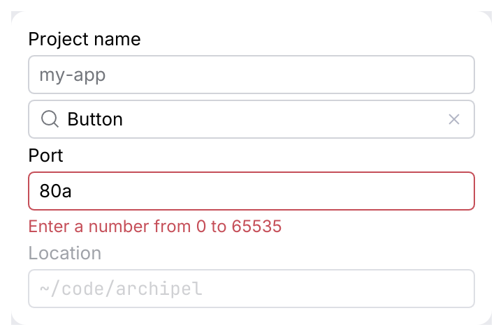
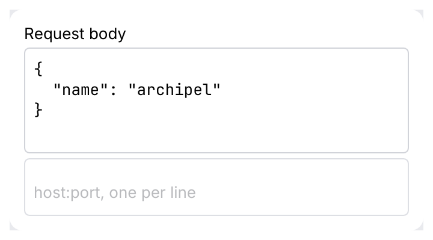
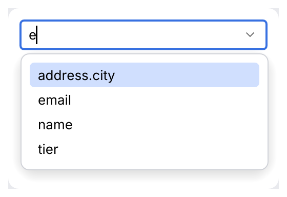
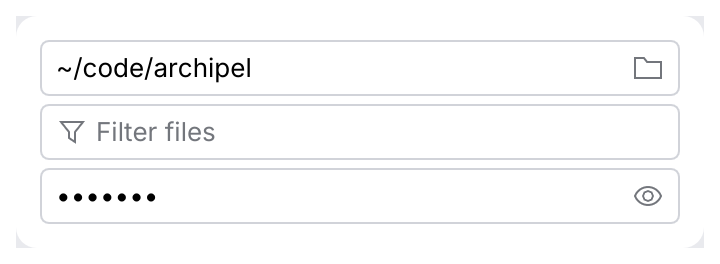
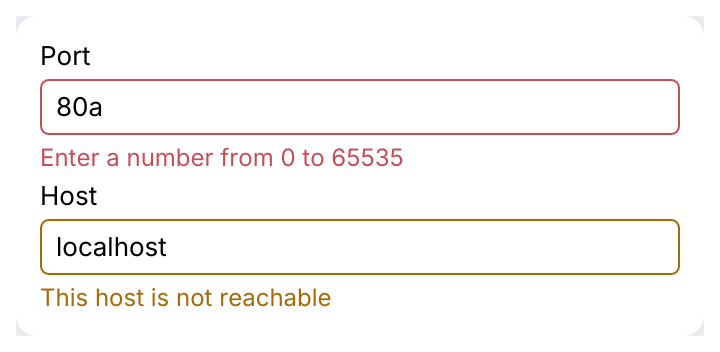
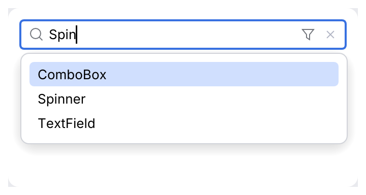
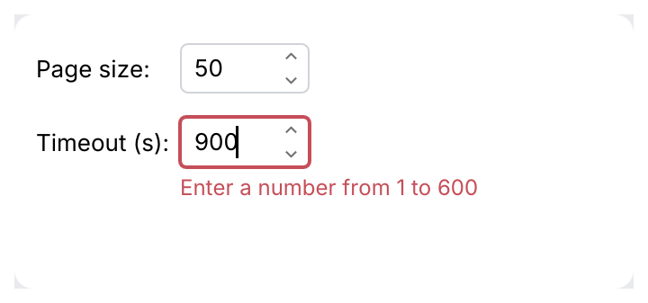

# JBTextField, SearchTextField, JBIntSpinner

A single-line or multi-line text input with an optional label, placeholder, leading icon, clear button and
validation message. `JBTextField::search` is the preset for filter and search boxes.

<picture>
  <source media="(prefers-color-scheme: dark)" srcset="img/jb_text_field.dark.png">
  
</picture>

## Usage

```rust
use archipel_kit::ui::JBTextField;
use archipel_kit::egui;

fn connection_form(ui: &mut egui::Ui, host: &mut String, port: &mut String) {
    ui.add(JBTextField::new(host).label("Host").placeholder("localhost"));
    let error = port.parse::<u16>().is_err().then_some("Enter a number from 0 to 65535");
    ui.add(JBTextField::new(port).label("Port").error(error));
}
```

## API

| Builder | Effect |
|---|---|
| `JBTextField::new(&mut String)` | Edits the string in place. `.id(Id)` sets the text edit's id (like `egui::TextEdit::id`): `response.id == id`, so `ctx.memory_mut(\|m\| m.request_focus(id))` focuses the field. |
| `JBTextField::search(&mut String)` | Magnifier icon, "Search" placeholder, clear button. |
| `.label(str)` | Visible label above the input, also its accessible name. |
| `.name(str)` | Accessible name without a visible label; defaults to the label or placeholder. |
| `.multiline(rows)` | At least two visible lines, wrapping and internal scrolling; Enter inserts a newline. |
| `.placeholder(str)` | Hint shown while empty. |
| `.error(Option<str>)` | Error outline and message below; `None` clears it, so `.error(validate(&text))` works. |
| `.leading_icon(Icon)` | Icon inside the input, before the text. |
| `.clearable(bool)` | Clear button while the input has text. |
| `.password(bool)` | Masks the text. |
| `.monospace(bool)` | Code font, for paths, URLs and ids. |
| `.enabled(bool)` | Disabled inputs are dimmed and read-only. |
| `.highlighter(&dyn SyntaxHighlighter)` | Colors the text (URLs, `{{variables}}`); see [single-line fields](code.md#single-line-fields-and-variables). |
| `.completer(&dyn Completer)` | A completion popup (IntelliJ `Lookup`: matched fragments, tail and type text, wrapping <kbd>Up</kbd>/<kbd>Down</kbd>, <kbd>Enter</kbd> inserts, <kbd>Tab</kbd> replaces the identifier tail, double click inserts) under the caret, operated by the kit; keys and rows in [autocomplete](code.md#autocomplete). A combo box's `.suggestions(..)` list keeps the combo behavior (a single click picks, no prefix matching). |
| `.suggestions(&[String])` | An editable combo box: free text plus a chevron listing the suggestions; see [combo box](#combo-box). |
| `.width(f32)` | Total width (default: the available width, at least 49 pt: `TextField.minimumSize`, and wide enough for its icons). |
| `.extension(Extension)` | An icon button inside the field; see [extensions](#extensions). |
| `.validation(Option<&ValidationInfo>)` | Like `.error`, with a yellow outline for a warning. |
| `.clear_on_escape(bool)` | <kbd>Esc</kbd> clears the text while there is any (default off; on for search). |
| `.history(&mut SearchHistory)` | A search history; use [`SearchTextField`](#searchtextfield). |

Returns the text edit's `Response`: `changed()` after each edit, `lost_focus()` when the user
leaves the field. `.show(ui)` returns a `JBTextFieldOutput` instead: the response, `submitted`
(<kbd>Enter</kbd>), the `caret_rect` and the `{{variable}}` at the caret, for autocomplete.

## Behavior

- Focus draws a 2 pt accent outline (`Component.focusWidth`, the border 1 pt outside); an error
  keeps the outline red, a warning yellow, and the message is shown under the field and as
  its tooltip. Inactive-window ring variants are not provided.
- The placeholder shows while the field is empty, focused or not.
- The clear button empties the field and keeps the focus in it.
- Caret and selection take the theme's editor caret and selection colors; <kbd>Ctrl</kbd>+<kbd>Z</kbd> and
  <kbd>Ctrl</kbd>+<kbd>Shift</kbd>+<kbd>Z</kbd> undo and redo (egui's text edit).
- Password fields show bullets (`.password(true)`); there is no reveal toggle: add an
  [extension](#extensions) with the eye icon and flip `.password(..)` yourself.
- Multi-line fields insert newlines with Enter and leave the field with Tab. `submitted` is
  always false for them. Password masking and highlighting still apply.

<picture>
  <source media="(prefers-color-scheme: dark)" srcset="img/jb_text_field_multiline.dark.png">
  
</picture>

### Combo box

`.suggestions(&values)` turns the field into an editable combo box, as Android Studio uses for
a field name, a recent value or a path: the user may type anything, and a chevron at the
right lists the suggestions below the field, as wide as it.

- Typing lists the suggestions containing the text, ignoring case; <kbd>Up</kbd>/<kbd>Down</kbd>
  move, <kbd>Enter</kbd>, <kbd>Tab</kbd> or a click replace the whole text, <kbd>Esc</kbd>
  closes the list and keeps the focus.
- The chevron, <kbd>Alt</kbd>+<kbd>Down</kbd> or <kbd>Ctrl</kbd>+<kbd>Space</kbd> list all
  suggestions on an empty field or one holding a suggestion; a second click on the chevron
  closes the list.
- Text that is no suggestion stays: validate it with `.error(..)` if it must be one, or use a
  [`ComboBox`](combo-box.md) when only the listed values are valid.

<picture>
  <source media="(prefers-color-scheme: dark)" srcset="img/jb_text_field_suggestions.dark.png">
  
</picture>

### Extensions

`.extension(Extension::new(icon, name))` adds an icon button inside the field, as IntelliJ's
`ExtendableTextField.Extension` (spec section 6). Several may be added; `show(ui)` reports the
one activated this frame in `JBTextFieldOutput::extension_clicked` (its index). Extensions sit
after the text, right to left from the clear button, in the order added; `.icon_before_text(true)`
puts one after the leading icon.

| | |
|---|---|
| Hover | Swaps to `.hovered_icon(..)` and the pointer becomes the action cursor over the icon; elsewhere the text cursor. |
| Click, <kbd>Space</kbd>, <kbd>Enter</kbd> | Report the extension. |
| <kbd>Tab</kbd> | Reaches it (`.focusable(false)` opts out). |
| Tooltip | `.tooltip(text)` after the help tooltip delay (0.5 s). |
| Width | The field grows to fit its icons and never goes below 49 pt. |
| Gap | 6 pt between icons (`size::EXTENSION_GAP`; the spec names `getIconGap` without a default). |

<picture>
  <source media="(prefers-color-scheme: dark)" srcset="img/jb_text_field_extensions.dark.png">
  
</picture>

### Validation

`.validation(Some(&ValidationInfo::error("...")))` (from [DialogWrapper](dialog-wrapper.md)) gives
the field the red outline and the message; `ValidationInfo::warning` the yellow one
(`Colors::warning`). The [UI DSL](dsl.md) hands a cell's validation to its text field.

<picture>
  <source media="(prefers-color-scheme: dark)" srcset="img/jb_text_field_validation.dark.png">
  
</picture>

## SearchTextField

A search input: magnifier, "Search" placeholder, clear button; `SearchTextField::new(&mut text)
.history(&mut SearchHistory)` makes the magnifier a button that lists earlier searches (IntelliJ
`SearchTextField`, spec section 6). `JBTextField::search` is the same without a history.

| Input | |
|---|---|
| <kbd>Esc</kbd> | Clears the text while there is any (`.clear_on_escape(false)` turns it off); on an empty field Esc is left to the window. |
| Click on the cross | Clears the text and keeps the focus. |
| Click on the magnifier, <kbd>Alt</kbd>+<kbd>Down</kbd> | Lists the history (the first 28 pt of the field are the button). |
| <kbd>Alt</kbd>+<kbd>Up</kbd>, and <kbd>Alt</kbd>+<kbd>Down</kbd> while the list is open | Step to the previous / next entry in the field, wrapping around. |
| <kbd>Enter</kbd> | Submits (`out.submitted`) and adds the text to the history. |
| In the list | <kbd>Up</kbd>/<kbd>Down</kbd> move, <kbd>Enter</kbd> or a click chooses (the entry goes to the front), <kbd>Esc</kbd> closes. The list is as wide as the field. |

`SearchHistory::new()` keeps five entries (newest first, duplicates move to the front, blank
text is ignored); `with_capacity(n)` changes that. The kit never saves it: persist it where your
app keeps settings (IntelliJ saves under a property name). The magnifier's chevron (the
`SearchWithHistory` icon) is not drawn.

```rust
use archipel_kit::ui::{SearchHistory, SearchTextField};
use archipel_kit::egui;

fn filter_box(ui: &mut egui::Ui, query: &mut String, history: &mut SearchHistory) -> bool {
    SearchTextField::new(query).history(history).show(ui).submitted
}
```

<picture>
  <source media="(prefers-color-scheme: dark)" srcset="img/search_text_field.dark.png">
  
</picture>

<picture>
  <source media="(prefers-color-scheme: dark)" srcset="img/search_text_field_empty.dark.png">
  
</picture>

## JBIntSpinner

An integer input (page size, timeout, port), as Android Studio's integer fields: a text
field with arrows whose number is written to the value as soon as it is valid and in range.
Anything else shows the error below the field and leaves the value alone; leaving the field
shows the value again. `changed()` reports a new value, not every keystroke. It edits any
`Integer`: `i32`, `i64`, `u16`, `u32`, `u64`, `usize`. IntelliJ spec section 13.4:

| Input | |
|---|---|
| <kbd>Up</kbd> / <kbd>Down</kbd> | Step by `.step(n)`, clamped to the range. |
| Arrows at the right edge | A press steps once; held, it repeats after 300 ms every 60 ms (Swing's spinner timer, marked S in the spec). |
| Mouse wheel | Steps, but only while the field has focus and is enabled; the page scrolls otherwise. |
| Leaving the field | Invalid text is replaced by the value (a valid number is already written). |

The size is `Spinner.minimumSize`, 72 x 28 (`NUMBER_FIELD_WIDTH`); the field takes the arrow area
out of its text. The spec says the value is committed when focus is lost; the kit writes a valid
number at once, which gives the same result when focus leaves.

```rust
use archipel_kit::ui::dsl::panel;

fn query_options(ui: &mut archipel_kit::egui::Ui, limit: &mut u64) {
    panel(ui, |p| {
        p.row("Limit:", |r| {
            r.int_spinner_with(limit, |spinner| spinner.range(1..=10_000).step(10));
        });
    });
}
```

| Builder | Effect |
|---|---|
| `JBIntSpinner::new(&mut T)` | Edits the integer in place; every value of `T` is valid. |
| `.range(min..=max)` | The accepted values; the error names them. |
| `.step(n)` | What <kbd>Up</kbd>/<kbd>Down</kbd> add or subtract (default 1). |
| `.name(str)` | Accessible name; a [UI DSL](dsl.md) row names it after its label. |
| `.width(f32)` | Default `NUMBER_FIELD_WIDTH` (72 pt). |
| `.enabled(bool)`, `.id(Id)` | As on `JBTextField`. |

<picture>
  <source media="(prefers-color-scheme: dark)" srcset="img/jb_int_spinner.dark.png">
  
</picture>

## Accessibility

Role `TextInput`, `MultilineTextInput` (or `PasswordInput`), named explicitly with `.name`,
otherwise by the visible label or placeholder. The error message is
also the input's tooltip. A combo box's chevron is a button named "Show suggestions".

## Testing

```rust
use archipel_kit::ui::JBTextField;
use archipel_kit::testing::{self, Queryable};
use archipel_kit::Theme;

let mut harness = testing::harness_state(Theme::dark(), String::new(), |ui, text| {
    ui.add(JBTextField::new(text).label("Name"));
});
let input = harness.get_by_label("Name");
input.focus();
input.type_text("archipel");
harness.run();
assert_eq!(harness.state(), "archipel");
```

Source: [`ui/text_field.rs`](../../crates/archipel-kit/src/ui/text_field.rs),
[`ui/search_text_field.rs`](../../crates/archipel-kit/src/ui/search_text_field.rs),
[`ui/text_extensions.rs`](../../crates/archipel-kit/src/ui/text_extensions.rs) ·
Tests: [`tests/jb_text_field.rs`](../../crates/archipel-kit/tests/jb_text_field.rs),
[`tests/search_text_field.rs`](../../crates/archipel-kit/tests/search_text_field.rs),
[`tests/jb_int_spinner.rs`](../../crates/archipel-kit/tests/jb_int_spinner.rs)
