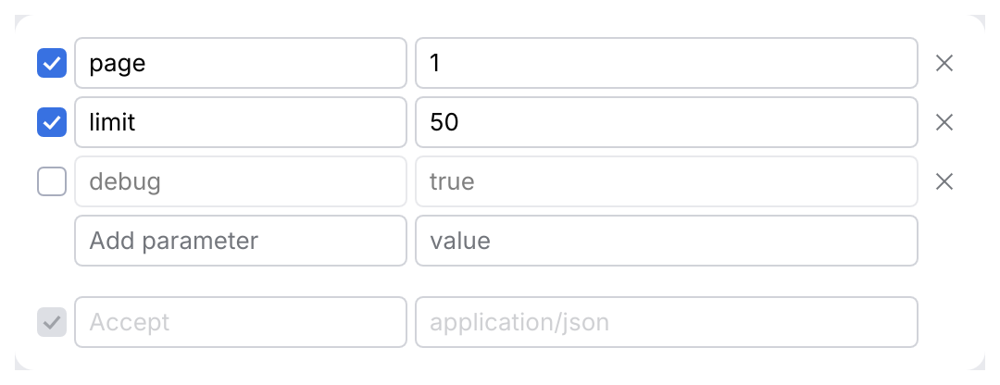

# KeyValueTable

An editable list of key/value rows: query parameters, headers, form fields, environment
variables, connection options. Each row has an enable checkbox, a key, a value and a delete
button; a trailing empty row appends a new row as soon as the user types into it.

<picture>
  <source media="(prefers-color-scheme: dark)" srcset="img/key_value.dark.png">
  
</picture>

## Usage

The caller owns the rows. Use the ready-made `KeyValueEntry`, or implement `KeyValueRow` for
your own model type so the table edits your rows in place, without copying them every frame.

```rust
use archipel_kit::components::{Change, KeyValueEntry, KeyValueTable};
use archipel_kit::egui;

fn query_params(ui: &mut egui::Ui, params: &mut Vec<KeyValueEntry>) {
    let out = KeyValueTable::new("params", params)
        .key_placeholder("Add parameter")
        .value_placeholder("value")
        .show(ui);
    for change in &out.changes {
        match change {
            Change::Added(row) | Change::KeyEdited(row) | Change::ValueEdited(row) => {
                let _ = row; // rebuild the URL preview
            }
            Change::Toggled(_) | Change::Removed(_) => {}
        }
    }
}
```

Your own row type:

```rust
use archipel_kit::components::{KeyValueRow, KeyValueTable};
use archipel_kit::egui;

#[derive(Default)]
struct Header {
    enabled: bool,
    name: String,
    value: String,
    description: String, // not shown by the table, left untouched
}

impl KeyValueRow for Header {
    fn enabled_mut(&mut self) -> &mut bool { &mut self.enabled }
    fn key_mut(&mut self) -> &mut String { &mut self.name }
    fn value_mut(&mut self) -> &mut String { &mut self.value }
}

fn headers(ui: &mut egui::Ui, rows: &mut Vec<Header>) {
    KeyValueTable::new("headers", rows).show(ui);
}
```

Rows must implement `Default`: new rows are created with it, then enabled and filled in.

## API

| Builder | Effect |
|---|---|
| `KeyValueTable::new(id_salt, &mut Vec<T>)` | `T: KeyValueRow + Default`. Tells tables on one screen apart. |
| `.key_placeholder(str)` | Hint of empty key cells (default "Key"). |
| `.value_placeholder(str)` | Hint of empty value cells (default "Value"). |
| `.read_only(bool)` | No trailing row, no delete buttons; checkboxes and cells are inert (and look disabled). |
| `.value_cell(\|ui, ValueCell\| Response)` | Draws the value cells yourself, e.g. to highlight `{{variables}}`. `ValueCell::text_field(ui)` is the default. |
| `.show(ui)` | Returns `KeyValueTableResponse { response, changes }`. |

`Change` is `KeyEdited(row)`, `ValueEdited(row)`, `Added(row)`, `Removed(row)` or
`Toggled(row)`, in the order they happened. `Removed` is applied after the rows are drawn;
indices refer to the `Vec` as it was when the table started the frame.

The key column takes `tokens::size::KEY_COLUMN_SHARE` (40 %) of the width left after the
checkbox and delete button; the value column takes the rest. The table fills the available
width and fits a 500 pt wide panel.

## Behavior

- Typing into the trailing row appends an enabled row with that text. Focus and cursor stay
  in the cell being typed into, which is now a real row; a new empty row appears below.
  Delete and Backspace in the empty row do nothing.
- <kbd>Tab</kbd> and <kbd>Shift+Tab</kbd> walk the cells row by row: checkbox, key, value,
  delete, next row. <kbd>Enter</kbd> in a key moves to its value.
- A disabled row (checkbox off) is dimmed but stays editable.
- The delete button has the tooltip "Remove".

## Accessibility

Every cell is named by its role and row: "Enabled, row 2" (checkbox, with its checked
state), "Key, row 2", "Value, row 2" and "Remove, row 2". The empty row's cells are "Key, new
row" and "Value, new row". A custom value cell must keep the `ValueCell::name`.

## Testing

```rust
use archipel_kit::components::{KeyValueEntry, KeyValueTable};
use archipel_kit::testing::{self, Queryable};
use archipel_kit::Theme;

let mut harness = testing::harness_state(Theme::dark(), Vec::<KeyValueEntry>::new(), |ui, rows| {
    KeyValueTable::new("params", rows).show(ui);
});
let cell = harness.get_by_label("Key, new row");
cell.focus();
cell.type_text("page");
harness.run();
assert_eq!(harness.state()[0].key, "page");
```

Source: [`components/key_value.rs`](../../crates/archipel-kit/src/components/key_value.rs) ·
Tests: [`tests/key_value.rs`](../../crates/archipel-kit/tests/key_value.rs)
