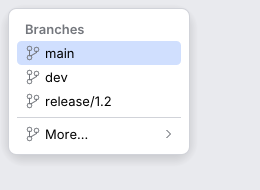

# ListPopup

A list that chooses a value (IntelliJ `ListPopup` built from `PopupStep`s, `ListPopupImpl` and
`WizardPopup`). Rows can open sub-steps in child lists, the keyboard moves one shared
highlight, and the timings are IntelliJ's. `ActionPopupMenu` runs on the same engine, so
menus and lists behave identically.

<picture>
  <source media="(prefers-color-scheme: dark)" srcset="img/list_popup.dark.png">
  
</picture>

## Usage

```rust
use archipel_kit::ui::{Button, popup::{BaseListPopupStep, ListPopup, PopupStepResult}};
use archipel_kit::{Glyph, egui};

fn branch_picker(ui: &mut egui::Ui, popup: &mut Option<ListPopup<String>>) -> Option<String> {
    let button = ui.add(Button::secondary("Branch"));
    if button.clicked() && popup.is_none() {
        let step = BaseListPopupStep::new("Branches", vec!["main".to_owned(), "dev".to_owned()])
            .icons(|_| Some(Glyph::Branch.into()))
            .speed_search(true);
        let mut p = ListPopup::new("branches", step);
        p.open(ui.ctx());
        *popup = Some(p);
    }
    let mut chosen = None;
    if let Some(p) = popup.as_mut() {
        let response = p.show(ui.ctx(), button.rect);
        chosen = response.chosen;
        if !p.is_open() {
            *popup = None;
        }
    }
    chosen
}
```

Sub-steps: `.has_substep(|v| ..)` marks rows with a chevron and `.on_chosen(|value, final_choice| ..)`
returns `PopupStepResult::Next(step)` for them, `FinalChoice` (the popup closes and reports the
value) or `Stay`. Implement `PopupStep` yourself for anything `BaseListPopupStep` does not
cover (it is the trait IntelliJ's `PopupStep` is).

## API

| Item | Role |
|---|---|
| `PopupStep<T>` | `title`, `values`, `text_for`, `icon_for`, `shortcut_for`, `separator_for`, `is_selectable`, `has_substep`, `on_chosen`, `canceled`, `mnemonic_for`, `is_mnemonics_navigation_enabled`, `is_speed_search_enabled`, `is_auto_selection_enabled`, `default_option_index`. |
| `BaseListPopupStep<T>` | A step from a value list: `.icons`, `.separator_before(i)`, `.unselectable(i)`, `.has_substep`, `.on_chosen`, `.mnemonics`, `.speed_search`, `.auto_selection`, `.default_index`. |
| `ListPopup<T>` | `new(id, step)`, `open(ctx)`, `show(ctx, anchor)` / `show_at(ctx, pos)`, `close`, `is_open`, `chain()`; `.show_submenu_on_hover(bool)`, `.cancel_on_click_outside(bool)`. |
| `ListPopupResponse<T>` | `chosen` (the final value this frame) and `cancelled`. |
| `PopupChain` | The open state, selection per level and timers; owned by the popup, or by you with `ActionPopupMenu`. |

## Keyboard (IntelliJ spec §5.1)

| Key | Action |
|---|---|
| <kbd>↑</kbd> <kbd>↓</kbd> | Move the selection, skipping separators and disabled rows; wraps around (first ↔ last). From no selection, <kbd>↓</kbd> selects the first and <kbd>↑</kbd> the last row. |
| <kbd>Home</kbd> <kbd>End</kbd> | First and last selectable row. |
| <kbd>PgUp</kbd> <kbd>PgDn</kbd> | A page up or down; stops at the ends. |
| <kbd>Enter</kbd> | Choose the row (`on_chosen(value, true)`); a row with a sub-step opens it instead. |
| <kbd>→</kbd> | Open the sub-step of the selected row. |
| <kbd>←</kbd> | Close the child list and return to the parent. |
| <kbd>Esc</kbd> | Back one level (clears the speed search first); at the first level it closes the popup (`canceled`). |
| <kbd>Shift</kbd>+<kbd>Esc</kbd> | Close the whole chain. |
| mnemonic | With `.mnemonics(true)`, typing a row's number (1-9, 0, then letters) chooses it. |
| typing | With `.speed_search(true)`, typed text filters the rows and selects the first match. |

## Pointer and timings (spec §5.2)

| Rule | Value |
|---|---|
| The first pointer move after opening is ignored; moves that do not change the position are not moves | `PopupChain` |
| Hovering a selectable row selects it; hovering a separator or disabled row clears the selection | |
| A row with a sub-step opens it after the pointer rests 250 ms, when `.show_submenu_on_hover(true)` | `motion::POPUP_SUBMENU_DELAY` |
| Moving toward an open child does not retarget the selection (a triangle from the pointer to the child's near edge); moving 16 pt away ends the guard | `popup::SUBMENU_AWAY` |
| With auto-selection the selected row is chosen (opening its sub-step) after 500 ms without moving; each move restarts the timer | `motion::POPUP_AUTO_SELECTION_DELAY` |
| A click chooses on release | |
| A press on the chevron opens the sub-step at once, without choosing | `popup::CHEVRON_HIT` |
| A press outside closes the popup; it cannot reopen for 200 ms, so the click that closes it through its owner button does not reopen it | `motion::POPUP_REOPEN_GUARD`, `PopupChain::open` |

## Geometry and paint (spec §5.3)

Rows are 24 pt and touch, with a pill inset 8 pt from the popup's sides; 8 pt above the
first and below the last row; a title is a 24 pt semibold row; separators are 9 pt rows
(a titled separator is a 24 pt row); the icon column is reserved only when a row has an icon
or check; a chevron marks sub-step rows; mnemonic hints are drawn in `Colors::popup_mnemonic`
before the icon column. Taller lists scroll with the wheel. Measured values of Android Studio
win where the spec lists a different default (selection arc 4 not 8, minimum width 180 not
170). Not implemented: multi-selection with Shift or Ctrl click, inline row buttons
(<kbd>→</kbd> between them), the advertiser strip and the header with controls.

## Accessibility

The popup is a `Menu`; rows are buttons named by their text (checked rows are check boxes) and
are not Tab stops: the popup owns the selection.

Source: [`ui/popup/`](../../crates/archipel-kit/src/ui/popup/) ·
Tests: [`tests/list_popup.rs`](../../crates/archipel-kit/tests/list_popup.rs)
