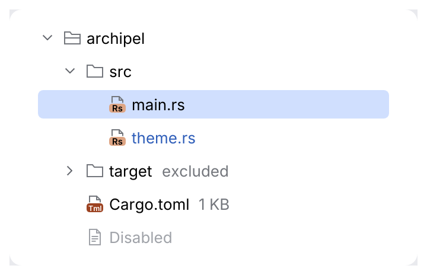
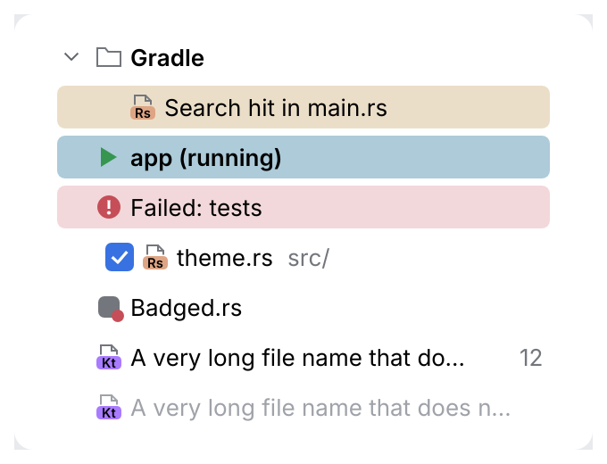
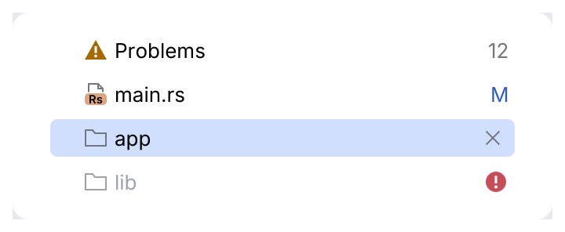

# ListRow

One row of a list or tree: expander chevron, icon, label, secondary text. The whole row is
the click target; the selection draws a rounded pill (blue while the list has focus,
`selection_inactive` gray without). As in Android Studio's trees, rows have no hover fill;
`flat` rows in popups highlight under the pointer like menu items. Rows are stateless (the caller
owns selection and expansion), so the same row serves a flat list, a lazily loaded tree or a
virtualized table.

<picture>
  <source media="(prefers-color-scheme: dark)" srcset="img/list_row.dark.png">
  
</picture>

## Usage

```rust
use archipel_kit::components::ListRow;
use archipel_kit::{Glyph, Icon, egui};

struct Tree {
    expanded: bool,
    selected: Option<usize>,
}

fn project_tree(ui: &mut egui::Ui, tree: &mut Tree, files: &[&str]) {
    let root = ListRow::new("src").icon(Glyph::Folder).expanded(Some(tree.expanded)).show(ui);
    if root.toggled {
        tree.expanded = !tree.expanded;
    }
    if tree.expanded {
        for (index, name) in files.iter().enumerate() {
            let row = ListRow::new(*name)
                .icon(Icon::for_file(name))
                .depth(1)
                .selected(tree.selected == Some(index))
                .show(ui);
            if row.response.clicked() {
                tree.selected = Some(index);
            }
        }
    }
}
```

For long lists, draw only the visible rows with `egui::ScrollArea::show_rows`.

### Leading content, emphasis, tints and long labels

<picture>
  <source media="(prefers-color-scheme: dark)" srcset="img/list_row_options.dark.png">
  
</picture>

- `.leading(Slot)` puts content before the icon, such as a checkbox for a commit row. Give
  widgets room with `Slot::ui_width`, and a `Checkbox` the visible label off
  (`.label_visible(false)`), since the row names it.
- `.strong(true)` draws the label semibold: group titles, the running configuration.
- `.tint(Tone)` tints the background by meaning (`Tone::Warning` for a search hit,
  `Tone::Success` for a running configuration). It is a tone like everywhere in the kit, never
  a color. The tint stays visible on a selected row.
- `.icon_painter(|painter, rect, color| …)` paints the 16×16 icon yourself, for an icon with a
  badge. `color` is the icon tone in the row's state, so it dims when the row is disabled.
- A label wider than the room (the row, minus the trailing slot) ends with `…`, and the
  full label is the row's tooltip. The dimmed secondary text shrinks first. Attach your own
  `Tooltip` and it replaces the automatic one.

```rust
use archipel_kit::components::{Checkbox, ListRow};
use archipel_kit::parts::Slot;
use archipel_kit::{Icon, Tone, egui};

fn commit_row(ui: &mut egui::Ui, path: &str, included: &mut bool) {
    ListRow::new(path)
        .icon(Icon::for_file(path))
        .leading(Slot::ui_width(22.0, |ui| {
            ui.add(Checkbox::new(included, format!("Include {path}")).label_visible(false));
        }))
        .tint(Tone::Warning)
        .show(ui);
}
```

### Trailing content and row actions

The trailing slot takes a count, a status, an icon or widgets. Actions that would clutter a
long list appear only on the hovered, focused or selected row with `.trailing_on_hover(true)`.
Row actions are small icon buttons (`IconButton::small`), which fit the 24-point row.

<picture>
  <source media="(prefers-color-scheme: dark)" srcset="img/list_row_slots.dark.png">
  
</picture>

```rust
use archipel_kit::behaviour::{ContextMenu, DragSource};
use archipel_kit::components::{IconButton, ListRow, MenuItem, Tooltip};
use archipel_kit::parts::Slot;
use archipel_kit::{Glyph, egui};

fn module_row(ui: &mut egui::Ui, name: &str, removed: &mut bool) {
    ListRow::new(name)
        .icon(Glyph::Folder)
        .trailing_on_hover(true)
        .trailing(Slot::ui(|ui| {
            if ui.add(IconButton::new(Glyph::Close, format!("Remove {name}")).small(true)).clicked() {
                *removed = true;
            }
        }))
        .with(Tooltip::new(name.to_string()).hint("A Gradle module"))
        .with(ContextMenu::new(|ui| {
            ui.add(MenuItem::new("Open Module Settings"));
        }))
        .with(DragSource(name.to_string()))
        .show(ui);
}
```

## API

| Builder | Effect |
|---|---|
| `ListRow::new(label)` | A row; `.show(ui)` returns `RowResponse { response, toggled }`. |
| `.icon(Icon)`, `.icon_tone(Tone)` | Leading icon. |
| `.secondary(str)` | Dimmed text after the label (path, size, type). |
| `.label_tone(Tone)` | E.g. `Tone::Modified` for a changed file. |
| `.strong(bool)` | Semibold label. |
| `.tint(Tone)` | Background tint by meaning. |
| `.icon_painter(Fn(&Painter, Rect, Color32))` | Custom-painted icon in the icon column. |
| `.leading(Slot)` | Content before the icon, after the chevron (a checkbox). |
| `.depth(usize)` | Tree indent. |
| `.expanded(Option<bool>)` | `Some` draws a chevron; `None` keeps leaves aligned. |
| `.selected(bool)`, `.enabled(bool)` | State. |
| `.trailing(Slot)` | Content at the right end: `Slot::text`, `Slot::icon`, `Slot::ui(...)`. |
| `.trailing_on_hover(bool)` | Show the trailing slot only on the hovered, focused or selected row. |
| `.with(behaviour)` | Tooltip, context menu, drag source or drop target (see [behaviours](../behaviours.md)). |

`response` gives `clicked()`, `double_clicked()` and `context_menu(...)`.

## Behavior

- A label that does not fit is elided with `…` and shown in full as the tooltip.
- A row with a `DragSource` is registered once, with click and drag sense, so a draggable
  folder keeps its place in the <kbd>Tab</kbd> order (chevron button after the row).
- `toggled` is set when the chevron is clicked, the row is double-clicked, or
  <kbd>→</kbd> / <kbd>←</kbd> is pressed on a focused collapsed / expanded node.

## Accessibility

Selectable items named "label secondary", reporting the selected state.

Source: [`components/list.rs`](../../crates/archipel-kit/src/components/list.rs) ·
Tests: [`tests/navigation.rs`](../../crates/archipel-kit/tests/navigation.rs)
