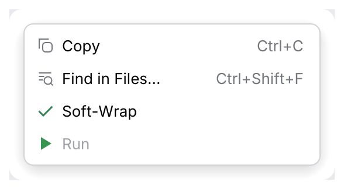
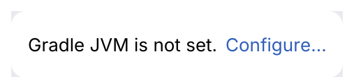

# MenuItem, Link

A **menu item** has an icon column, a label and a right-aligned shortcut, for menu bars and
context menus. A **link** is inline text that performs an action.

<picture>
  <source media="(prefers-color-scheme: dark)" srcset="img/menu_item.dark.png">
  
</picture>

<picture>
  <source media="(prefers-color-scheme: dark)" srcset="img/link.dark.png">
  
</picture>

## Usage

```rust
use archipel_kit::components::{Button, Link, MenuItem};
use archipel_kit::{Glyph, Icon, egui};

fn file_row(ui: &mut egui::Ui, wrap: &mut bool) {
    ui.add(Button::secondary("main.rs")).context_menu(|ui| {
        if ui.add(MenuItem::new("Copy Path").icon(Glyph::Copy).shortcut("Ctrl+Shift+C")).clicked() {
            ui.close();
        }
        if ui.add(MenuItem::new("Soft-Wrap").checked(*wrap)).clicked() {
            *wrap = !*wrap;
        }
    });
    ui.horizontal(|ui| {
        ui.label("Gradle JVM is not set.");
        ui.add(Link::new("Configure…"));
    });
}
```

## API

| Component | Builders |
|---|---|
| `MenuItem::new(label)` | `.icon(Icon)`, `.shortcut(str)`, `.checked(bool)`, `.enabled(bool)` |
| `Link::new(text)` | Underlined on hover, pointer cursor. |

## Accessibility

Menu items are buttons (checkable items are check boxes) named by their label; links have
role `Link`.

Source: [`components/misc.rs`](../../crates/archipel-kit/src/components/misc.rs) ·
Tests: [`tests/menus.rs`](../../crates/archipel-kit/tests/menus.rs)
