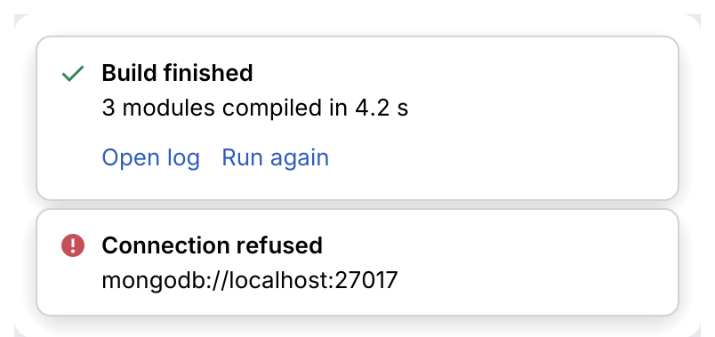
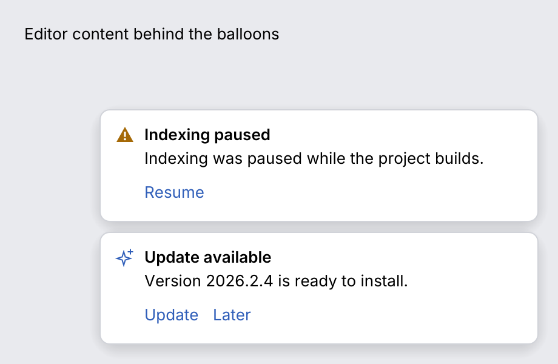

# Notification

A **notification** tells the user about something that happened without interrupting them: a
finished build, a failed sync, an update. This page covers the card (`Notification`), the
balloon stack that shows cards in the corner of the window (`NotificationsManager`), and
the model they share (`NotificationType`, `NotificationGroup`, `NotificationAction`),
after IntelliJ's `Notification`, `NotificationGroup` and `BalloonLayout`.

<picture>
  <source media="(prefers-color-scheme: dark)" srcset="img/notification.dark.png">
  
</picture>

<picture>
  <source media="(prefers-color-scheme: dark)" srcset="img/notification_balloons.dark.png">
  
</picture>

## Usage

Keep a `NotificationsManager` in your application state, add notifications with `notify`, and
call `show` once per frame. It draws the balloons and reports what the user did.

```rust
use archipel_kit::egui;
use archipel_kit::notification::{
    Notification, NotificationEventKind, NotificationGroup, NotificationType,
    NotificationsManager,
};

struct App {
    notifications: NotificationsManager,
}

fn build_failed(app: &mut App) {
    app.notifications.notify(
        Notification::new(NotificationType::Error, "Build failed")
            .body("3 errors in 2 files")
            .group(NotificationGroup::sticky_balloon_group("Build"))
            .action("Show errors"),
    );
}

fn frame(ctx: &egui::Context, app: &mut App) {
    for event in app.notifications.show(ctx) {
        match event.kind {
            NotificationEventKind::Action(0) => { /* open the problems view */ }
            NotificationEventKind::Dismissed | NotificationEventKind::Hidden => {}
            _ => {}
        }
    }
}
```

A card can also be drawn in place, without the manager:

```rust
use archipel_kit::{ui::Status, notification::Notification};
use archipel_kit::egui;

fn card(ui: &mut egui::Ui) {
    let out = Notification::new(Status::Success, "Build finished")
        .body("3 modules compiled in 4.2 s")
        .action("Open log")
        .show(ui);
    if out.action == Some(0) {
        // open the log
    }
}
```

## Balloon behavior

| Rule | Value | IntelliJ spec |
|---|---|---|
| Width | 360 pt | §10.1 |
| Visible at once | 2 (`size::NOTIFICATION_VISIBLE_COUNT`); the rest wait and start their timer when they get a place | §10.1 |
| Position | Stack in the bottom-right corner, the newest at the bottom, 16 pt from the edges (`bottom_inset` lifts it above a status bar), 8 pt apart (the kit's own choice) | §10.1 |
| Time on screen | 10 s; 300 s for a sticky group (`NotificationGroup::sticky_balloon_group`) | §10.1 |
| Hover | The timer stops while the pointer is over the balloon and starts over (the full time) when it leaves | §10.1 |
| Inactive window | The timer stops while the window is not focused and goes on with the time left | §10.1 |
| Fade-out | 200 ms, then `Hidden` | §10.1 |
| Close | The close button (shown while the pointer is over the card or it has the focus) reports `Dismissed`; <kbd>Esc</kbd> does too while a button or link of the balloon has the focus | §10.1 |
| Click outside | Hides regular balloons (`Hidden`), never sticky ones; `hide_on_click_outside(false)` turns it off. The click that creates a balloon does not hide it | §10.1 |
| Actions | Links under the text; performing one reports `Action(index)` and expires the notification unless `NotificationAction::keep_notification(true)` | §10.1 |
| Height | A balloon taller than 75% of the window scrolls its text; the actions stay | §10.1 |
| Log-only groups | `NotificationGroup::log_only_group` notifications are never shown, only added to the history | §10.1 |

Hidden and dismissed notifications go to `history()` (the last 200); the history list itself is
yours to draw. `expire(id)` removes a notification, shown or waiting, without a trace.

## API

| Item | Use |
|---|---|
| `Notification::new(Status \| NotificationType, title)` | A card. |
| `.body(str)`, `.action(label)`, `.notification_action(NotificationAction)`, `.group(NotificationGroup)` | Content, actions and the group. |
| `.show(ui)` | Draws it in place (360 pt wide); returns `MessageResponse` (`action`, `dismissed`, `focused`). |
| `.show_corner(ctx, id, index)` | Floats one card bottom-right; use the manager for several. |
| `NotificationType` | `Information`, `Warning`, `Error`, `IdeUpdate` (the promo style); converts to `Status`. |
| `NotificationGroup` (`NotificationDisplayType`: `Balloon`, `StickyBalloon`, `ToolWindow`, `None`) | `balloon_group`, `sticky_balloon_group`, `log_only_group`, `tool_window_group(id, tool_window_id)`; `display_id()`, `display_type()`. |
| `NotificationsManager::new()` | `.notify(n)` → `NotificationId`, `.show(ctx)` → events, `.expire(id)`, `.visible()`, `.queued()`, `.history()`, `.hide_on_click_outside(bool)`, `.bottom_inset(f32)`. |

Tool-window groups behave like balloon groups; anchoring the balloon to a tool window's stripe
is up to the application.

## Accessibility

The title and body are labels, the actions are links and the close button is named "Dismiss";
it keeps its name and Tab stop while it is hidden.

Source: [`notification/`](../../crates/archipel-kit/src/notification/) ·
Tests: [`tests/notifications.rs`](../../crates/archipel-kit/tests/notifications.rs),
[`tests/feedback.rs`](../../crates/archipel-kit/tests/feedback.rs)
