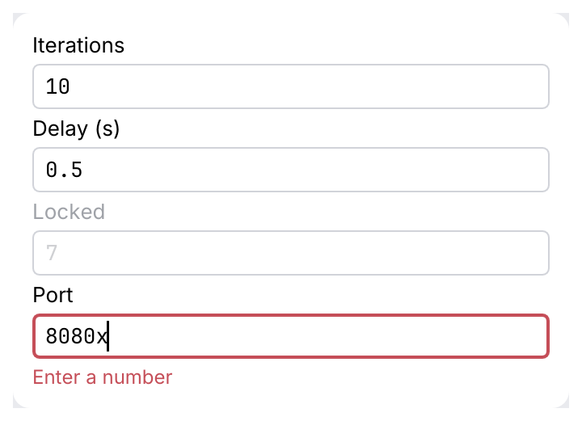

# NumberField

A number input built on [`TextField`](text-field.md): same look, focus ring and states. It
edits an integer or a float, with optional `min`, `max` and `step`, and keeps the last valid
value while the text is wrong.

<picture>
  <source media="(prefers-color-scheme: dark)" srcset="img/number_field.dark.png">
  
</picture>

## Usage

```rust
use archipel_kit::components::NumberField;
use archipel_kit::egui;

fn runner_settings(ui: &mut egui::Ui, iterations: &mut u32, delay_s: &mut f64) {
    if ui
        .add(NumberField::new(iterations).label("Iterations").range(1..=1000))
        .changed()
    {
        // `*iterations` is the new valid value
    }
    ui.add(NumberField::new(delay_s).label("Delay (s)").min(0.0).step(0.1));
}
```

One generic type covers integers and floats: any `Number` (`i32`, `i64`, `u32`, `u64`,
`usize`, `f32`, `f64`). `min`, `max` and `step` have the type of the value, so integers step
exactly and saturate at their type's bounds, and floats are rounded so `0.1 + 0.2` reads `0.3`.

## API

| Builder | Effect |
|---|---|
| `NumberField::new(&mut N)` | Edits the number in place. |
| `.min(N)` / `.max(N)` / `.range(a..=b)` | Allowed values (none by default). |
| `.step(N)` | Added by the arrow keys (default 1). |
| `.label(str)` | Visible label, also the accessible name. |
| `.enabled(bool)` | Disabled fields are dimmed and read-only. |
| `.width(f32)` | Total width (default: the available width). |
| `.id(Id)` | The text edit's id. The default is stable while the field keeps its place in the `Ui`. |

Returns the text edit's `Response`; `changed()` is true on the frames the value changed.

## Behavior

- <kbd>↑</kbd> / <kbd>↓</kbd> add or subtract `step`; with <kbd>Shift</kbd> ten steps. The
  result is clamped to `min..=max`.
- Typing updates the value as soon as the text is a number in range.
- Text that is not a number, or is out of range, shows the error state with a message. The
  value keeps the last valid number; leaving the field restores its text.
- The text being typed is kept in egui's memory (like a `TextEdit`'s cursor); the caller only
  sees valid numbers.

## Accessibility

Role `TextInput`, labelled by the visible label, with the text as its value. The error message
is also the tooltip.

## Testing

```rust
use archipel_kit::components::NumberField;
use archipel_kit::egui::Key;
use archipel_kit::testing::{self, NodeExt, Queryable};
use archipel_kit::Theme;

let mut harness = testing::harness_state(Theme::dark(), 10_i32, |ui, value| {
    ui.add(NumberField::new(value).label("Iterations").range(0..=100));
});
harness.get_by_label("Iterations").focus();
harness.run();
harness.key_press(Key::ArrowUp);
harness.run();
assert_eq!(*harness.state(), 11);
```

Source: [`components/number_field.rs`](../../crates/archipel-kit/src/components/number_field.rs) ·
Tests: [`tests/number_field.rs`](../../crates/archipel-kit/tests/number_field.rs)
