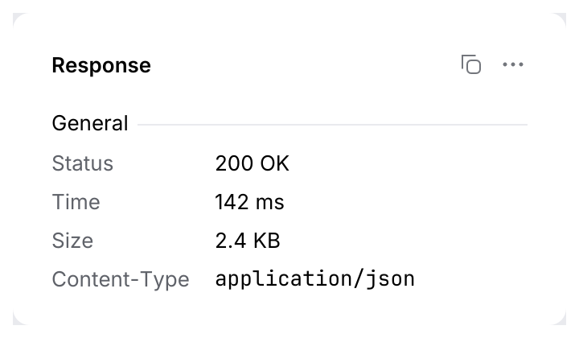
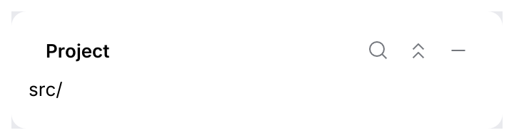
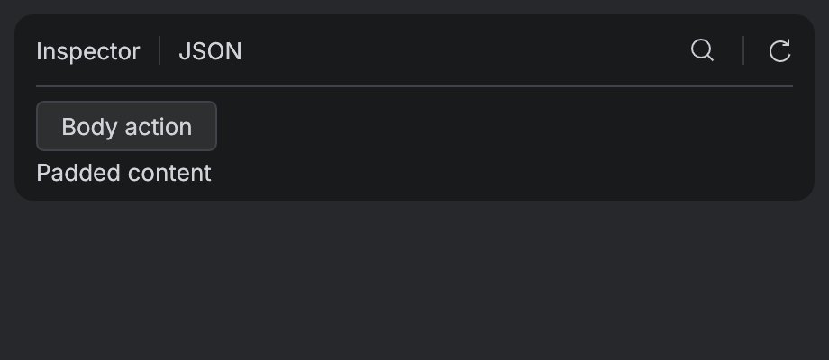
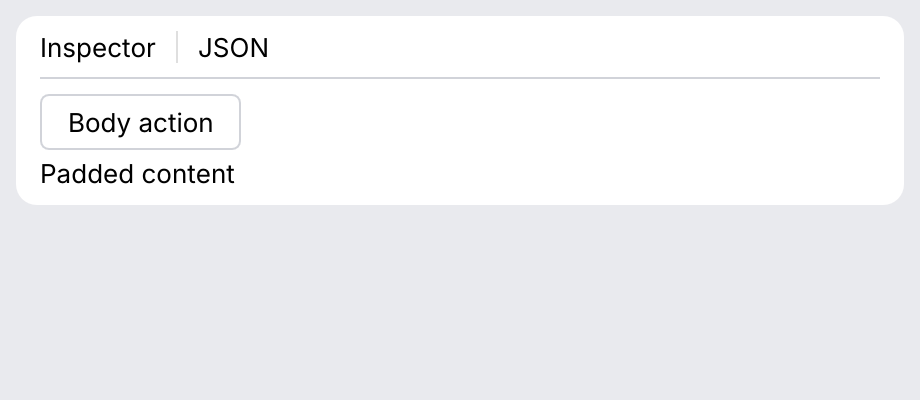

# Panel, SectionHeader, Separator, PropertyGrid

Layout building blocks. A **panel** is an island with a title bar: the unit of a workbench
layout (tool windows, sidebars, inspectors). **Section headers** group content inside it;
**property grids** show key/value details.

<picture>
  <source media="(prefers-color-scheme: dark)" srcset="img/panel.dark.png">
  
</picture>

## Usage

```rust
use archipel_kit::components::{IconButton, Panel, PropertyGrid, SectionHeader};
use archipel_kit::{Glyph, egui};

fn response_panel(ui: &mut egui::Ui) {
    Panel::new("Response")
        .actions(|ui| {
            // Laid out right to left: the first action is the rightmost.
            ui.add(IconButton::new(Glyph::More, "More"));
            ui.add(IconButton::new(Glyph::Copy, "Copy"));
        })
        .show(ui, |ui| {
            ui.add(SectionHeader::new("General"));
            PropertyGrid::new("response")
                .row("Status", "200 OK")
                .mono_row("Content-Type", "application/json")
                .show(ui);
        });
}
```

### Tool window header

`.on_hide(|| …)` adds the tool window's hide button at the right end of the title bar (named
"Hide <title>", tooltip "Hide"). With `.actions(...)` the title bar is the IntelliJ-style
header: title, action icon buttons, hide. Panels without `on_hide` are unchanged.

<picture>
  <source media="(prefers-color-scheme: dark)" srcset="img/panel_tool_window.dark.png">
  
</picture>

```rust
use archipel_kit::components::{IconButton, Panel};
use archipel_kit::{Glyph, egui};

fn project_window(ui: &mut egui::Ui, visible: &mut bool) {
    Panel::new("Project")
        .actions(|ui| {
            ui.add(IconButton::new(Glyph::CollapseAll, "Collapse all"));
            ui.add(IconButton::new(Glyph::Search, "Find"));
        })
        .on_hide(|| *visible = false)
        .show(ui, |ui| {
            ui.label("src/");
        });
}
```

The kit has one container with a title bar, so the header is part of `Panel` rather than a
second component that would paint the same title and toolbar.

## API

| Component | API |
|---|---|
| `Panel::new(title)` | `.actions(|ui| …)` toolbar on the right of the title (right to left), `.on_hide(\|\| …)` hide button, `.show(ui, |ui| body)`. |
| `SectionHeader::new(title)` | Group title with a line to the right edge, 20 pt above it (none at the top of a `Ui`). In settings pages use [`Form::group`](form.md). |
| `Separator` | 1 pt line across the available width, or a vertical one in a horizontal layout. |
| `PropertyGrid::new(id)` | `.row(key, value)`, `.mono_row(key, value)`, `.show(ui)`. |

Panels sit on the frame color with a 4 pt gap between them (`tokens::size::ISLAND_GAP`); see
the [gallery](../../crates/archipel-kit-gallery/src/main.rs) for a full workbench layout.

Source: [`components/layout.rs`](../../crates/archipel-kit/src/components/layout.rs) ·
Tests: [`tests/data.rs`](../../crates/archipel-kit/tests/data.rs)

## Composable island headers

`Panel::header(width, content)` replaces the painted title with a bounded left slot.
`padded(true)` applies the shared content inset; trees can retain edge-to-edge bodies.
`header_separator(true)` adds a hairline below the header, edge to edge in the frame color (as under Android Studio's Problems header). Header actions can
contain `Separator::group()` between groups (a 20 pt line, as in Android Studio).

`hover_actions(true)` shows the actions only while the pointer is anywhere over the island
(header or body) or keyboard focus is inside it, like an Android Studio tool window. The
timing was measured in Android Studio (Rabbit, Islands UI) at 60 fps:

- **Show:** at once, no fade-in.
- **Hide:** after `tokens::motion::ISLAND_ACTIONS_HIDE_DELAY` (200 ms), a 70 ms fade
  (`ISLAND_ACTIONS_FADE_OUT`). Crossing a gap or a scroll bar does not flicker them.
- **Narrow islands:** hidden actions take no space, so the title gets the whole header.
  Shown actions win: a title (or `header` slot) that no longer fits beside them is hidden
  whole, not cut, and the right-anchored actions are clipped at the island's left edge.
  The title returns when they hide.

Hidden actions keep their accessible names and Tab order; focusing one reveals them.
Always-visible actions remain the default for compatibility.

```rust
# egui::__run_test_ui(|ui| {
use archipel_kit::{Glyph, components::{Panel, IconButton, Separator}};
Panel::new("Inspector")
    .header(180.0, |ui| { ui.label("Inspector · JSON"); })
    .padded(true).header_separator(true).hover_actions(true)
    .actions(|ui| {
        ui.add(IconButton::new(Glyph::Refresh, "Reload inspector"));
        ui.add(Separator::group());
        ui.add(IconButton::new(Glyph::Search, "Find in inspector"));
    })
    .show(ui, |ui| { ui.label("Properties"); });
# });
```




## Content tabs

`Panel::tabs(&tabs, &mut selected)` puts content tabs after the title, like Android Studio's
Problems tool window ("File", "Project Errors"), and draws the header hairline. Measured
there: 22 pt after the title, 10 pt inside each tab, 10 pt between tabs, 28 pt pills. Tabs
that don't fit before the header actions go behind a "More tabs" chevron (the selected one
stays in the header). The
selected tab is blue while the tool window is active (keyboard focus inside it) and outlined
gray otherwise; the others show a hover fill.

```rust
# egui::__run_test_ui(|ui| {
use archipel_kit::components::Panel;

let tabs = ["File".to_owned(), "Project Errors".to_owned()];
let mut selected = 0;
Panel::new("Problems")
    .tabs(&tabs, &mut selected)
    .show(ui, |ui| { ui.label("No problems in main.rs"); });
# });
```

## View switcher

`Panel::views(&views, &mut selected)` makes the title a view switcher, like Android Studio's
"Project ▾": the title reads the selected view with a chevron; a click or <kbd>Enter</kbd>
opens the list right below the header, as wide as its longest name, with the current view
highlighted. The title has no hover fill, as in Android Studio.

```rust
# egui::__run_test_ui(|ui| {
use archipel_kit::components::Panel;

let views = ["Project".to_owned(), "Packages".to_owned(), "Tests".to_owned()];
let mut selected = 0;
Panel::new("Project")
    .views(&views, &mut selected)
    .show(ui, |ui| { ui.label("src/"); });
# });
```
