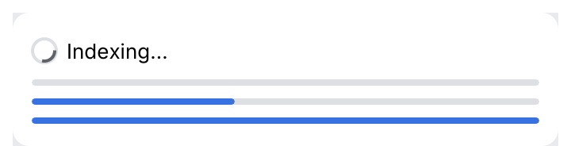
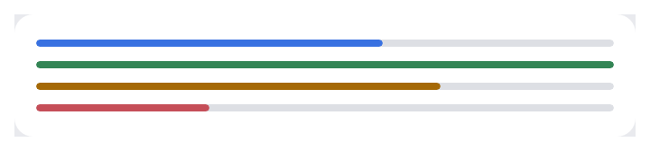

# AsyncProcessIcon, ProgressBar

Progress indicators: a **spinner** for work of unknown length that blocks a small area
(connecting, loading a panel), a **progress bar** for downloads and builds, determinate when
the fraction is known.

<picture>
  <source media="(prefers-color-scheme: dark)" srcset="img/progress.dark.png">
  
</picture>

## Usage

```rust
use archipel_kit::ui::{ProgressBar, AsyncProcessIcon};
use archipel_kit::egui;

fn status(ui: &mut egui::Ui, download: Option<f32>) {
    ui.horizontal(|ui| {
        ui.add(AsyncProcessIcon::new().label("Indexing"));
        ui.label("Indexing…");
    });
    ui.add(ProgressBar::new(download).label("Downloading JDK"));
}
```

<picture>
  <source media="(prefers-color-scheme: dark)" srcset="img/progress_states.dark.png">
  
</picture>

## API

| Builder | Effect |
|---|---|
| `AsyncProcessIcon::new()` | `.size(f32)` (16 pt), `.label(str)` (accessible name, "Loading"). |
| `ProgressBar::new(Option<f32>)` | `Some(0.0..=1.0)` determinate, `None` indeterminate. `.label(str)`, `.width(f32)`, `.state(ProgressState)`. |
| `ProgressState` | `Normal` (accent), `Passed`, `Warning`, `Failed`: IntelliJ's `ProgressBar.progressColor` and its passed, warning and failed variants. |

## Timing and size

| Part | Value | Source |
|---|---|---|
| Spinner | Eight frames per turn, 125 ms each: it steps, it does not turn smoothly (`AsyncProcessIcon::frame_at`) | IntelliJ `AnimatedIcon.Default` |
| Spinner wake-ups | One repaint per frame, not per display refresh | |
| Indeterminate bar | A segment of 30% of the width slides in from the left and out on the right once every 1.67 s (`ProgressBar::indeterminate_segment`) | The kit's measured value: IntelliJ spec section 13.8 gives no period |
| Track height | 4 pt in an 8 pt row, fully round ends | Kept from the measurement: the spec says the height is unknown |
| Colors | Fill `accent`; passed `success`, warning `warning`, failed `error`; track `progress_track` | Spec section 13.8 |

Animated indicators request repaints only while they are visible.

## Accessibility

Role `ProgressIndicator`; determinate bars report their value in percent.

Source: [`ui/progress.rs`](../../crates/archipel-kit/src/ui/progress.rs) ·
Tests: [`tests/feedback.rs`](../../crates/archipel-kit/tests/feedback.rs),
[`tests/tooltips.rs`](../../crates/archipel-kit/tests/tooltips.rs)
