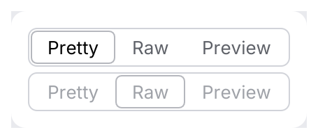
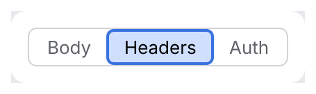
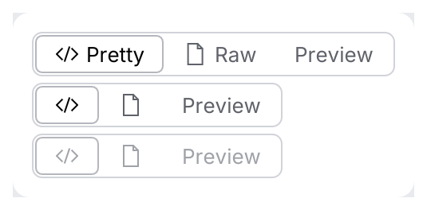

# SegmentedButton

Connected buttons of which exactly one is selected, for switching between views or modes of
the same content (*Pretty | Raw | Preview*, *Body | Headers | Auth*).

<picture>
  <source media="(prefers-color-scheme: dark)" srcset="img/segmented_button.dark.png">
  
</picture>

## Usage

```rust
use archipel_kit::ui::SegmentedButton;
use archipel_kit::egui;

#[derive(PartialEq, Clone, Copy)]
enum View { Pretty, Raw, Preview }

fn view_switch(ui: &mut egui::Ui, view: &mut View) {
    ui.add(SegmentedButton::new(
        view,
        [(View::Pretty, "Pretty"), (View::Raw, "Raw"), (View::Preview, "Preview")],
    ));
}
```

## API

| Builder | Effect |
|---|---|
| `SegmentedButton::new(&mut T, [(T, label)])` | Options as value/label pairs. |
| `.enabled(bool)` | Disabled controls are dimmed and ignore clicks. |
| `.icon(value, Icon)` | Leading icon for the matching segment. |
| `.icon_only(bool)` | Hide labels on segments with icons; retain accessible names and tooltips. |

The returned `Response` is `changed()` when the selection changed.

IntelliJ spec section 13.5 (`SegmentedButtonComponent`):

| Input | Result |
|---|---|
| <kbd>Left</kbd> / <kbd>Right</kbd> | Select the previous / next segment and move the focus to it; stops at the ends. |
| <kbd>Enter</kbd> / <kbd>Space</kbd> | Select the focused segment. |
| <kbd>Tab</kbd> | Visits the segments. |
| Click | Selects the segment. Exactly one is selected. |
| More than 6 segments (`.max_segments(n)`) | The control becomes a [`ComboBox`](combo-box.md) of the same options (`DEFAULT_MAX_BUTTONS_COUNT`; 6 is IntelliJ's value, not in the spec notes). |

The selected segment has the `segment_selected` fill and a 1 pt `segment_selected_border`; while
it has focus it takes the selection color (`SegmentedButton.focusedSelectedButtonColor`, nearest
theme color) and the focus ring.

<picture>
  <source media="(prefers-color-scheme: dark)" srcset="img/segmented_button_focus.dark.png">
  
</picture>

<picture>
  <source media="(prefers-color-scheme: dark)" srcset="img/segmented_button_icons.dark.png">
  
</picture>

## Accessibility

Each segment is a `RadioButton` named by its label and reports whether it is selected.

Source: [`ui/segmented.rs`](../../crates/archipel-kit/src/ui/segmented.rs) ·
Tests: [`tests/inputs_behavior.rs`](../../crates/archipel-kit/tests/inputs_behavior.rs), [`tests/navigation.rs`](../../crates/archipel-kit/tests/navigation.rs)
