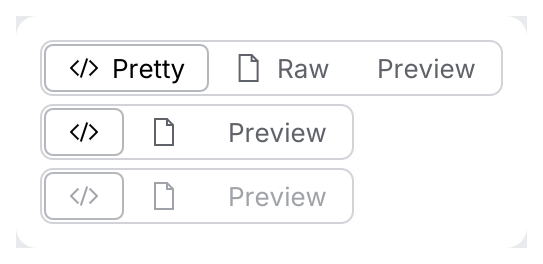

# SegmentedControl

Connected buttons of which exactly one is selected, for switching between views or modes of
the same content (*Pretty | Raw | Preview*, *Body | Headers | Auth*).

<picture>
  <source media="(prefers-color-scheme: dark)" srcset="img/segmented_control.dark.png">
  
</picture>

## Usage

```rust
use archipel_kit::components::SegmentedControl;
use archipel_kit::egui;

#[derive(PartialEq, Clone, Copy)]
enum View { Pretty, Raw, Preview }

fn view_switch(ui: &mut egui::Ui, view: &mut View) {
    ui.add(SegmentedControl::new(
        view,
        [(View::Pretty, "Pretty"), (View::Raw, "Raw"), (View::Preview, "Preview")],
    ));
}
```

## API

| Builder | Effect |
|---|---|
| `SegmentedControl::new(&mut T, [(T, label)])` | Options as value/label pairs. |
| `.enabled(bool)` | Disabled controls are dimmed and ignore clicks. |
| `.icon(value, Icon)` | Leading icon for the matching segment. |
| `.icon_only(bool)` | Hide labels on segments with icons; retain accessible names and tooltips. |

The returned `Response` is `changed()` when the selection changed.
Left/Right moves selection and focus between segments. Enter/Space activates the focused
segment; Tab visits the segments.

<picture>
  <source media="(prefers-color-scheme: dark)" srcset="img/segmented_icons.dark.png">
  
</picture>

## Accessibility

Each segment is a `RadioButton` named by its label and reports whether it is selected.

Source: [`components/segmented.rs`](../../crates/archipel-kit/src/components/segmented.rs) ·
Tests: [`tests/navigation.rs`](../../crates/archipel-kit/tests/navigation.rs)
