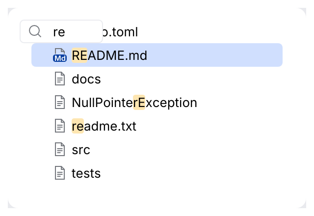
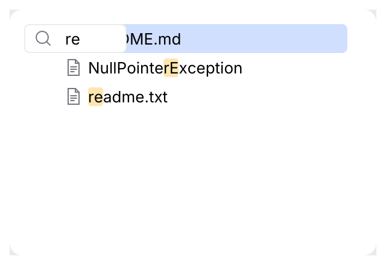
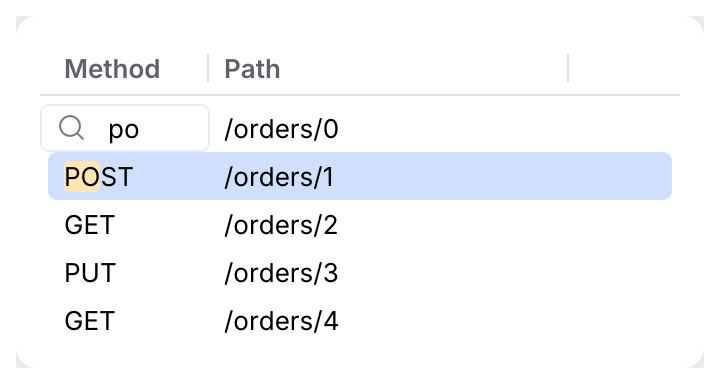

# SpeedSearch

Type in a focused list, tree or table to jump to what matches (IntelliJ's speed search). The
caller owns a `SpeedSearchState`; the collection opens the popup, edits the text, moves the
selection and highlights the matching letters in the rows.

<picture>
  <source media="(prefers-color-scheme: dark)" srcset="img/speed_search.dark.png">
  
</picture>

## Usage

```rust
use archipel_kit::ui::{ColoredListCellRenderer, JBList, SpeedSearch, SpeedSearchState};
use archipel_kit::egui;

struct Files {
    names: Vec<String>,
    selected: Option<usize>,
    search: SpeedSearchState,
}

fn files(ui: &mut egui::Ui, files: &mut Files) {
    JBList::new("files", files.names.len(), &mut files.selected)
        .speed_search(SpeedSearch::new(&mut files.search))
        .show(ui, |i| ColoredListCellRenderer::new(&files.names[i]));
}
```

`JBList`, `Tree`, `JBTable` and `TreeTable` all take `.speed_search(..)`. A tree searches its
visible rows (the ones you pass), a table matches a row when any of its cells does.

## Behavior

| Rule | Behavior |
|---|---|
| Opens | A letter, digit or one of `PUNCTUATION_MARKS` (`*_-+"'/.#$>: ,;?!@%^&`) typed in the focused collection opens the popup with that character. A space alone does not; Alt- and Ctrl-modified keys never do. |
| Popup | A small bordered field at the top-left of the viewport: search icon, the text, or the "Search" hint while empty. The text turns to the error color when nothing matches. |
| Typing | Refines the text; the selection moves to the first match from the current row on, wrapping to the first match. |
| <kbd>Backspace</kbd> | Deletes a character; the popup stays open when the text is empty. |
| <kbd>Ctrl</kbd>/<kbd>Cmd</kbd> + <kbd>Backspace</kbd> | Clears the whole text, popup stays open. |
| <kbd>↑</kbd> <kbd>↓</kbd> <kbd>Home</kbd> <kbd>End</kbd> | Move to the previous, next, first or last **match** (the popup stays). |
| <kbd>PgUp</kbd> <kbd>PgDn</kbd> <kbd>←</kbd> <kbd>→</kbd> <kbd>Enter</kbd> | Close the popup and act on the key (Enter activates the match). |
| <kbd>Esc</kbd> | Closes the popup and is consumed. |
| Focus lost | Closes the popup. |

## Matching

`SpeedSearchComparator` matches like the IDE's name matcher: case-insensitive unless the
pattern has an uppercase letter (which only matches an uppercase letter); the first letter
may match anywhere, later letters continue the previous one or start a word or camel hump
(`rm` finds `README.md`, `npe` finds `NullPointerException`); `*` matches anything and a space
starts a new word. `matching_fragments(text)` returns the matched character ranges.
The matched fragments are drawn on the theme's search match background
(`Colors::search_match`, `SimpleTextAttributes::SEARCH_MATCH_ATTRIBUTES`).

## Filtering

`SpeedSearch::new(&mut state).filter(true)` hides the rows that do not match (as in list
popups) and shows "No matches" when none does. The selection and the indices you get back are
still indices into your data. Matches are recomputed when the text or the row count changes.

<picture>
  <source media="(prefers-color-scheme: dark)" srcset="img/speed_search_filter.dark.png">
  
</picture>

A table highlights the match inside the cell:

<picture>
  <source media="(prefers-color-scheme: dark)" srcset="img/table_speed_search.dark.png">
  
</picture>

## API

| Item | Use |
|---|---|
| `SpeedSearchState` | Caller-owned: `text()`, `is_active()`, `activate(text)`, `clear()`, `reset()`. |
| `SpeedSearch::new(&mut state)` | `.filter(bool)`; pass it to `.speed_search(..)` of a collection. |
| `SpeedSearchComparator::new(pattern)` | `matches(text)`, `matching_fragments(text)`, `is_empty()`. |

Source: [`ui/speed_search.rs`](../../crates/archipel-kit/src/ui/speed_search.rs) ·
Tests: [`tests/speed_search.rs`](../../crates/archipel-kit/tests/speed_search.rs)
