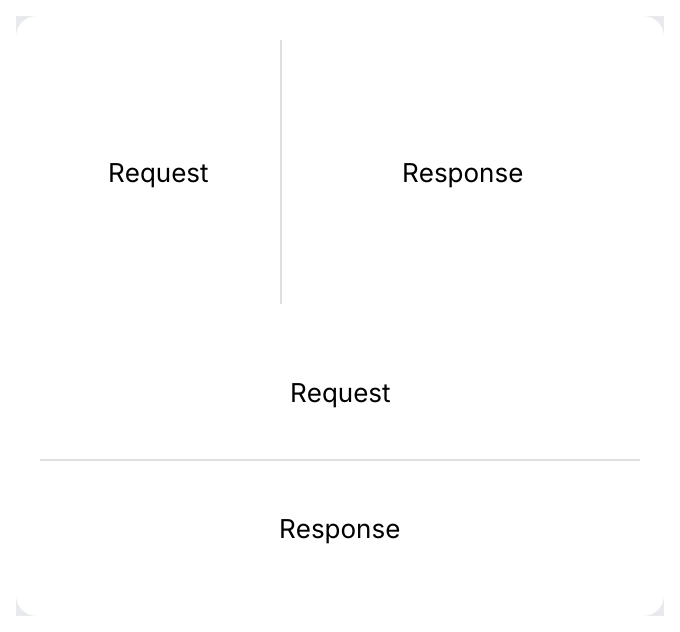
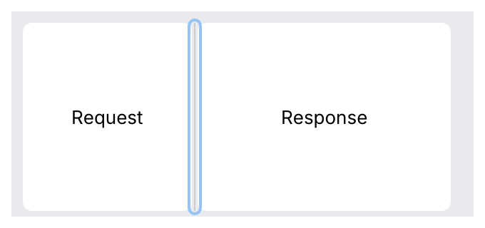

# SplitPane

Two panes with a draggable divider, side by side or stacked, for workbench layouts such as
*sidebar | request | response*. Nest one split in a pane of another for three or more.

<picture>
  <source media="(prefers-color-scheme: dark)" srcset="img/split_pane.dark.png">
  
</picture>

## Usage

The caller owns the split. `ratio` is the share (0 to 1) of the space the first pane gets;
persist it with the rest of your settings.

```rust
use archipel_kit::components::SplitPane;
use archipel_kit::egui;

struct Layout {
    sidebar: f32,
    request: f32,
}

fn workbench(ui: &mut egui::Ui, layout: &mut Layout) {
    let Layout { sidebar, request } = layout;
    // sidebar | (request | response): two splits make three columns.
    SplitPane::horizontal("workbench", sidebar)
        .default_ratio(0.2)
        .min_size(160.0)
        .label("Resize sidebar")
        .show(
            ui,
            |ui| {
                ui.label("Collections");
            },
            |ui| {
                SplitPane::horizontal("editor", request)
                    .label("Resize response")
                    .show(ui, |ui| ui.label("Request"), |ui| ui.label("Response"));
            },
        );
}
```

A split fills the space it is given. Give it a size with `ui.allocate_ui(size, …)` where
the layout is not already bounded.

Stacked panes:

```rust
use archipel_kit::components::SplitPane;
use archipel_kit::egui;

fn stacked(ui: &mut egui::Ui, ratio: &mut f32) {
    SplitPane::vertical("request-response", ratio)
        .min_sizes(80.0, 120.0)
        .show(ui, |top| { top.label("Request"); }, |bottom| { bottom.label("Response"); });
}
```

## API

| Builder | Effect |
|---|---|
| `SplitPane::horizontal(id, &mut f32)` | Side by side: left and right panes. |
| `SplitPane::vertical(id, &mut f32)` | Stacked: top and bottom panes. |
| `SplitPane::new(id, Orientation, &mut f32)` | Either, chosen by state. |
| `.default_ratio(f32)` | What a double click resets to (default 0.5). |
| `.min_size(points)`, `.min_sizes(first, second)` | Smallest size of each pane (default 120 points). |
| `.label(text)` | The divider's accessible name (default "Resize panes"). |
| `.enabled(bool)` | A locked split ignores pointer and keyboard. |
| `.with(behaviour)` | A [behaviour](../behaviours.md) on the divider, such as a tooltip. |
| `.show(ui, first, second)` | Draws both panes; each closure gets a `Ui` that is exactly its pane. |

`show` returns a `SplitResponse` with what each pane returned (`first`, `second`) and the
`divider` response: `changed()` when the user moved it, `dragged()` while the pointer
drags it.

## Behavior

- **Drag**: the divider follows the pointer, wherever on it was grabbed. The cursor is
  `ResizeHorizontal` or `ResizeVertical` (see [cursors](../cursors.md)) and stays while
  dragging, even if the pointer leaves the thin divider.
- **Double click** resets to the default ratio.
- **Keyboard**: <kbd>Tab</kbd> focuses the divider (focus ring). The arrow keys along the
  split (<kbd>←</kbd> <kbd>→</kbd> side by side, <kbd>↑</kbd> <kbd>↓</kbd> stacked) move it by
  16 points; <kbd>Home</kbd> and <kbd>End</kbd> jump to the minimum and maximum. The arrow
  keys don't move the focus away.
- **Clamping**: each pane keeps its minimum size. When the window is too small for both,
  they share the space in proportion to their minimums. A resize only clamps the layout:
  `ratio` is written when the user moves the divider, so the split springs back when the
  window grows again. A `NaN` or out-of-range ratio is treated as the default.
- **Look**: a 1-point divider line in the separator color that grows to 2 points on hover
  and takes the accent color while pressed or dragged. The divider occupies the 4-point
  gap between the panes and reaches 2 points further on each side for the pointer.

<table>
<tr>
<td><picture><source media="(prefers-color-scheme: dark)" srcset="img/split_pane_hover.dark.png"></picture><br>Hover</td>
<td><picture><source media="(prefers-color-scheme: dark)" srcset="img/split_pane_dragging.dark.png"></picture><br>Dragging</td>
<td><picture><source media="(prefers-color-scheme: dark)" srcset="img/split_pane_focus.dark.png"></picture><br>Focused</td>
</tr>
</table>

## Accessibility

The divider is a `Splitter` named by `.label(...)`. Its value is the first pane's share in
percent, with the allowed range as minimum and maximum, so a screen reader announces
"Resize sidebar, 25". Disabled, it reports disabled and is skipped by <kbd>Tab</kbd>.

Source: [`components/split_pane.rs`](../../crates/archipel-kit/src/components/split_pane.rs) ·
Tests: [`tests/split_pane.rs`](../../crates/archipel-kit/tests/split_pane.rs),
[`tests/conformance.rs`](../../crates/archipel-kit/tests/conformance.rs)
