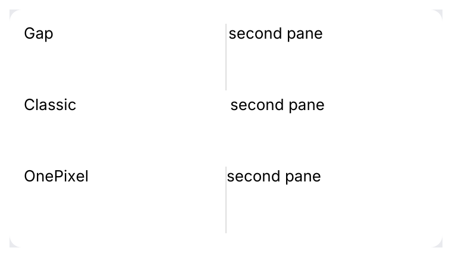
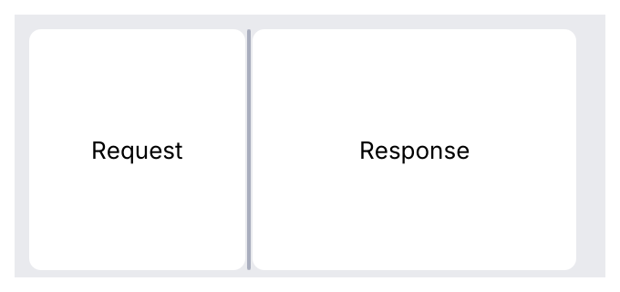
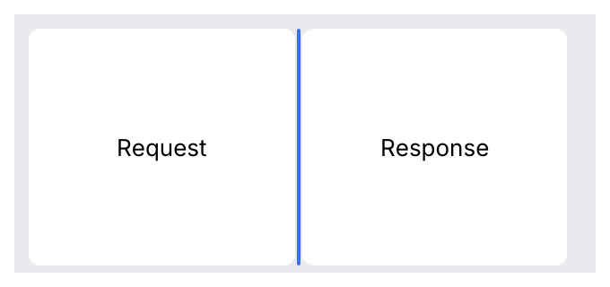
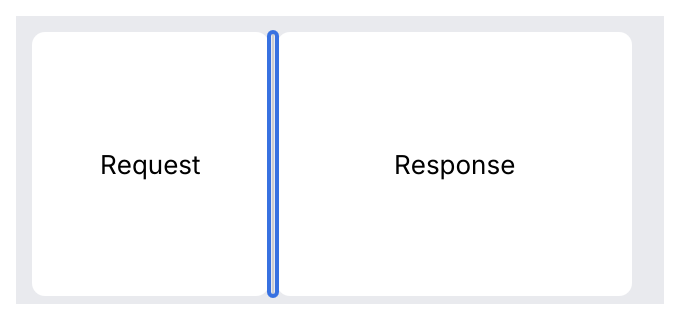

# Splitter

Two panes with a draggable divider, side by side or stacked, for workbench layouts such as
*sidebar | request | response*. Nest one split in a pane of another for three or more.

<picture>
  <source media="(prefers-color-scheme: dark)" srcset="img/splitter.dark.png">
  
</picture>

Divider variants, from the IntelliJ Platform's splitter family: the Islands gap (default),
the classic 7 pt `Splitter` divider and the `OnePixelSplitter` line:

<picture>
  <source media="(prefers-color-scheme: dark)" srcset="img/splitter_variants.dark.png">
  
</picture>

## Usage

The caller owns the split. `ratio` is the share (0 to 1) of the space the first pane gets;
persist it with the rest of your settings.

```rust
use archipel_kit::openapi::ui::Splitter;
use archipel_kit::egui;

struct Layout {
    sidebar: f32,
    request: f32,
}

fn workbench(ui: &mut egui::Ui, layout: &mut Layout) {
    let Layout { sidebar, request } = layout;
    // sidebar | (request | response): two splits make three columns.
    Splitter::horizontal("workbench", sidebar)
        .default_ratio(0.2)
        .min_size(160.0)
        .label("Resize sidebar")
        .show(
            ui,
            |ui| {
                ui.label("Collections");
            },
            |ui| {
                Splitter::horizontal("editor", request)
                    .label("Resize response")
                    .show(ui, |ui| ui.label("Request"), |ui| ui.label("Response"));
            },
        );
}
```

A split fills the space it is given. Give it a size with `ui.allocate_ui(size, …)` where
the layout is not already bounded.

Stacked panes:

```rust
use archipel_kit::openapi::ui::Splitter;
use archipel_kit::egui;

fn stacked(ui: &mut egui::Ui, ratio: &mut f32) {
    Splitter::vertical("request-response", ratio)
        .min_sizes(80.0, 120.0)
        .show(ui, |top| { top.label("Request"); }, |bottom| { bottom.label("Response"); });
}
```

### Collapsing a side

Either side can collapse to nothing, for a sidebar that hides. The caller owns the flag, like
the ratio, so a toolbar button or a command can flip it:

```rust
use archipel_kit::{action_system::ActionButton, openapi::ui::{Side, Splitter}};
use archipel_kit::{Glyph, egui};

fn with_sidebar(ui: &mut egui::Ui, ratio: &mut f32, collapsed: &mut bool) {
    let label = if *collapsed { "Show sidebar" } else { "Hide sidebar" };
    if ui.add(ActionButton::new(Glyph::SidebarLeft, label).selected(!*collapsed)).clicked() {
        *collapsed = !*collapsed;
    }
    Splitter::horizontal("workbench", ratio)
        .min_size(160.0)
        .label("Resize sidebar")
        .collapsible(Side::First, collapsed)
        .show(ui, |ui| ui.label("Collections"), |ui| ui.label("Request"));
}
```

## API

| Builder | Effect |
|---|---|
| `Splitter::horizontal(id, &mut f32)` | Side by side: left and right panes. |
| `Splitter::vertical(id, &mut f32)` | Stacked: top and bottom panes. |
| `Splitter::new(id, Orientation, &mut f32)` | Either, chosen by state. |
| `.default_ratio(f32)` | What a double click resets to (default 0.5). |
| `.min_size(points)`, `.min_sizes(first, second)` | Smallest size of each pane (default 120 points). |
| `.collapsible(Side, &mut bool)` | The side that can collapse (`Side::First` or `Side::Second`) and the caller's collapsed flag. One side per split. |
| `.label(text)` | The divider's accessible name (default "Resize panes"). |
| `.enabled(bool)` | A locked split ignores pointer and keyboard. |
| `.divider_style(style)` with a `DividerStyle` | `Gap` (default, the 4 pt Islands gap), `Classic` (a 7 pt divider that draws nothing, IntelliJ `Splitter`) or `OnePixel` (a 1 pt line with a 6 pt hit zone, IntelliJ `OnePixelSplitter`). |
| `.lack_of_space_strategy(s)` with a `LackOfSpaceStrategy` | When both minimums do not fit: `SimpleRatio` (default), `HonorTheFirstMinSize`, `HonorTheSecondMinSize`. |
| `.proportion_limits(min, max)` | The first pane's share stays in `min..=max` (IntelliJ `setMinProportion`/`setMaxProportion`). |
| `.allow_switch_orientation_by_mouse_click(bool)` | <kbd>Ctrl</kbd>+click (<kbd>Cmd</kbd> on macOS) on the divider is reported as `SplitterResponse::flip_orientation`; the caller flips the orientation it passes. |
| `.persist(key, &mut dyn PropertiesComponent)` | Loads the share from the properties the first time the split is shown and stores it on every user change (IntelliJ `JBSplitter`). Saving the properties is the host's job. |
| `OnePixelSplitter::horizontal(id, &mut f32)` / `vertical` | A `Splitter` with the `OnePixel` divider. |
| `JBSplitter::horizontal(id, &mut f32, key, &mut props)` / `vertical` | A one pixel splitter that persists its share by `key`. |
| `.line(bool)` | Whether the divider draws a line (default `true`). Islands pass `false`: the frame-colored gap is the divider, and only the resize cursor, a collapsed edge and the focus ring show. |
| `.with(behaviour)` | A [behaviour](../behaviours.md) on the divider, such as a tooltip. |
| `.show(ui, first, second)` | Draws both panes; each closure gets a `Ui` that is exactly its pane. |

`show` returns a `SplitterResponse` with what each pane returned (`first`, `second`) and the
`divider` response: `changed()` when the user moved it or collapsed or expanded a pane,
`dragged()` while the pointer drags it. Changing the collapsed flag from code is not a
user change.

## Behavior

- **Drag**: the divider follows the pointer, wherever on it was grabbed. The cursor is
  `ResizeHorizontal` or `ResizeVertical` (see [cursors](../cursors.md)) and stays while
  dragging, even if the pointer leaves the thin divider.
- **Divider widths** (`tokens::size`): `Gap` is `SPLIT_DIVIDER` (4 pt) plus 2 pt of reach on each side;
  `Classic` is `SPLIT_CLASSIC_DIVIDER` (7 pt); `OnePixel` is a `SPLIT_ONE_PIXEL` (1 pt) line in the
  separator color with a `SPLIT_MOUSE_ZONE` (6 pt) hit zone that reaches into the panes. Classic and one
  pixel dividers draw no hover or drag highlight (only the cursor and the focus ring), as in IntelliJ.
- **Double click** resets to the default ratio (0.5 unless `default_ratio` says otherwise). On a collapsed pane it only expands it, to
  the size it had; it never resets that.
- **Keyboard**: <kbd>Tab</kbd> focuses the divider (focus ring). The arrow keys along the
  split (<kbd>←</kbd> <kbd>→</kbd> side by side, <kbd>↑</kbd> <kbd>↓</kbd> stacked) move it by
  16 points; <kbd>Home</kbd> and <kbd>End</kbd> jump to the minimum and maximum. The arrow
  keys don't move the focus away.
- **Clamping**: each pane keeps its minimum size. When the window is too small for both,
  they share the space in proportion to their minimums. A resize only clamps the layout:
  `ratio` is written when the user moves the divider, so the split springs back when the
  window grows again. A `NaN` or out-of-range ratio is treated as the default.
- **Collapse**: with `.collapsible(side, &mut collapsed)` the user collapses the pane by
  dragging the divider more than 40 points past its minimum size (`SPLIT_COLLAPSE`), or
  with <kbd>Enter</kbd> or <kbd>Space</kbd> on the focused divider. The other pane takes
  all the room and the divider stays as a thin edge of the split, with the same resize cursor,
  to grab. A collapsed pane's closure still runs, hidden and disabled, laid out at its
  minimum size so what it holds doesn't reflow; keep it cheap.
- **Expand**: drag the edge out (the pane appears at its minimum size once the pointer is
  close to it and follows the pointer from there, with no flicker in between), double-click
  it, press <kbd>Enter</kbd>/<kbd>Space</kbd> on the focused divider, or the arrow toward the
  content. Other keys do nothing while collapsed.
- **The ratio** is never written while collapsed, and collapsing by dragging puts back the
  ratio from before the drag (not the minimum the pane was dragged down to), so expanding by
  code, key or double click restores the size you started from. Dragging out sets the ratio
  to where the pointer lets go.
  There is no animation: the kit has no animation token.
- **Look**: a 1-point divider line in the separator color that grows to 2 points on hover
  and takes the accent color while pressed or dragged. The divider occupies the 4-point
  gap between the panes and reaches 2 points further on each side for the pointer.

<picture>
  <source media="(prefers-color-scheme: dark)" srcset="img/splitter_collapsed.dark.png">
  
</picture>

Collapsed: the divider stays as a thin edge in the control border color. It takes the accent
color on hover (an open divider only gets a stronger line), so it shows it can be grabbed,
and has the same pressed and focus states as an open one.

<table>
<tr>
<td><picture><source media="(prefers-color-scheme: dark)" srcset="img/splitter_collapsed_hover.dark.png"></picture><br>Collapsed, hover</td>
<td><picture><source media="(prefers-color-scheme: dark)" srcset="img/splitter_collapsed_focus.dark.png"></picture><br>Collapsed, focused</td>
</tr>
</table>

<table>
<tr>
<td><picture><source media="(prefers-color-scheme: dark)" srcset="img/splitter_hover.dark.png"></picture><br>Hover</td>
<td><picture><source media="(prefers-color-scheme: dark)" srcset="img/splitter_dragging.dark.png"></picture><br>Dragging</td>
<td><picture><source media="(prefers-color-scheme: dark)" srcset="img/splitter_focus.dark.png"></picture><br>Focused</td>
</tr>
</table>

## Accessibility

The divider is a `Splitter` named by `.label(...)`. Its value is the first pane's share in
percent, with the allowed range as minimum and maximum, so a screen reader announces
"Resize sidebar, 25". A collapsible divider also reports whether it is expanded or collapsed
(`expanded` in AccessKit), and while collapsed its value is 0 (or 100 for a collapsed second
pane). Disabled, it reports disabled and is skipped by <kbd>Tab</kbd>.

Source: [`openapi/ui/splitter.rs`](../../crates/archipel-kit/src/openapi/ui/splitter.rs),
[`openapi/ui/one_pixel_splitter.rs`](../../crates/archipel-kit/src/openapi/ui/one_pixel_splitter.rs) ·
Tests: [`tests/splitter.rs`](../../crates/archipel-kit/tests/splitter.rs),
[`tests/splitter_variants.rs`](../../crates/archipel-kit/tests/splitter_variants.rs),
[`tests/conformance.rs`](../../crates/archipel-kit/tests/conformance.rs)
