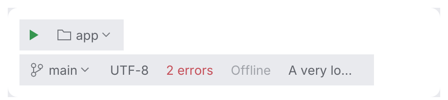

# StatusBarWidget

A flat widget for the status bar or a toolbar: an optional icon, text and an optional chevron
for items that open a popup (the branch, the run configuration). It fills on hover and press
like a toolbar button, has the action cursor, and is a button named by its text. It takes at
most the available width (or `.max_width`): longer text ends with `…` and the full text is
the tooltip.

<picture>
  <source media="(prefers-color-scheme: dark)" srcset="img/status_bar_widget.dark.png">
  
</picture>

## Why not `Button::ghost`

`Button::ghost` is a button: a minimum width of 72 points, 10 to 14 points of padding, the
button text style, no chevron and no eliding. A status bar item is denser (6 points of
padding, the body text size), shows a chevron for items that open a popup, and shrinks to the
available width, so it is a separate component.

## Usage

Draw the bar on `Surface::Chrome`, the frame color of the workbench.

```rust
use archipel_kit::{wm::StatusBarWidget, ide::HelpTooltip};
use archipel_kit::parts::Surface;
use archipel_kit::{Glyph, Tone, egui};

fn status_bar(ui: &mut egui::Ui, branch: &str, errors: usize) {
    Surface::Chrome.frame(ui.ctx()).show(ui, |ui| {
        ui.horizontal(|ui| {
            let item = StatusBarWidget::new(branch).icon(Glyph::Branch).chevron(true);
            if ui.add(item.with(HelpTooltip::new("Git branch"))).clicked() {
                // open the branches popup
            }
            ui.add(StatusBarWidget::new("UTF-8"));
            if errors > 0 {
                ui.add(StatusBarWidget::new(format!("{errors} errors")).tone(Tone::Error));
            }
        });
    });
}
```

## API

| Builder | Effect |
|---|---|
| `StatusBarWidget::new(text)` | A flat item; `ui.add(...)` returns the `Response`. |
| `.icon(Icon)` | Icon before the text. |
| `.chevron(bool)` | Chevron after the text: opens a popup. |
| `.tone(Tone)` | Meaning of the text and icon color. |
| `.enabled(bool)` | Disabled items are dimmed and ignore clicks. |
| `.max_width(f32)` | Widest the item may be; text is elided beyond it. |
| `.with(behaviour)` | A tooltip, context menu … (see [behaviours](../behaviours.md)). A tooltip you attach replaces the automatic one for elided text, so only one shows. |

## Behavior

- Click, <kbd>Enter</kbd> and <kbd>Space</kbd> activate it; <kbd>Tab</kbd> reaches it.
- Hover fills it; the cursor is the theme's action cursor (the arrow when disabled).

## Accessibility

A `Button` named by its text, reporting disabled.

Source: [`wm/status_bar_widget.rs`](../../crates/archipel-kit/src/wm/status_bar_widget.rs) ·
Tests: [`tests/status_bar.rs`](../../crates/archipel-kit/tests/status_bar.rs)

## Status bar and breadcrumbs (measured on Android Studio)

The status bar is 30 pt on the window frame below the islands (`ToolWindowPane::status`), 8 pt from
the window's left edge. Items are 21 pt hover pills; their text is dimmed (`text_secondary`)
at rest and full strength under the pointer.

`BreadcrumbsComponent` is the navigation path at its left (`project › src › main.rs`): each crumb is a
flat button (4 pt padding, optional icon, text), dimmed chevrons separate them, and `show`
reports the crumb clicked and each crumb's response (`BreadcrumbsComponentResponse`). It also serves as a settings page's location.

```rust
# egui::__run_test_ui(|ui| {
use archipel_kit::{Glyph, Icon, ui::BreadcrumbsComponent, wm::StatusBarWidget};

let clicked = BreadcrumbsComponent::new()
    .crumb("archipel", Some(Glyph::Folder.into()))
    .crumb("main.rs", Some(Icon::for_file("main.rs")))
    .show(ui)
    .clicked;
ui.add(StatusBarWidget::new("UTF-8"));
# let _ = clicked;
# });
```
