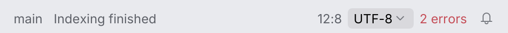
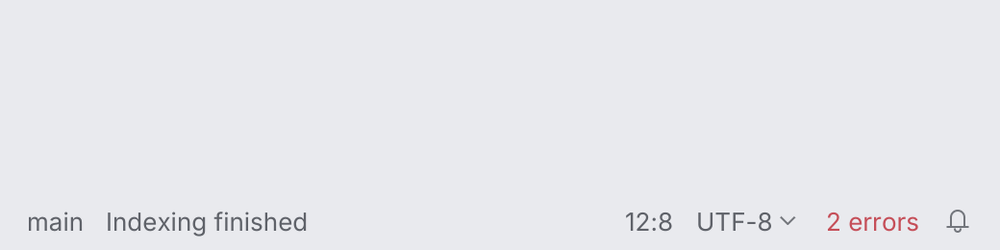

# StatusBarWidget

A flat widget for the status bar or a toolbar: an optional icon, text and an optional chevron
for items that open a popup (the branch, the run configuration). It fills on hover and press
like a toolbar button, has the action cursor, and is a button named by its text. It takes at
most the available width (or `.max_width`): longer text ends with `…` and the full text is
the tooltip.

<picture>
  <source media="(prefers-color-scheme: dark)" srcset="img/status_bar_widget.dark.png">
  
</picture>

## Why not `Button::ghost`

`Button::ghost` is a button: a minimum width of 72 points, 10 to 14 points of padding, the
button text style, no chevron and no eliding. A status bar item is denser (6 points of
padding, the body text size), shows a chevron for items that open a popup, and shrinks to the
available width, so it is a separate component.

## Usage

Draw the bar on `Surface::Chrome`, the frame color of the workbench.

```rust
use archipel_kit::{wm::StatusBarWidget, ide::HelpTooltip};
use archipel_kit::parts::Surface;
use archipel_kit::{Glyph, Tone, egui};

fn status_bar(ui: &mut egui::Ui, branch: &str, errors: usize) {
    Surface::Chrome.frame(ui.ctx()).show(ui, |ui| {
        ui.horizontal(|ui| {
            let item = StatusBarWidget::new(branch).icon(Glyph::Branch).chevron(true);
            if ui.add(item.with(HelpTooltip::new("Git branch"))).clicked() {
                // open the branches popup
            }
            ui.add(StatusBarWidget::new("UTF-8"));
            if errors > 0 {
                ui.add(StatusBarWidget::new(format!("{errors} errors")).tone(Tone::Error));
            }
        });
    });
}
```

## API

| Builder | Effect |
|---|---|
| `StatusBarWidget::new(text)` | A flat item; `ui.add(...)` returns the `Response`. |
| `.icon(Icon)` | Icon before the text. |
| `.chevron(bool)` | Chevron after the text: opens a popup. |
| `.tone(Tone)` | Meaning of the text and icon color. |
| `.enabled(bool)` | Disabled items are dimmed and ignore clicks. |
| `.max_width(f32)` | Widest the item may be; text is elided beyond it. |
| `.hover_effect(bool)` | Hover and press fill it (default `true`; `StatusBar` turns it off for its left panel). |
| `.text_alignment(f32)`, `.reserve_width_of(prototype)` | Where the text sits in spare width (0 to 1), and a prototype that reserves the width of a changing value. |
| `.name(text)` | The accessible name and tooltip of an icon-only widget. |
| `.with(behaviour)` | A tooltip, context menu … (see [behaviours](../behaviours.md)). A tooltip you attach replaces the automatic one for elided text, so only one shows. |

## Behavior

- Click, <kbd>Enter</kbd> and <kbd>Space</kbd> activate it; <kbd>Tab</kbd> reaches it.
- Hover and press fill it with the same color (IntelliJ Islands: one token for both), a
  rounded rectangle of arc 4; the cursor is the theme's action cursor (the arrow when
  disabled). The focus ring has arc 10 (`radius::STATUS_FOCUS`).

# StatusBar

`StatusBar` is the container: info text and left widgets on the left, the right panel's
widgets at the right end in anchor order, with what IntelliJ's status bar adds to them.

<picture>
  <source media="(prefers-color-scheme: dark)" srcset="img/status_bar.dark.png">
  
</picture>

<picture>
  <source media="(prefers-color-scheme: dark)" srcset="img/status_bar_values.dark.png">
  
</picture>

```rust
# egui::__run_test_ui(|ui| {
use archipel_kit::wm::{
    IconPresentation, MultipleTextValuesPresentation, StatusBar, StatusBarAnchor,
    StatusBarWidgetItem, TextPresentation,
};
use archipel_kit::Glyph;

let mut encoding = 0;
let out = StatusBar::new("status")
    .info("Indexing finished")
    .left_widget(StatusBarWidgetItem::new("vcs", TextPresentation::new("main")))
    .widget(StatusBarWidgetItem::new(
        "position",
        TextPresentation::new("12:8").max_value("9999:99").alignment(1.0),
    ))
    .widget(StatusBarWidgetItem::new(
        "encoding",
        MultipleTextValuesPresentation::new(vec!["UTF-8".into(), "UTF-16".into()], encoding),
    ))
    .widget(
        StatusBarWidgetItem::new("bell", IconPresentation::new(Glyph::Bell, "Notifications"))
            .anchor(StatusBarAnchor::Before("encoding".into())),
    )
    .show(ui);
if let Some((_id, index)) = out.selected_value {
    encoding = index;
}
# let _ = encoding;
# });
```

| Item | Effect (IntelliJ spec section 9) |
|---|---|
| `StatusBar::new(id).info(text)` | The info text, between the panels, in the secondary text color. |
| `.left_widget(item)` / `.widget(item)` | The left panel (no hover effect) / the right panel (hover and press effect). |
| `StatusBarWidgetItem::new(id, presentation)` | `.anchor(StatusBarAnchor)`: `First`, `Last` (default), `Before(id)`, `After(id)`; an anchor that names a missing id waits for it and ends up last. `.enabled(bool)`, `.tone(Tone)`. |
| `WidgetPresentation` | The enum a widget item takes: `Text(TextPresentation)`, `Icon(IconPresentation)`, `MultipleTextValues(MultipleTextValuesPresentation)`. |
| `TextPresentation` | `text`, `.tooltip`, `.alignment(0..1)`, `.max_value(prototype)` reserves the width of a changing value. |
| `IconPresentation::new(icon, tooltip)` | An icon-only widget, named by its tooltip. |
| `MultipleTextValuesPresentation::new(values, selected)` | The selected value as text with a chevron; a press opens the list **above** it; the pick is `StatusBarResponse::selected_value`. <kbd>Esc</kbd> or a click outside closes it. |
| `StatusBarResponse` | `activated` (a left **press**, or <kbd>Enter</kbd>/<kbd>Space</kbd> on a focused widget), `selected_value`, `widgets_menu` (a right click on the right panel: show the menu that enables and disables widgets), `escaped`. |

- A left click acts on **press**, as in IntelliJ; a right click is never a click.
- <kbd>←</kbd> <kbd>→</kbd> move the focus between the widgets (left panel first); <kbd>Esc</kbd> lets
  go of it and is reported as `escaped`, for the caller to give the focus back.
- The bar takes the width it is given and no outer padding (the window frame supplies it:
  `ToolWindowPane::status` insets 8 pt, where IntelliJ has 10).
- Deferred: the progress indicator in the center, the status bar widgets menu itself (reported,
  not drawn), widget enable/disable persistence, the macOS tool window stripe toggle.

Tests: [`tests/status_bar_widgets.rs`](../../crates/archipel-kit/tests/status_bar_widgets.rs)

## Accessibility

A `Button` named by its text, reporting disabled.

Source: [`wm/status_bar_widget.rs`](../../crates/archipel-kit/src/wm/status_bar_widget.rs) ·
Tests: [`tests/status_bar.rs`](../../crates/archipel-kit/tests/status_bar.rs)

## Status bar and breadcrumbs (measured on Android Studio)

The status bar is 30 pt on the window frame below the islands (`ToolWindowPane::status`), 8 pt from
the window's left edge. Items are 21 pt hover pills; their text is dimmed (`text_secondary`)
at rest and full strength under the pointer.

`BreadcrumbsComponent` is the navigation path at its left (`project › src › main.rs`): each crumb is a
flat button (4 pt padding, optional icon, text), dimmed chevrons separate them, and `show`
reports the crumb clicked and each crumb's response (`BreadcrumbsComponentResponse`). It also serves as a settings page's location.

```rust
# egui::__run_test_ui(|ui| {
use archipel_kit::{Glyph, Icon, ui::BreadcrumbsComponent, wm::StatusBarWidget};

let clicked = BreadcrumbsComponent::new()
    .crumb("archipel", Some(Glyph::Folder.into()))
    .crumb("main.rs", Some(Icon::for_file("main.rs")))
    .show(ui)
    .clicked;
ui.add(StatusBarWidget::new("UTF-8"));
# let _ = clicked;
# });
```
