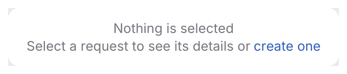
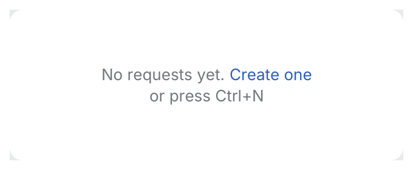

# StatusText

What a list, table or panel shows when it has nothing to display: an icon, a title, a hint
that says how to fill it and optionally one action.

<picture>
  <source media="(prefers-color-scheme: dark)" srcset="img/status_text.dark.png">
  
</picture>

## Usage

```rust
use archipel_kit::ui::StatusText;
use archipel_kit::{Glyph, Icon, egui};

fn requests(ui: &mut egui::Ui, requests: &mut Vec<String>) {
    if requests.is_empty() {
        let new = StatusText::new("No requests yet")
            .icon(Glyph::Send)
            .hint("Create a request to start testing your API.")
            .action("New request")
            .show(ui);
        if new.clicked() {
            requests.push("Untitled".into());
        }
    }
}
```

## Lines of text with links

The IDE's empty text: grayed lines centered in the space, with clickable link fragments.
A `JBList`, `Tree`, `JBTable` or `TreeTable` with no rows shows one in its viewport
(`.empty_text(StatusText)`, default "Nothing to show").

<picture>
  <source media="(prefers-color-scheme: dark)" srcset="img/status_text_lines.dark.png">
  
</picture>

<picture>
  <source media="(prefers-color-scheme: dark)" srcset="img/jb_list_empty.dark.png">
  
</picture>

```rust
use archipel_kit::ui::StatusText;
use archipel_kit::egui;

fn empty(ui: &mut egui::Ui) {
    let out = StatusText::text("No requests yet. ")
        .link("Create one")
        .append(" or ")
        .link("import a collection")
        .line("Press Ctrl+N at any time")
        .show_with_links(ui);
    match out.link {
        Some(0) => { /* create */ }
        Some(1) => { /* import */ }
        _ => {}
    }
}
```

`StatusTextResponse` carries the `response` and the index of the clicked `link` (counting
links from 0). Links are focusable with <kbd>Tab</kbd>, show the action cursor and underline
under the pointer; <kbd>Enter</kbd>/<kbd>Space</kbd> or a click runs them. Lines are
`SimpleTextAttributes::GRAYED_ATTRIBUTES` by default; `append_with` and `line_with` take any
attributes. `.above_center(true)` places the block above the center of its space.

## API

| Builder | Effect |
|---|---|
| `StatusText::new(title)` | `.hint(str)`, `.icon(Icon)`, `.action(label)`. |
| `.show(ui)` | Centered; returns the action button's `Response`. |
| `StatusText::text(str)` | IntelliJ-style lines: `.append(str)`, `.append_with(str, SimpleTextAttributes)`, `.link(str)`, `.line(str)`, `.line_with(..)`, `.above_center(bool)`. |
| `.show_with_links(ui)` | Returns a `StatusTextResponse`: `response` and the clicked `link`. |

Source: [`ui/status_text.rs`](../../crates/archipel-kit/src/ui/status_text.rs) ·
Tests: [`tests/feedback.rs`](../../crates/archipel-kit/tests/feedback.rs)
